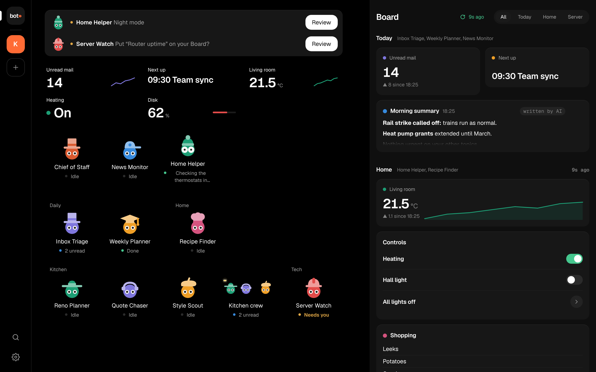
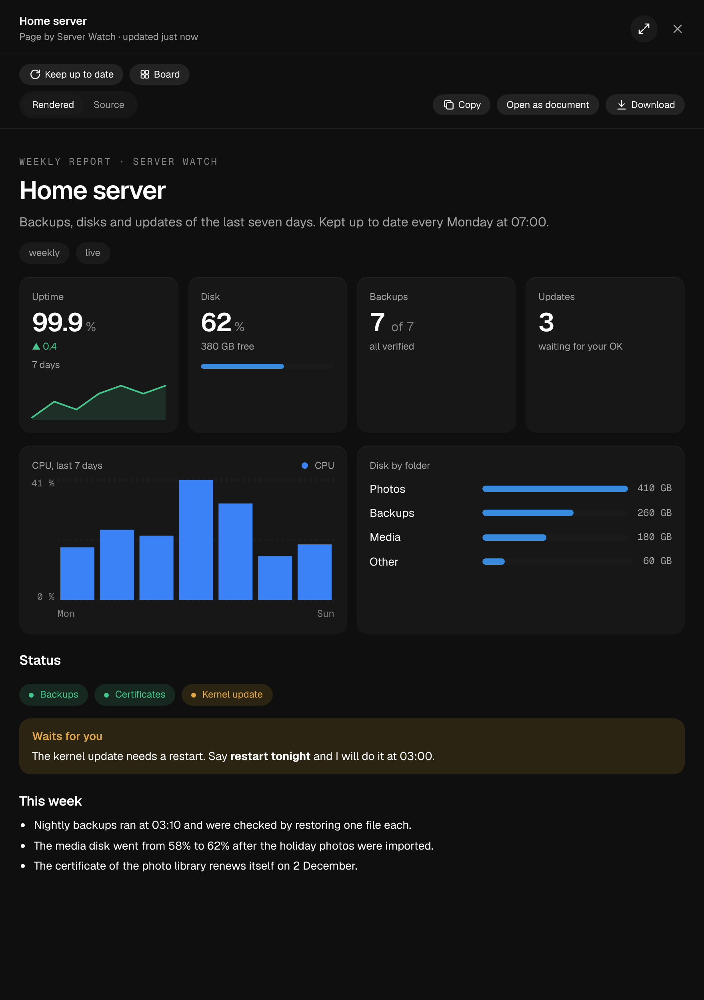
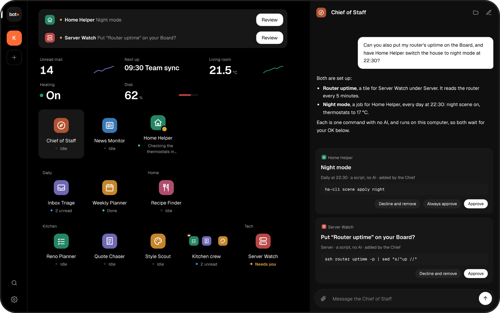
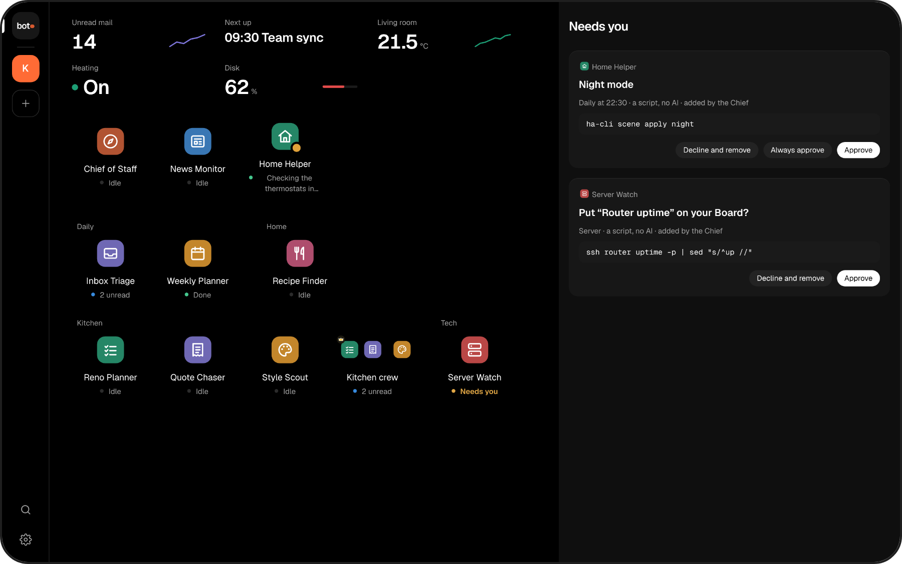
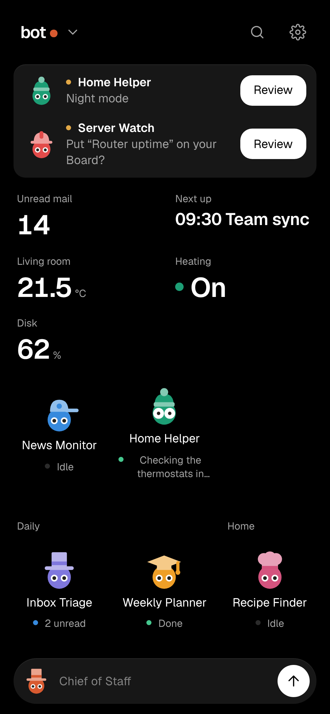
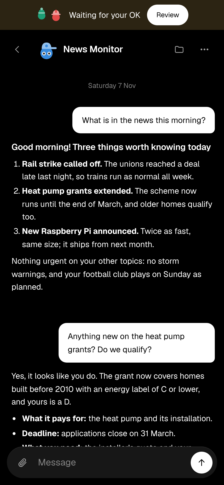
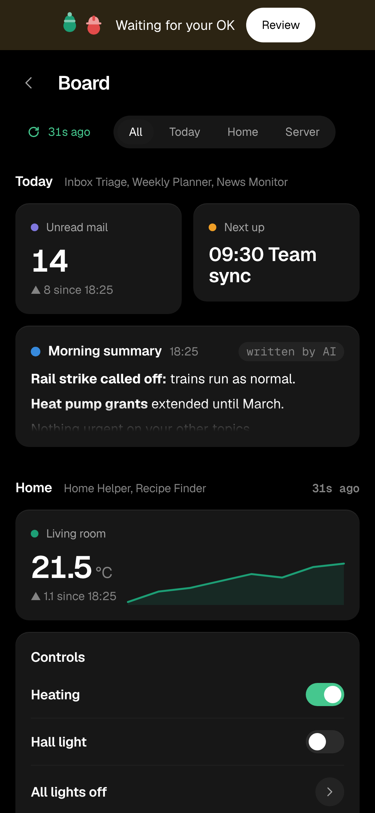
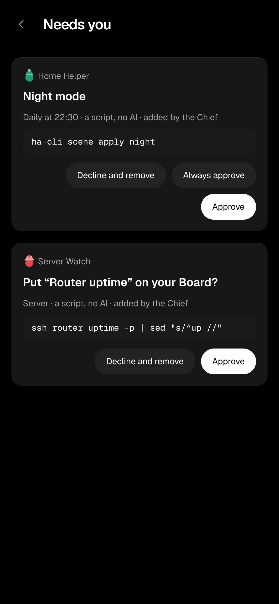

<h1 align="center">botdot</h1>

<p align="center"><b>A self-hosted team of Claude Code bots you run by chat.</b></p>

<p align="center">
  <a href="LICENSE"></a>
  
  
  
</p>

<p align="center">
  <a href="#quickstart">Quickstart</a> ·
  <a href="#what-you-need">Requirements</a> ·
  <a href="#features">Features</a> ·
  <a href="docs/install-linux.md">Install guide</a> ·
  <a href="docs/user-guide.md">User guide</a> ·
  <a href="docs/FAQ.md">FAQ</a>
</p>

A messenger-style app for a team of **bots**. Each bot is a Claude Code agent with one job, its own tools, permissions, workspace and schedule. You don't configure them by hand: you tell the **Chief of Staff** what you need in a chat, and it makes the bots, runs them and reports back. Anything risky waits for your OK.

It runs on your own Linux server, with each account walled off under rootless Docker and gVisor, and you use it from the web page, the Android app or the desktop app. It uses the official Claude Code CLI, signed in with your own Claude subscription or API key. MIT licensed, no telemetry.


## Quickstart

On a fresh Linux server or VM (not a container), as a user with `sudo`. On Ubuntu or Debian:

```bash
sudo apt-get update && sudo apt-get install -y git curl
git clone https://github.com/Kordal/bot-dot.git bot-dot-source
sudo sh bot-dot-source/install.sh
```

On Fedora, RHEL, Rocky Linux or AlmaLinux, the first line is `sudo dnf install -y git curl`.

1. The installer checks the machine and asks before it installs Docker, rootless Docker and gVisor. It downloads botdot's signed images (about 11 GB) and checks their signature first.
2. It asks how you reach botdot: a **public domain** (Caddy gets the HTTPS certificate) or a **Tailscale tailnet** (nothing on the internet). Then your account's name.
3. It asks about three optional services. Answer `n` to each if you don't use them; you can add them later.
4. It ends with your address and a **sign-up link**. Open it, make your passkey, and sign in to Claude on the setup page.
5. Ask the Chief of Staff for your first bot: "Make a bot that sends me the three biggest tech stories every morning at 8."

Lost the link, or the install stopped? See [Troubleshooting](#troubleshooting).

## What you need

| | |
| --- | --- |
| **A server** | A Linux VM or VPS of its own, on Intel/AMD or ARM, where you can use `sudo`: Ubuntu 22.04 or newer, Debian 12 or 13, Fedora, or RHEL 9 or 10 and its rebuilds (Rocky Linux, AlmaLinux). Other distributions work when you install Docker, rootless Docker and gVisor yourself ([Platforms](docs/install-linux.md#platforms)). It needs a full VM (KVM, Proxmox VM, cloud VPS): an LXC or OpenVZ container won't run rootless Docker and gVisor |
| **Size, one account** | At least 4 CPUs, 8 GB of RAM and 40 GB of free disk. Each account takes a share of the machine (by default 2 CPUs and half the RAM, at least 5 GB) and about 15 GB of disk, plus room for one more copy of the images while it updates |
| **Claude** | A Claude Pro or Max subscription, or an Anthropic API key, for each account. Bots' runs count against that subscription's usage limits, or are paid as you go on the key |
| **A way in** | A domain whose DNS points at the server, with ports 80, 443 and 8443 open (8443 serves bots' interactive pages), or a free [Tailscale](https://tailscale.com) account |
| **Docker** | The installer installs Docker from docker.com when it's missing. If Docker is already there, it must be docker.com's `docker-ce`: the distributions' own `docker.io` and `moby-engine`, and Podman, have no rootless Docker |

botdot runs bots unattended. Read what Anthropic's terms say about that first: [Claude Code's legal and compliance page](https://code.claude.com/docs/en/legal-and-compliance) and the [Consumer Terms](https://www.anthropic.com/legal/consumer-terms). [Install on Linux](docs/install-linux.md#what-botdot-needs-and-whom-it-trusts) has the full list, and [what the installer changes on the machine](docs/install-linux.md#what-the-installer-changes-on-the-machine).

**Optional services.** botdot works without any of them.

| | What it adds | Who pays |
| --- | --- | --- |
| [Composio](https://composio.dev) | Bots use your apps (Gmail, Calendar, Slack, GitHub and more) | Your own Composio key |
| [Bitwarden](https://bitwarden.com) | Bots log in to websites with logins from your vault, without seeing the passwords | Your own Bitwarden account |
| [OpenRouter](https://openrouter.ai) ("Jev") | A small, cheap model that picks which bot answers in a group chat, in place of Claude Haiku | Your own OpenRouter key |
| [boat.dev](https://boat.dev) | A cloud computer for the bots, in place of the one on your server | Your own boat.dev key |

## Features

| | |
| --- | --- |
| 🎩 **Chief of Staff** | Tell it what you need. It makes the bots, changes them, runs them and reports back. It writes to you first when it finds something worth saying, briefs you at the times you name, and drafts the replies you owe from your mail. |
| 🤖 **Bots with one job each** | Each bot has its own instructions, tools, permissions, workspace and scheduled jobs. Its face shows what it is doing. A busy bot answers a new message at once, and `/btw` asks it a quick side question without stopping its work. |
| 🏗 **Projects** | A space for one goal, such as a renovation or a launch: a team of bots with a lead, a team chat, goals you can count, a calendar of to-dos and check-ins, and the project's own files. |
| 📋 **The Board** | One page of live tiles for what you use most: switches, values, lists, notes and charts. [More below](#the-board). |
| 📄 **Pages** | Reports a bot keeps up to date on a schedule, with the Board's live numbers and charts. Any long reply exports to Word, PDF, Markdown or Google Docs. |
| ⏰ **Scheduled jobs** | A job runs on a schedule. When no AI is needed, a small script runs instead. |
| 👥 **Groups** | Two to six bots in one chat, handing the work on to each other. On a machine of several accounts, shared rooms bring other people and their bots into one chat. |
| 🧠 **Memory** | Bots remember what you tell them, and you correct or erase it by chat. |
| 🖥 **The bots' computer** | One always-on Ubuntu desktop for the account, where each bot has a screen and a browser of its own. You can watch it live and take over. |
| 🔐 **Vault and connectors** | Bots use your logins without seeing them, and your apps through Composio. |
| ✋ **Your OK first** | A script, a login, a write in a connected app or anything risky waits for you in **Needs you**. |
| 📱 **Web, Android and desktop** | The web page works everywhere. Android has its own app with notifications and no push service. The desktop app for Windows and Mac shows botdot in a window of its own. |

## Projects


A project is a space of its own on the left rail. Its team works together in one chat: the lead hands work on to the others by name, and you write once. Goals show how far along it is, and the calendar holds what is due and when. Start one with **+** on the rail, then ask the Chief to put a team on it.

## The Board



The Board is your page of tiles: the temperature, a light switch, a shopping list, your next meeting, a server's disk, a morning summary. Its values also sit on top of the home screen, so the numbers you check every day are the first thing you see.

**You build it by chat.** There are no edit buttons: ask the Chief to "add a switch for the living room light" or "move Server to the top", and it does. You drag tiles to rearrange them.

A tile's value comes from an API call with a saved login (made by botdot itself, with no AI, so a tap is instant; Home Assistant works this way), from a small script that waits for your OK first, or from the bot itself. Bots also suggest tiles when they notice you keep asking for the same thing. The [user guide](docs/user-guide.md#board) has the details.

## Pages



Ask a bot for a report and it saves it as a page. Tap **Keep up to date** and it rewrites the page every hour, morning or Monday, while numbers tied to the Board stay live. A bot that uses the computer can also publish a small interactive site, sandboxed on an address of its own.

## Your team, run by chat

<table>
<tr>
<td width="50%"></td>
<td width="50%"></td>
</tr>
<tr>
<td><b>Ask the Chief.</b> It hands the task to the right bot, or builds a new one with the tools, permissions and jobs it needs.</td>
<td><b>Your OK first.</b> A script, a login or anything risky waits in <b>Needs you</b>, with exactly what it would run.</td>
</tr>
</table>

## On your phone

<table>
<tr>
<td width="25%"></td>
<td width="25%"></td>
<td width="25%"></td>
<td width="25%"></td>
</tr>
<tr>
<td align="center">Home</td>
<td align="center">A chat</td>
<td align="center">The Board</td>
<td align="center">Needs you</td>
</tr>
</table>

The web page works on any phone and installs as an app. The [Android app](android/README.md) adds notifications with **Reply** and **Approve**, without Google's push service, and sharing files to a bot from any app. Download the `.apk` from the newest `android-v…` release on the [Releases page](https://github.com/Kordal/bot-dot/releases) once; after that, phones update themselves from your server. There is no iOS app yet: on an iPhone, add the web page to the Home Screen.

## Desktop app

The desktop app for [Windows](https://github.com/Kordal/bot-dot/releases/download/desktop-latest/botdot-windows-x64-setup.exe) · [Windows on ARM](https://github.com/Kordal/bot-dot/releases/download/desktop-latest/botdot-windows-arm64-setup.exe) · [Mac with Apple silicon](https://github.com/Kordal/bot-dot/releases/download/desktop-latest/botdot-mac-apple-silicon.dmg) · [Mac with Intel](https://github.com/Kordal/bot-dot/releases/download/desktop-latest/botdot-mac-intel.dmg) shows your botdot in a window of its own and keeps itself up to date. It is built from `main` and is not signed yet: on Windows, choose **More info → Run anyway**; on a Mac, open it once, then **System Settings → Privacy & Security → Open Anyway**.

**Preview: botdot on your own computer.** On a Mac or PC with no server, the app can also run botdot itself, in a Linux VM of its own (Lima on macOS, WSL2 on Windows): one account at `http://localhost:4700`, with bots that run only while the computer is on. [The desktop app](docs/desktop.md) has the requirements and what differs from a server.

## Updating, backups and removal

- **Update:** the admin presses **Update every account** on the admin page (`https://<your address>/admin`), or runs the installer again from a newer source (`git -C bot-dot-source pull && sudo sh bot-dot-source/install.sh`). Each account checks the signature first, and one whose new version doesn't start goes back to its old one. Bots, chats and memory stay. [Updates](docs/install-linux.md#updates).
- **Back up:** **Settings → Backups → Download** gives one encrypted file of your account. The admin can also back the whole machine up every night, off-site, with restic. [Back up and restore](docs/install-linux.md#back-up-and-restore).
- **Remove:** `sudo sh bot-dot-source/install.sh --uninstall` lists what it removes and asks you to type `yes`. [Uninstall](docs/install-linux.md#uninstall).

## Security and privacy

- **Each account is walled off:** its own Linux user, rootless Docker whose every container runs under gVisor, and its own botdot server.
- **Root sees everything:** whoever is root on the machine can reach every account, its data and the logins its bots hold. Keep root to yourself.
- **The bots of one account share one computer, without walls between them:** every bot there works as the same user, with sudo. Give the computer only to bots you trust with what the others do there.
- **Anything risky waits in Needs you,** until you say OK.
- **Nothing a bot writes is trusted as markup:** text and drawings from Claude are checked on the server and drawn by the apps' own code. An interactive page runs sandboxed on an address of its own, with no way to the internet.
- **No telemetry.** botdot sends nothing to its author. The connections it makes on its own are Claude runs to Anthropic, the update check and image downloads from GitHub's registry, and the one-time download of its search model from Hugging Face. Claude Code's own non-essential traffic is turned off. [What leaves your server](docs/FAQ.md#does-botdot-send-anything-off-my-server).

[What bots can reach](docs/what-bots-can-reach.md) and [SECURITY.md](SECURITY.md) have the full picture. Report a vulnerability privately through **Security → Report a vulnerability** on this repository.

## Troubleshooting

| | |
| --- | --- |
| **The sign-up link is lost or used** | Make a new one on the server: `cd /var/lib/botdot/front-door && sudo docker compose exec front-door node front-door.js sign-up-link --account <your account's name>` |
| **Caddy has no certificate yet** | Check that the DNS points at the server and ports 80, 443 and 8443 are open, then `cd /var/lib/botdot/front-door && sudo docker compose logs caddy` |
| **"This machine's Docker isn't Docker's own"** | Docker came from the distribution (`docker.io`, `moby-engine`), which has no rootless Docker. Remove it and run the installer again, which installs Docker from docker.com |
| **A bot says it isn't signed in to Claude** | The setup page opens by itself: choose **Sign in to Claude** there, or use an API key |

More answers in the [FAQ](docs/FAQ.md#troubleshooting).

## Status

botdot is early: version 0.x, built by one person with Claude, so expect breaking changes. What changed lately is in [whats-new/](whats-new/). It is not a hosted service, and it runs Claude only.

## Development

botdot's server needs nothing but Node 22.13 or newer.

```bash
npm start            # → http://localhost:4747, with the link to make your passkey
npm test             # the tests, with a stand-in for Claude
make lint            # the documentation links, that the code parses, and the type checks
```

[Development](docs/development.md) has how to sign in, the tests and the code layout. [AGENTS.md](AGENTS.md) is how work is done in this repository, and [CONTRIBUTING.md](CONTRIBUTING.md) how to send a change.

## Documentation

| | |
| --- | --- |
| [Install on Linux](docs/install-linux.md) | Requirements, accounts, shares, updates, backups, uninstall, platforms |
| [The desktop app](docs/desktop.md) | The app for Windows and Mac, and botdot on your own computer |
| [User guide](docs/user-guide.md) | The app and every feature |
| [FAQ](docs/FAQ.md) | Short answers: requirements, costs, updates, privacy and troubleshooting |
| [What bots can reach](docs/what-bots-can-reach.md) | What each bot, the Chief and botdot may see |
| [botdot for Android](android/README.md) | The Android app |
| [The API](docs/api.md) | The contract the apps use |
| [Development](docs/development.md) | Running from source, tests, code layout |
| [Security](SECURITY.md) | What botdot protects, and how to report a problem |

## Licence

[MIT](LICENSE). Third-party code keeps its own licence: see [NOTICE](NOTICE).
