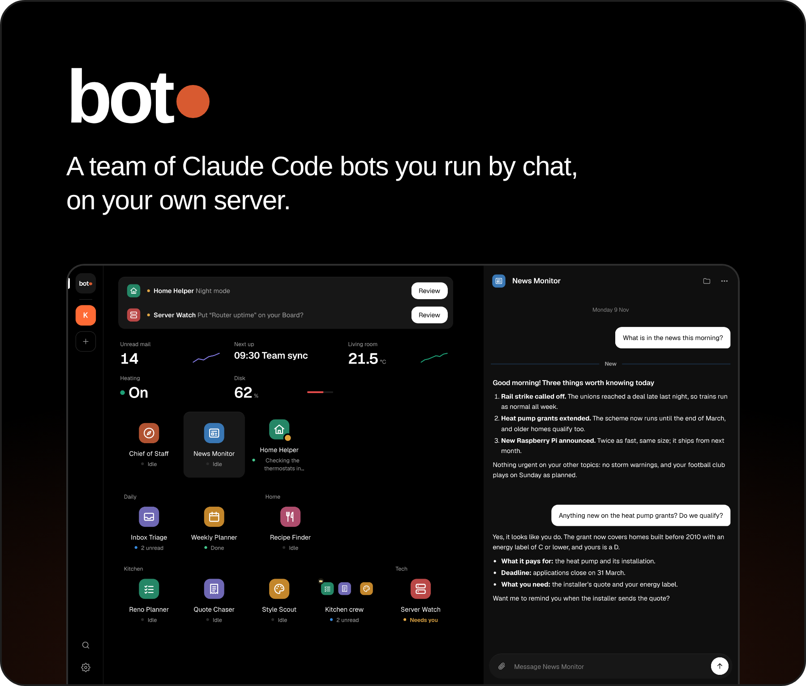
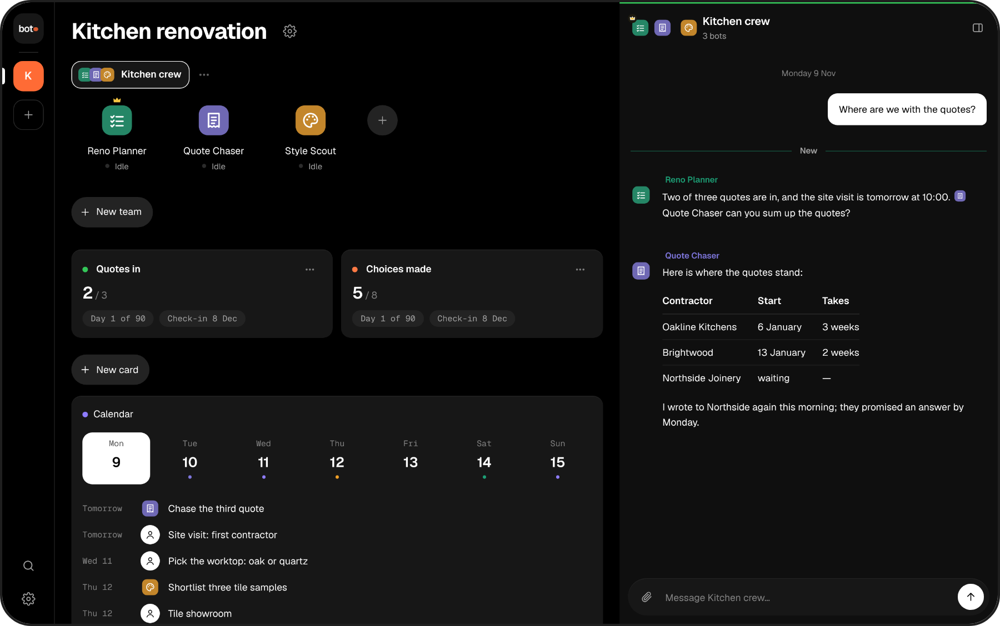
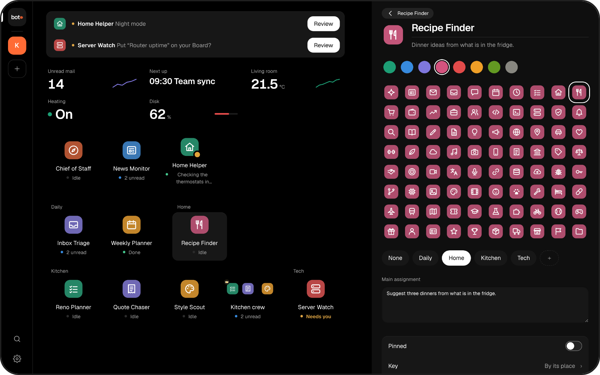
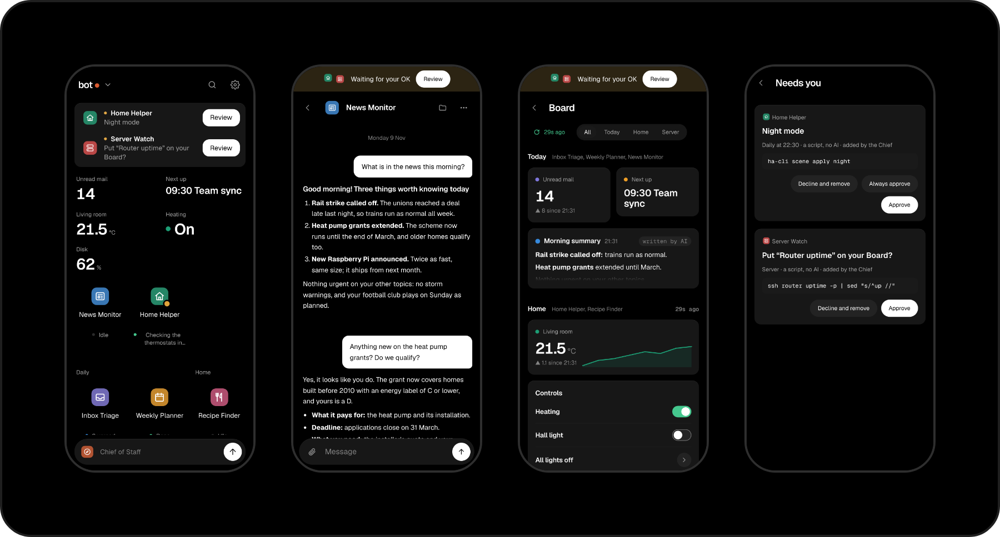
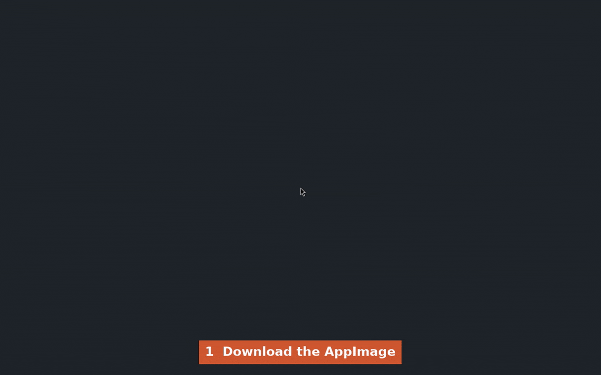

<p align="center">
  
</p>

<p align="center">
  <a href="#install"><b>Install</b></a> ·
  <a href="#desktop-app">Desktop</a> ·
  <a href="#android">Android</a> ·
  <a href="docs/user-guide.md">User guide</a> ·
  <a href="docs/FAQ.md">FAQ</a> ·
  <a href="LICENSE">MIT</a>
</p>

A messenger-style app for a team of **bots**. Each bot is a Claude Code agent with one job, its own tools, permissions, workspace and schedule. You tell the **Chief of Staff** what you need in a chat, and it makes the bots, runs them and reports back. Anything risky waits for your OK.

It runs on your own Linux server, each account walled off under rootless Docker and gVisor, with the official Claude Code CLI signed in to your own Claude subscription or API key. No telemetry.

## Install

On a fresh Linux VM or VPS (not a container), as a user with `sudo`:

```bash
curl -fsSL https://raw.githubusercontent.com/Kordal/bot-dot/main/get.sh | sudo sh
```

It puts botdot's source in `./bot-dot-source` (installing git first if it's missing) and runs the `install.sh` in it. The same by hand:

```bash
sudo apt-get update && sudo apt-get install -y git curl   # Fedora, RHEL, Rocky, Alma: sudo dnf install -y git curl
git clone https://github.com/Kordal/bot-dot.git bot-dot-source
sudo sh bot-dot-source/install.sh
```

The installer asks before it installs Docker, rootless Docker and gVisor, checks the signature of botdot's images (about 11 GB), and asks how you reach botdot: a **public domain** or a **Tailscale tailnet**. It ends with a sign-up link: make your passkey, sign in to Claude, and ask for your first bot.

| | |
| --- | --- |
| **Server** | Ubuntu 22.04+, Debian 12 or 13, Fedora, RHEL 9 or 10 and its rebuilds; Intel/AMD or ARM; a full VM, not LXC or OpenVZ |
| **Size** | 4 CPUs, 8 GB RAM, 40 GB free disk for one account |
| **Claude** | Pro, Max or an Anthropic API key, per account |
| **Access** | A domain pointed at the server (ports 80, 443, 8443), or Tailscale |

botdot runs bots unattended: read [Claude Code's legal and compliance page](https://code.claude.com/docs/en/legal-and-compliance) and the [Consumer Terms](https://www.anthropic.com/legal/consumer-terms) first. [Install on Linux](docs/install-linux.md) has the full requirements, the optional services (Composio, Bitwarden, OpenRouter, boat.dev), what the installer changes, updates, backups and uninstalling. Stuck? [Troubleshooting](docs/FAQ.md#troubleshooting).

## What it does



**Projects.** A space for one goal: a team of bots with a lead, one team chat, goals you can count and a calendar of to-dos.


**Ask, don't configure.** The Chief hands a task to the right bot, or builds a new one with the tools, permissions and jobs it needs.


**Your OK first.** A script, a login, a write in a connected app or anything risky waits in **Needs you**, with exactly what it would run.


**The Board.** Live tiles for what you check every day: switches, values, lists, notes and charts. You build it by chat: "add a switch for the living room light".


**Pages.** Reports a bot keeps up to date on a schedule, with live numbers and charts. Export to Word, PDF, Markdown or Google Docs.



**Bots with one job each.** Each is an icon on a tile in its colour; a ring shows it working, a dot that it needs you. It has its own instructions, tools, scheduled jobs and memory you correct by chat.

Also: scheduled jobs that run a small script when no AI is needed, groups of two to six bots handing work on, an always-on desktop where each bot has its own screen and browser, and logins and apps (Gmail, Slack, GitHub and more through Composio) the bots use without seeing your passwords. The [user guide](docs/user-guide.md) covers every feature.

## Android



The [Android app](android/README.md) adds notifications with **Reply** and **Approve**, without Google's push service. Download the `.apk` from the newest `android-v…` release on the [Releases page](https://github.com/Kordal/bot-dot/releases) once; after that it updates itself from your server. The web page works on any phone and installs as an app.

## Desktop app

| Windows | Mac | Linux |
| --- | --- | --- |
| [x64](https://github.com/Kordal/bot-dot/releases/download/desktop-latest/botdot-windows-x64-setup.exe) · [ARM](https://github.com/Kordal/bot-dot/releases/download/desktop-latest/botdot-windows-arm64-setup.exe) | [Apple silicon](https://github.com/Kordal/bot-dot/releases/download/desktop-latest/botdot-mac-apple-silicon.dmg) · [Intel](https://github.com/Kordal/bot-dot/releases/download/desktop-latest/botdot-mac-intel.dmg) | [AppImage](https://github.com/Kordal/bot-dot/releases/download/desktop-latest/botdot-linux-x64.AppImage) · [.deb](https://github.com/Kordal/bot-dot/releases/download/desktop-latest/botdot-linux-x64.deb) · [.rpm](https://github.com/Kordal/bot-dot/releases/download/desktop-latest/botdot-linux-x64.rpm) · [ARM](docs/desktop.md#download) |



Your botdot in a window of its own, kept up to date. Without a server it can run botdot on the computer itself (preview): in a VM on a Mac or PC, directly on Linux. The apps are not signed yet: on Windows choose **More info → Run anyway**, on a Mac **System Settings → Privacy & Security → Open Anyway**. [The desktop app](docs/desktop.md) has the details.

Screenshots and the recording show demo data.

## Security

Each account has its own Linux user, rootless Docker with every container under gVisor, and its own botdot server. Nothing a bot writes is trusted as markup. Whoever is root on the machine can reach every account, and the bots of one account share one computer. [What bots can reach](docs/what-bots-can-reach.md), [what leaves your server](docs/FAQ.md#does-botdot-send-anything-off-my-server) and [SECURITY.md](SECURITY.md) have the full picture; report a vulnerability through **Security → Report a vulnerability**.

## Development

```bash
npm start     # http://localhost:4747, with the link to make your passkey
npm test      # the tests, with a stand-in for Claude
make lint     # documentation links, parsing and type checks
```

Node 22.13 or newer, no dependencies. [Development](docs/development.md), [AGENTS.md](AGENTS.md), [CONTRIBUTING.md](CONTRIBUTING.md). botdot is early (0.x), built by one person with Claude: expect breaking changes, listed in [whats-new/](whats-new/).

| Docs | |
| --- | --- |
| [Install on Linux](docs/install-linux.md) | Requirements, accounts, updates, backups, uninstall |
| [The desktop app](docs/desktop.md) | Windows, Mac, Linux, and botdot on your own computer |
| [User guide](docs/user-guide.md) | Every feature |
| [FAQ](docs/FAQ.md) | Costs, privacy, troubleshooting |
| [The API](docs/api.md) | The contract the apps use |

[MIT](LICENSE). Third-party code keeps its own licence: see [NOTICE](NOTICE).
