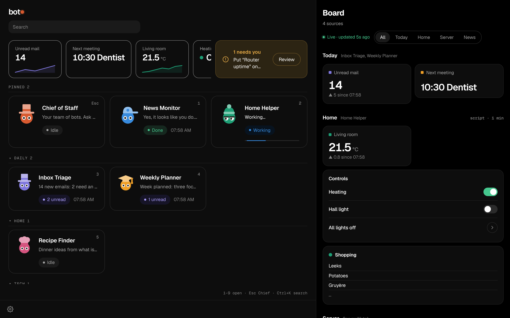
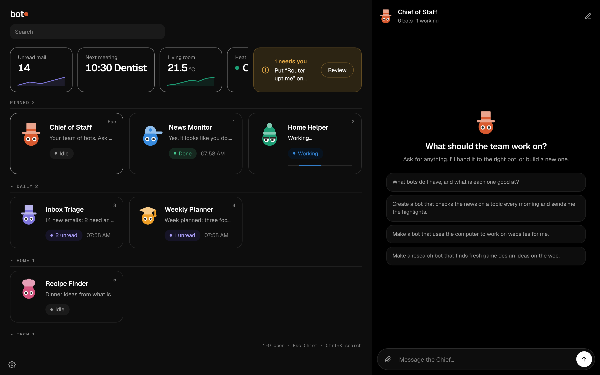
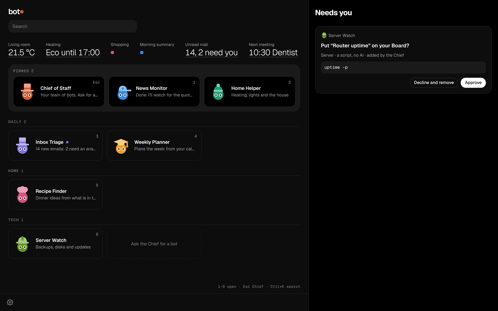
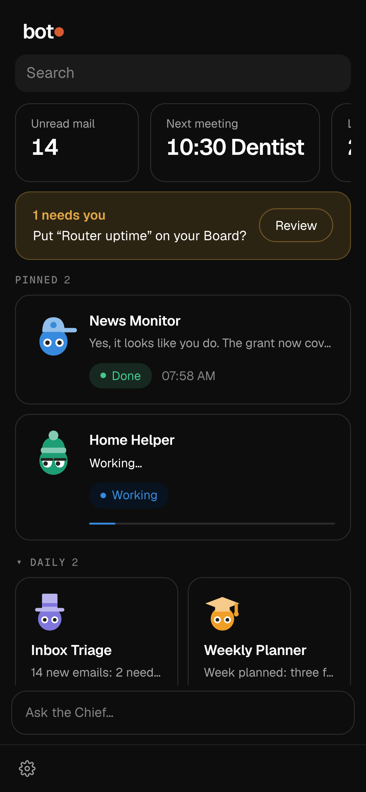
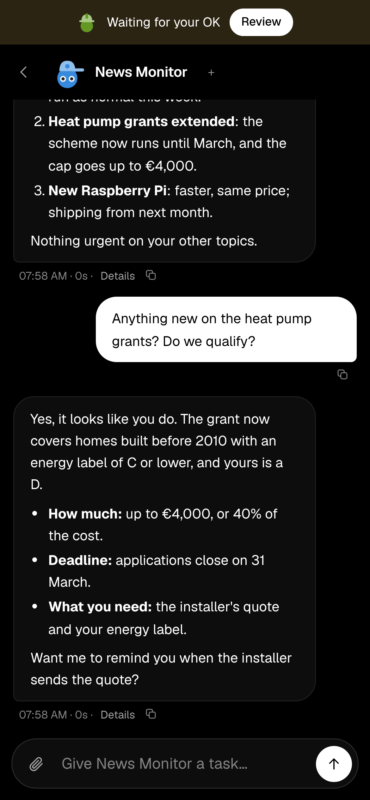
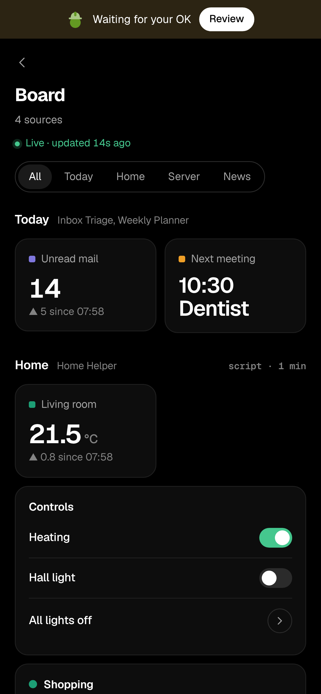
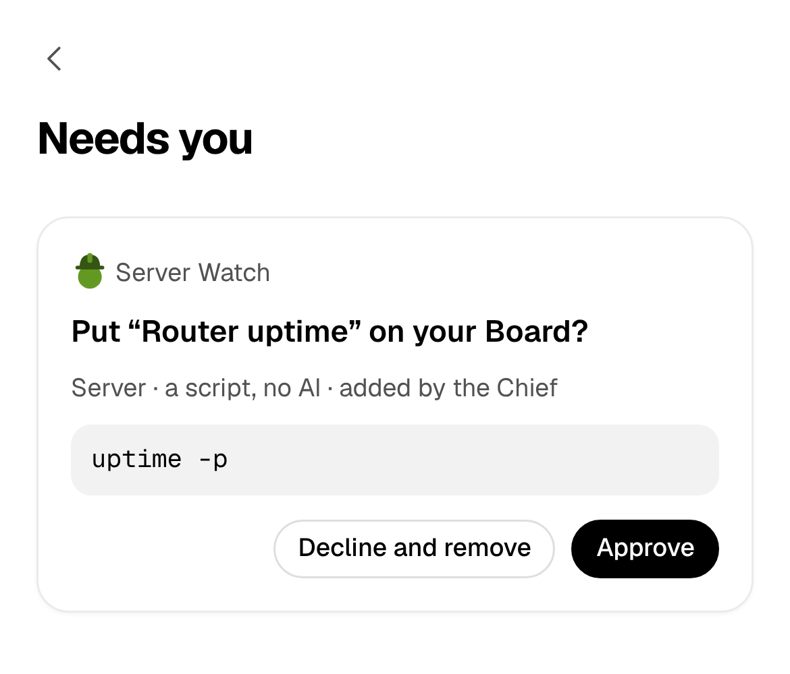

<h1 align="center">botdot</h1>

<p align="center"><b>A self-hosted team of Claude Code bots you run by chat.</b></p>

<p align="center">
  <a href="https://github.com/Kordal/bot-dot/actions/workflows/tests.yml"></a>
  <a href="LICENSE"></a>
  
  
  
  
</p>

<p align="center">
  <a href="#features">Features</a> ·
  <a href="#the-board">The Board</a> ·
  <a href="#on-your-phone">Android</a> ·
  <a href="#install">Install</a> ·
  <a href="docs/user-guide.md">User guide</a> ·
  <a href="docs/FAQ.md">FAQ</a>
</p>

A messenger-style app for a team of **bots**. Each bot is a Claude Code agent with its own job, and a **Chief of Staff** creates and runs them when you ask it in a chat. botdot runs on your own server, and you use it on the web and on Android.


## Features

| | |
| --- | --- |
| 🎩 **Chief of Staff** | Tell it what you need. It makes the bots, changes them, runs them and reports back. It writes to you first when it finds something worth saying, briefs you at the times you name, and drafts the replies you owe from your mail. |
| 🤖 **Bots with one job each** | Every bot has its own instructions, tools, permissions, workspace and scheduled jobs. Its face shows what it is doing. A busy bot answers a new message at once, and `/btw` asks it a quick side question without stopping its work. |
| 📋 **The Board** | One page of live tiles for the things you use most: switches, values, lists and notes. [More below](#the-board). |
| 📄 **Pages** | Reports and overviews a bot keeps for you, up to date on a schedule, with the Board's live numbers and charts. A bot with a computer can publish a small interactive site, sandboxed on an address of its own. Any long reply exports to Word, PDF, Markdown or Google Docs. |
| ⏰ **Scheduled jobs** | A job runs on a schedule. When no AI is needed, a small script runs instead. |
| 👥 **Groups and shared rooms** | Put two to six bots in one chat, and they hand the work on to each other. On a machine of several accounts, shared rooms bring other people and their bots into one chat. |
| 🧠 **Memory** | Bots remember what you tell them, and you correct or erase it by chat. |
| 🖥 **The bots' computer** | One always-on computer for the account, where bots work, each on a screen of its own with its own browser, which you can watch live. They share it as one user with sudo, so every bot there sees what the others do. |
| 🔐 **Vault and connectors** | Bots use your logins without seeing them, and your apps (Gmail, Slack, GitHub and more) through Composio, with an account botdot makes for you. |
| ✋ **Your OK first** | Anything risky waits for you in **Needs you**. |
| 📱 **Web and Android** | The web page works everywhere, and Android has its own app with notifications and no push service. |

## The Board

The Board is your page of tiles: the temperature, a light switch, a shopping list, your next meeting, a server's disk, a morning summary. It reads like a status page: numbers with how they changed and a line of recent values, charts, statuses and tables. Its values sit on top of the keypad and the list as small live cards, so the numbers you check every day are the first thing you see.



**You build it by chat.** There are no edit buttons: ask the Chief to "add a switch for the living room light", "move Server to the top" or "make the summary wide", and it does. You drag tiles to rearrange them.

| Tile | What it shows | A tap |
| --- | --- | --- |
| **Switch** | On or off | switches it |
| **Button** | One action | does it |
| **Value** | A number or a few words, with a green, amber or red dot when it has limits | refreshes it |
| **List** | Up to 8 lines | opens all of it |
| **Note** | A few short lines, in Markdown | opens all of it |
| **Group** | Related tiles, one dot each | folds them open |
| **Blocks** | A number with its change, a chart, a status, a callout or a table you sort and filter | says the values |

**Where the values come from:**

- **An API call with a saved login.** botdot makes it itself, with no AI, so a tap is instant. Home Assistant works this way.
- **A small script** in the bot's workspace. It waits for your OK in **Needs you** first, and again whenever it changes.
- **The bot itself**, for example from its morning job.

Every tile belongs to a bot, uses that bot's saved logins and wears its colour. Bots also **suggest** tiles when they notice you keep asking for the same thing: one tap adds it. Values refresh only while the Board is open.

The [user guide](docs/user-guide.md#board) has the details.

## Your team, run by chat

<table>
<tr>
<td width="50%"></td>
<td width="50%"></td>
</tr>
<tr>
<td><b>Ask the Chief.</b> It hands the task to the right bot, or builds a new one with the tools, permissions and jobs it needs.</td>
<td><b>Your OK first.</b> A script, a login or anything risky waits in <b>Needs you</b>, with what it would run.</td>
</tr>
</table>

botdot has one look, dark, on the web and on Android. A bot's head shows its state: it blinks when idle, looks around while it works, bobs when it needs you and closes its eyes when paused. Dots after its name count new replies. A wide window shows the keypad, with each bot's status and when it last did something: <kbd>1</kbd>–<kbd>9</kbd> open a bot (give one its own digit in its settings), <kbd>Esc</kbd> brings back the Chief, <kbd>Ctrl</kbd>+<kbd>K</kbd> searches every chat.

## On your phone

<table>
<tr>
<td width="25%"></td>
<td width="25%"></td>
<td width="25%"></td>
<td width="25%"></td>
</tr>
<tr>
<td align="center">Your team</td>
<td align="center">A chat</td>
<td align="center">The Board</td>
<td align="center">Needs you</td>
</tr>
</table>

The web page works on any phone. The [Android app](android/README.md) adds notifications with **Reply** and **Approve**, sharing files to a bot from any app, and the keypad on tablets and foldables. For the first install, download the `.apk` from the newest `android-v…` release on the [Releases page](https://github.com/Kordal/bot-dot/releases); after that, botdot carries the newest app and phones update themselves from your server. There is no iOS app: on an iPhone, use the web page.

**Install it as an app.** The web page installs in its own window, with its own icon: in Chrome or Edge (computer or Android), choose **Install app** in botdot's Settings or the install icon in the address bar; in Safari on a Mac, **File → Add to Dock**; on an iPhone or iPad, **Share → Add to Home Screen** (which is also where notifications work on iOS).

## How it works

- **One server holds the truth.** The botdot server (Node.js, no dependencies) keeps the bots, their jobs, the Board and the chats. The web page and the Android app are windows onto its [API](docs/api.md).
- **Each bot is Claude Code.** A run is `claude -p` in the bot's own workspace, with only the tools and permissions you gave it.
- **Accounts are walled off.** One machine can hold several people's botdot, and nothing in one account can be seen or reached from another.
- **Nothing a bot writes is trusted as markup.** Text and drawings from Claude are checked on the server and drawn by the apps' own code.

## Security

- **Each account is walled off under gVisor:** its own Linux user and rootless Docker, whose every container runs under gVisor.
- **The installer runs as root, and root sees everything:** whoever is root on the machine can reach every account, its data and the logins its bots hold. Keep root to yourself.
- **The bots share one computer, without walls between them:** every bot works on the account's computer as the same user, with sudo. Each can see, change and end what the others do there, and read any password, card or SSH key botdot types or hands to a command there. Other accounts, the botdot server and the machine stay out of its reach.
- **Anything risky waits in Needs you:** a script, a login, a connected app's write (unless you always allow it), or a change the Chief makes on its own after reading the web, until you say OK.
- **What a bot builds can't reach your account:** a page is drawn by the apps' own code, and an interactive page runs on an address of its own, sandboxed, with no way to the internet.
- **Shared rooms are off until the admin turns them on:** a bot mentioned in one by someone else only talks, with no tools and nothing of yours.

[What bots can reach](docs/what-bots-can-reach.md) and [Security](SECURITY.md) have the full picture.

## What you need

| | |
| --- | --- |
| **A server** | A Linux server or VM of its own (Ubuntu 24.04, Intel/AMD or ARM) where you can use `sudo` |
| **Docker** | The installer offers to install it when it's missing |
| **Claude** | A Claude subscription (Pro or Max), or an Anthropic API key, for each account. Bots' runs count against that subscription's usage limits, or are paid as you go on the key |
| **Room** | Per account, its share of the machine (by default 2 CPUs and half the machine's RAM, at least 5 GB), and 15 GB of disk: its server holds about 2 GB (mostly the memory search model), and the account's computer, an Ubuntu desktop in a container that stays on, 0.5–1 GB idle plus what each bot's screen and programs use. The share's RAM and CPUs are the computer's limits. Measured on an 8-CPU, 16 GB server, where the front door and Caddy take 65 MB |
| **A way in** | [Tailscale](https://tailscale.com) (a private tailnet) or a public domain that points at the server, with ports 80, 443 and 8443 open (8443 carries interactive pages) |

botdot runs the official Claude Code CLI, signed in by you on your account's setup page. Bots run unattended, so read what Anthropic's terms say about that first: [Claude Code's legal and compliance page](https://code.claude.com/docs/en/legal-and-compliance) and the [Consumer Terms](https://www.anthropic.com/legal/consumer-terms). The full list, and whom botdot trusts, is in [Install on Linux](docs/install-linux.md#what-botdot-needs-and-whom-it-trusts).

## Status

botdot is early: version 0.x, built by one person with Claude, so expect breaking changes ([Releases](https://github.com/Kordal/bot-dot/releases)). It is not a hosted service, it runs Claude only (no other models), and it is not a laptop app: it installs on a Linux server of its own, and you use it from the web page or the Android app.

## Install

On the Linux server:

```bash
git clone https://github.com/Kordal/bot-dot.git bot-dot-source
sudo sh bot-dot-source/install.sh
```

The installer asks a few questions and ends with your address and a sign-up link. Open the link, make your passkey, and sign in to Claude on the setup page. Then ask the Chief of Staff for your first bot. On a public domain, open the link right away: until the first account is made, the front door also prints a fresh sign-up link in its log each time it starts.

| Where | Guide |
| --- | --- |
| A Linux server or VM, one or more accounts | [Install on Linux](docs/install-linux.md): accounts, updates, backups, uninstalling |

To remove botdot, follow [Uninstall](docs/install-linux.md#uninstall).

## Development

botdot's server needs nothing but Node 22.13 or newer.

```bash
npm start            # → http://localhost:4747, with the link to make your passkey
npm test             # the tests, with a stand-in for Claude
make lint            # the documentation links, that the code parses, and the type checks
```

`npm start` runs the server behind its front door, with one account; [Development](docs/development.md) has how to sign in, the setup notes, the tests and the code layout. [AGENTS.md](AGENTS.md) is how work is done in this repository.

## Documentation

| | |
| --- | --- |
| [User guide](docs/user-guide.md) | The app and every feature |
| [FAQ](docs/FAQ.md) | Short answers: requirements, costs, updates, security and troubleshooting |
| [Install on Linux](docs/install-linux.md) | Accounts, shares, updates, backups, uninstall, platforms |
| [What bots can reach](docs/what-bots-can-reach.md) | What each bot, the Chief and botdot may see on a Docker install |
| [Development](docs/development.md) | Running from source, tests, code layout |
| [The API](docs/api.md) | The contract the apps use |
| [botdot for Android](android/README.md) | The Android app |
| [Security](SECURITY.md) | What botdot protects, and how to report a problem |

## Licence

[MIT](LICENSE). Third-party code keeps its own licence: see [NOTICE](NOTICE).
