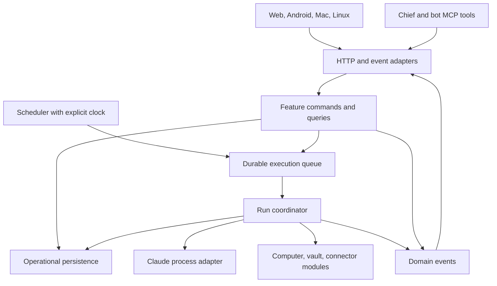

# Architecture review — 27 September 2026

Historical record: the native Linux GUI app was removed on 29 September 2026. References to its Rust/GTK/Flatpak code, builds and outstanding checks below describe the earlier scope, not current support or release requirements. Linux servers, containers and bots' computers remain supported.

Keep the app as a modular monolith: one server, explicit feature modules, and small transport adapters. The current deployment shape fits a private, single-owner application. The implementation has outgrown three central files, and there is a confirmed queue reliability bug to fix before structural cleanup.

This review covers the local working tree on `main`, including existing uncommitted changes, with HEAD at `88fe2710a3c063f1ec301bbe2c8158b3070bbc38`. Source files, native-client state management, persistence, tests, and deployment configuration were inspected. Third-party/vendor code and generated marketing output were excluded from the size inventory. Source edits continued during the review; counts below were checked when writing this report. No application source was changed by this review.

## What is already working architecturally

- The server's static local CommonJS dependency graph has no import cycles. The issue is concentrated responsibility and broad interfaces, rather than circular imports.
- Domain areas already have recognizable modules: jobs, memory, dashboard, vault, computers, identity, and messaging. `dashboard.create(dataDir, { run, feed })` is an existing example of injecting execution behavior rather than constructing the entire runtime inside a feature.
- Memory uses SQLite with transactions and full-text indexing. The app already has the building block needed for durable operational state.
- The HTTP integration harness starts real servers with temporary data, private test keys, and a fake Claude executable. Keep it. It gives useful protection while moving code.
- The live feed has bounded replay, boot-specific event IDs, and a reset signal for clients that missed too much history. API version and feature discovery already exist.
- Linux identity isolation and per-run credentials have their own modules. Preserve those rules and their tests when extracting runtime code.

## Size and change concentration

Physical lines, including comments and blank lines; these are triage measurements, not quality scores.

| File | Lines | Assessment |
| --- | ---: | --- |
| [public/app.js](../../public/app.js) | 4,765 | Highest refactoring priority: nearly the whole browser application, with 185 named top-level functions. |
| [server.js](../../server.js) | 1,572 | Bootstrap, HTTP dispatch, policy, orchestration, streaming, and native-app downloads. |
| [lib/bots.js](../../lib/bots.js) | 1,301 | Bot persistence, execution, prompts, scheduling, messages, reviews, and infrastructure setup; 52 exported members. |
| [linux/src/store.rs](https://github.com/Kordal/bot-dot/blob/88fe2710a3c063f1ec301bbe2c8158b3070bbc38/linux/src/store.rs#L112) | 998 | Shared mutable application state plus routing, polling, approvals, notifications, and commands. |
| [linux/src/ui/widgets.rs](https://github.com/Kordal/bot-dot/blob/88fe2710a3c063f1ec301bbe2c8158b3070bbc38/linux/src/ui/widgets.rs#L18) | 968 | Large UI toolkit; less urgent than the runtime, but inputs, pickers, and dialogs are natural internal groups. |
| [linux/src/ui/bot_settings.rs](https://github.com/Kordal/bot-dot/blob/88fe2710a3c063f1ec301bbe2c8158b3070bbc38/linux/src/ui/bot_settings.rs#L137) | 943 | Large settings implementation; split by settings section and keep one save coordinator. |
| [linux/src/ui/settings.rs](https://github.com/Kordal/bot-dot/blob/88fe2710a3c063f1ec301bbe2c8158b3070bbc38/linux/src/ui/settings.rs#L52) | 918 | Multiple independent concerns: memory, sign-in, updates, and backups. |
| [macos/BotDot/UI/SettingsView.swift](../../macos/BotDot/UI/SettingsView.swift) | 595 | Lower priority; feature-specific settings views are an appropriate extraction. |
| [macos/BotDot/Data/Store.swift](https://github.com/Kordal/bot-dot/blob/88fe2710a3c063f1ec301bbe2c8158b3070bbc38/macos/BotDot/Data/Store.swift#L98) | 582 | Smaller version of the Linux store's responsibility concentration. |
| [android/app/src/main/java/dev/botdot/app/ui/NeedsYouScreen.kt](../../android/app/src/main/java/dev/botdot/app/ui/NeedsYouScreen.kt) | 566 | Android is more evenly divided into screens, but orchestration still lives in composables. |

These are active hotspots: in the last 60 commits, `public/app.js` was touched 28 times, `lib/bots.js` 20 times, and `server.js` 19 times. Their size matters because unrelated features repeatedly change the same files.

`lib/memory.js` (576 lines), `lib/mcp-server.js` (581), and `public/style.css` (848) are secondary candidates. SQL, tool definitions, and styles legitimately occupy space. Splitting them merely to meet a line limit would deliver less value than fixing state ownership.

## Findings, in priority order

### 1. P1 — The execution queue acknowledges work that it discards

**Confirmed by two isolated reproductions.**

[enqueue](../../lib/bots.js) logs a warning and returns when ten entries are waiting. [startOrQueue](../../lib/bots.js) treats every attempt against a busy bot as queued, and [sendBotMessage](../../lib/bots.js) reports `delivered: 'queued'` regardless of whether admission succeeded.

Reproduction: hold a recipient busy using the existing fake Claude fixture, start a sender, send twelve priority messages, then release both runs. All twelve responses reported `queued`. Only ten message runs executed; messages eleven and twelve disappeared. The server logged two overflow warnings.

The queue also stores JavaScript closures in an in-memory `Map`, with no persisted queue record. In a separate reproduction, one priority message returned `queued`; after restarting the scratch server, the recipient had only its interrupted original run and an empty inbox. The sender's persisted wait remained.

The same mechanism serves jobs and follow-ups. [tick](../../lib/bots.js) removes one-time jobs immediately after `runJob`, even when execution was only queued. This creates another code-visible loss window; the one-time-job case was not separately reproduced.

**Change:** make queue admission return an explicit result, such as `started`, `queued`, `already_queued`, or `rejected`. Persist accepted queue items as data before acknowledging them. A small SQLite-backed queue is sufficient for this deployment. Define restart recovery, cancellation, and overflow behavior. Do not blindly retry interrupted external actions: pending work and work that may already have produced side effects need distinct states.

**Acceptance:** an overflow response is never a success; accepted pending work survives restart; a one-time job leaves its schedule only after a durable execution handoff; cancellation and approval changes are checked before dispatch.

### 2. P2 — `bots.js` is the runtime container, store, and scheduler simultaneously

[startRun](../../lib/bots.js) is about 275 lines and assembles prompts, consumes inboxes, sets permissions, provisions tool configuration, creates credentials, launches a process, parses its output, persists results, publishes events, updates memory, and triggers follow-ups.

The module constructs stores at import time, detects and invokes the Claude binary, calls [identity.lockDown](../../lib/bots.js), and [rewrites interrupted runs](../../lib/bots.js) when imported. Its exported object exposes storage, computers, settings, identity, jobs, and connectors to callers. Consumers effectively import most of the application through `B`.

Lifecycle ownership is also scattered. [chief.js](../../lib/chief.js) starts reminder timers on import; [embed.js](../../lib/embed.js) installs process-wide signal handlers that call `process.exit`; [startScheduler](../../lib/bots.js) starts timers without returning a corresponding stop operation.

**Change:** introduce explicit application construction and `start`/`stop` ownership. Extract bot storage and normalization, run storage, prompt construction, Claude process execution, and scheduling into cohesive modules. Inject a clock and the process adapter into the run coordinator. Keep per-run state and cleanup in that coordinator. Pass callers the capability they need rather than the entire `B` object.

**Acceptance:** importing domain modules does not create directories, start processes or timers, or change records; the runtime can be started and stopped predictably; existing HTTP integration behavior stays intact.

### 3. P2 — The browser has shared state and refresh coupling across unrelated features

[public/app.js](../../public/app.js) contains application state, HTTP calls, navigation, HTML generation, streaming, dictation, settings, backups, secrets dialogs, and dashboard drag behavior.

[refresh](../../public/app.js) fetches five resources together and launches three more requests before view-specific work. [render](../../public/app.js) knows every feature; it explicitly avoids rebuilding the vault because doing so would wipe forms. [setView](../../public/app.js) manages feature-specific cache flags and stream cleanup. Those exceptions show that rendering, draft state, and resource lifecycle are not encapsulated.

[followFeed](../../public/app.js) triggers broad refreshes, while [boot](../../public/app.js) independently refreshes every eight seconds and polls logins and Bitwarden every three/four seconds. There is no general in-flight guard or response version check in `refresh`, so overlapping calls can apply older responses after newer ones. Some individual views already guard stale responses; the missing piece is a consistent mechanism.

**Change:** use browser ES modules with a small bootstrap, HTTP module, synchronization module, and feature-owned views. Give each mounted view an explicit cleanup operation for streams, requests, listeners, and timers. Keep drafts local to their feature. Apply live events to the relevant state, and use broad refresh as a controlled recovery path. The dashboard's periodic source refresh has a separate purpose and should retain its freshness behavior.

**Acceptance:** moving between views closes their resources; a late request cannot overwrite a newer selection; incoming updates preserve unsent text and open forms; one event updates only the data it invalidates.

### 4. P2 — History queries scale with all history, and JSON persistence has inconsistent failure behavior

[listRuns](../../lib/bots.js) synchronously lists every run metadata file, reads and parses every file, sorts all matching runs, and only then applies `limit`. A request for the latest twenty runs still scans the full history. [botStates](../../server.js) also invokes that scan. [listChats](../../lib/chief.js) reads full conversations just to produce sidebar summaries.

Because these operations run synchronously in the HTTP process and clients repeatedly refresh them, growing history increases work on the same event loop that serves streams and dispatches jobs. This is a verified query pattern, not a production latency measurement.

Persistence differs by feature: bot definitions and dashboard configuration use temporary-file replacement, but [run metadata](../../lib/bots.js), [Chief chats](../../lib/chief.js), [inboxes](../../lib/messages.js), and [waits](../../lib/awaits.js) directly overwrite JSON files. Several readers collapse missing files, malformed JSON, and I/O errors into empty state. A failed/truncated write can therefore look like missing history or work. This failure mode was identified from code, not induced against user data.

**Change:** introduce an indexed operational store for runs, chat summaries, and pending work, with bounded queries and cursor pagination. Keep large raw run logs as files. Keep operational records independent of memory-index retention. While migrating incrementally, standardize atomic JSON writes and distinguish `ENOENT` from corruption; preserve damaged data and surface an actionable error.

**Acceptance:** fetching a page does not open every historical run file; interrupted writes cannot silently replace existing records with empty state; operational data survives memory-index pruning.

### 5. P2 — HTTP dispatch also owns business operations and policy plumbing

The [api handler](../../server.js) runs for roughly 975 lines. Alongside routing it handles job mutation, credentials, approvals, bot deletion cleanup, skills, dashboards, backup restoration, and client downloads. [changeJob](../../server.js) contains domain behavior inside the transport file. [bot deletion](../../server.js) coordinates several stores and infrastructure operations there as well.

Authorization has useful existing checks, but adding an operation requires understanding [CHIEF_ROUTES](../../server.js), caller identity, endpoint checks, and domain normalization. This finding is about maintaining those rules consistently; it does not assert a new authorization bypass.

**Change:** leave `server.js` responsible for configuration, application construction, listening, and shutdown. Group route adapters by feature. Move multi-module operations into explicit domain commands, with an actor supplied by trusted request context. Keep authorization at the command that performs the change, while retaining transport-level access gates. HTTP and MCP should use the same operations.

**Acceptance:** an operation's business rules can be tested without an HTTP server; owner/chief/bot policy is exercised through the same command; adding a route does not require editing an unrelated feature's handler.

### 6. P2 — Four clients duplicate contracts and workflow state

The [API guide](../api.md), server response objects, MCP tool schemas, [Android models](../../android/app/src/main/java/dev/botdot/app/data/Models.kt), [Swift models](https://github.com/Kordal/bot-dot/blob/88fe2710a3c063f1ec301bbe2c8158b3070bbc38/macos/BotDot/Data/Models.swift#L10), and [Rust models](https://github.com/Kordal/bot-dot/blob/88fe2710a3c063f1ec301bbe2c8158b3070bbc38/linux/src/models.rs#L21) are maintained separately. There is no checked-in machine-readable HTTP contract in the inspected source inventory.

Swift and Rust wrap raw JSON and default many missing or unexpected values to empty strings, zero, or false. That tolerates additive changes, but it also hides broken required fields. The problem is already visible at the feature level: web and Android have Dashboard, while the inspected Mac and Linux route enums have no Dashboard route. That may be an intentional release gap; it needs an explicit capability/parity decision.

State duplication extends beyond data structures. The Linux store combines navigation, synchronization, approvals, unlocking, and notifications. The Mac store follows a similar pattern. Android's [HomeScreen.load](../../android/app/src/main/java/dev/botdot/app/ui/HomeScreen.kt) fetches several resources and reconstructs the attention list inside a composable. The server already has an [attention projection](../../server.js) that can be developed into a consistent shared contract.

**Change:** define schemas and shared example payloads for core HTTP and event messages. Preserve tolerance for unknown optional fields while validating required identifiers, states, and action payloads. Have all clients decode the same fixtures in CI. Generate DTOs where useful. Move shared approval/state projections to the server, and divide native stores into synchronization, navigation, and feature modules. Record supported features per client.

**Acceptance:** a changed required field fails a contract test; a new feature records each client's support explicitly; approval counts and decisions agree across clients for the same fixture.

### 7. P2 — Tests protect HTTP behavior better than the proposed refactoring seams

The current integration tests are an asset, but they did not catch the queue admission or restart failures above. [Scheduler tests](../../test/quiet-runs.test.js) wait for real minute boundaries because the clock is embedded in the runtime.

No automated browser interaction suite was found in the inspected test configuration. Tests named `android-app` and `desktop-apps` cover app-package serving/version metadata, not those clients' screens. [CI](../../.github/workflows/tests.yml) builds Android and Mac; Linux additionally runs unit tests and Clippy through its Flatpak manifest. Native UI behavior was not validated by this review.

**Change:** add regression tests for the confirmed queue failures first. As modules are extracted, test scheduling and run transitions through explicit clocks and fake process adapters. Add a small browser interaction suite covering navigation during a response, preservation of drafts, approvals, reconnect/replay, and dashboard actions. Add shared contract-fixture tests for native clients. Preserve the existing end-to-end HTTP tests.

**Acceptance:** queue/restart and clock-driven tests finish without waiting for a real minute; browser tests catch stale updates or lost draft input; all native clients validate common payloads.

### 8. P3 — The application runtime is less reproducible than its small package.json suggests

[Dockerfile](../../Dockerfile) installs Claude Code and Bitwarden without versions and uses mutable base-image tags. The server depends on Claude's command-line options, stream format, and permission behavior, while most automated runtime tests use the fake executable.

**Change:** pin the external runtime versions and image digests used for releases, record them in build metadata, and update them deliberately. Add a small compatibility check for the supported Claude CLI version and expected stream shape. Treat these tools as runtime dependencies even though they do not appear in the app's npm dependencies.

## Recommended module shape

The important separation is who owns state and rules. Merely moving the existing functions into several files while keeping shared globals would preserve the problem.



A practical initial directory shape:

```text
server.js                       # construct, start, stop
lib/app.js                      # wire explicit dependencies
lib/http/                       # routing, request context, streaming, errors
lib/bots/                       # definitions, normalization, bot commands
lib/runs/                       # coordinator, queue, records, prompts, process adapter
lib/jobs/                       # schedules, approval rules, script jobs
lib/messaging/                  # inboxes, waits, follow-ups
lib/clients/                    # shared response projections and contracts
public/app.js                   # browser bootstrap
public/core/                    # HTTP, synchronization, navigation, view lifecycle
public/features/                # chats, dashboard, approvals, settings, vault, etc.
```

Reuse existing feature modules while extracting these responsibilities. This is a target direction, not a requirement to create every directory in one change. Keep native rendering native; share server decisions and contracts.

## Implementation order

| Step | Scope | Done when |
| --- | --- | --- |
| 1 | Queue admission regression fix | The eleventh pending request gets an honest result; no accepted work is silently dropped. |
| 2 | Durable queue and recovery | Accepted pending work survives restart; one-time jobs and follow-ups hand off atomically; ambiguous interrupted actions are surfaced. |
| 3 | Runtime extraction and lifecycle | Bot/run stores, prompt builder, process adapter, and scheduler have explicit interfaces and shutdown ownership. |
| 4 | Browser extraction | Start with a bounded feature such as Dashboard, then chats; use feature-owned state and cleanup, not a global utility dump. |
| 5 | HTTP/domain separation and indexed history | Route handlers become adapters; hot history queries are bounded; persistence errors are distinguishable. |
| 6 | Contracts and native state modules | Shared fixtures cover all clients; parity is explicit; UI modules no longer own cross-feature synchronization. |
| 7 | Release dependency pinning | A release records and verifies its external runtime versions. |

Use a separate reviewable change for each independent step; keep behavior-preserving moves separate from storage-format changes. Add focused tests at the seams being changed instead of a broad rewrite of the test suite. File-size checks can warn about new hotspots, but responsibility and change locality should decide whether a split is worthwhile.

## Validation performed

- `npm test` on local Node `v26.8.1`: **101 tests discovered, 98 passed, 0 failed, 3 skipped**, approximately 84 seconds. The skipped tests require Linux and root; CI and the Dockerfile specify Node 24, so this local run does not substitute for that environment.
- Isolated queue-overflow reproduction using the existing test harness: **12 reported queued, 10 executed, 2 missing**.
- Isolated restart reproduction: **accepted queued task absent after restart; previous active run interrupted; recipient inbox empty; sender wait persisted**. Source inspection confirms no durable queue restoration path.
- Static source inventory, local import-graph inspection, recent change-frequency inspection, and focused reads of server, browser, native state, contracts, persistence, tests, and deployment configuration.
- No production data was used. No native application build, physical-device test, browser interaction test, production load test, or complete security audit was performed.
