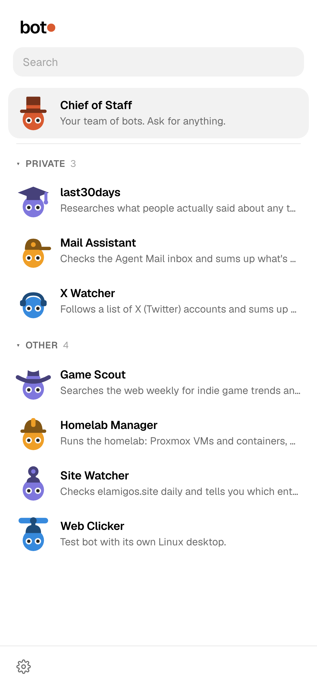
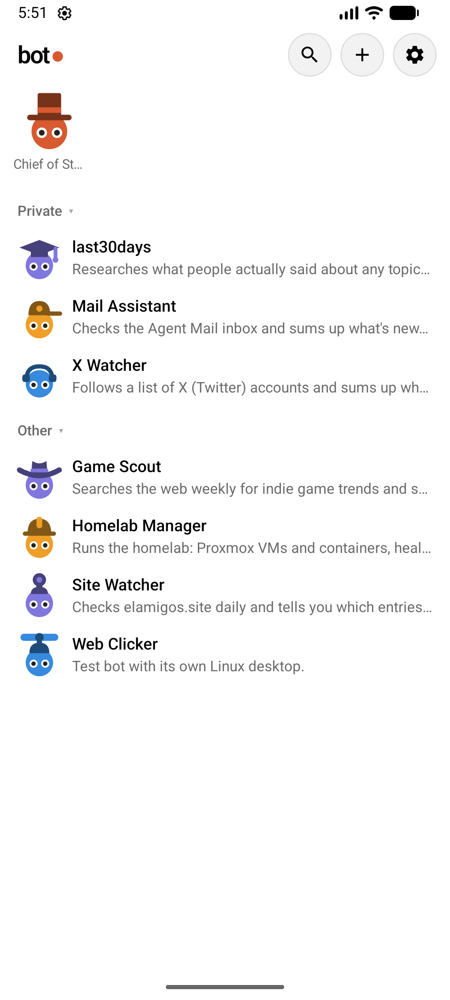
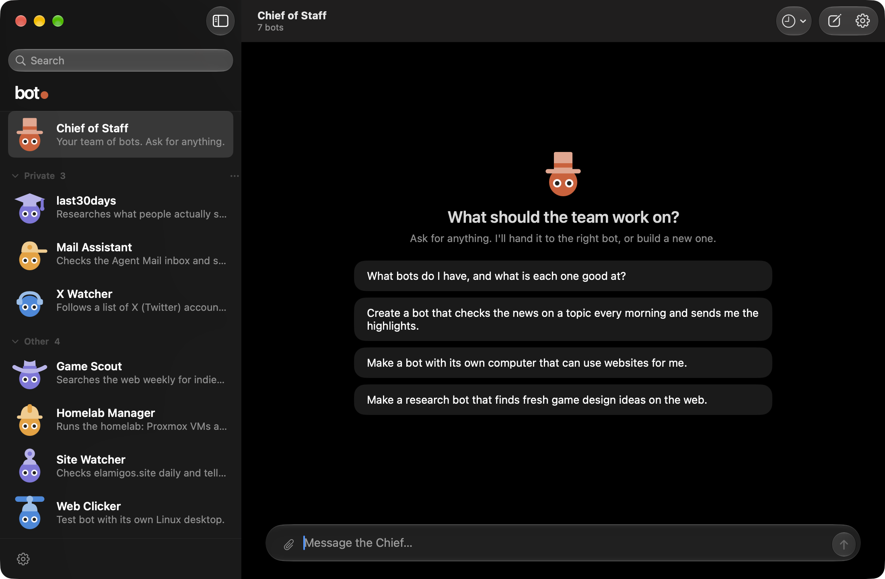

# MVP 1 test: heads with hats for bots

The owner's test of [MVP 1](milestone1.md), on the branch `task/fig-009`.

## Review

The MVP review runs on the whole diff from main, by the `kordal-reviewer` agent, once per axis (Standards, Spec) each time. The milestone was reviewed in two rounds, because the owner revised the scope during the first acceptance test.

| Round | Pass | Reviewed commit | Result |
| --- | --- | --- | --- |
| Stick figures | 1 | the head of `mvp1` at the start of FIG-009 | 13 findings; 7 confirmed and fixed in FIG-010 |
| Stick figures | 2 | `babb6e7` | 2 confirmed and fixed in FIG-011 |
| Stick figures | 3 | `0127dee` | No findings |
| Heads with hats | 4 | `157ad60` | 11 findings on the two axes, some shared; all confirmed. Fixed in FIG-015, and this document rewritten here |
| Heads with hats | 5 | `c49671f` | No blocking findings; every earlier finding closed. Two low notes on this document fixed here; three low notes left, below |

Fixed in FIG-015: an empty bot chat on Android showed no large head; a changed hat did not show everywhere on the open web page; a stored bot that only held an object was never given a hat; the three renderers did not accept the same definitions; the Mac did not ask for the figure again after a failed fetch; leftover stick-figure wording in the docs.

Low notes of pass 5, left as they are: on the Mac, a server whose figure keeps failing to load is asked twice per reconnect (no wrong result, and it stops once the figure loads); a comment in `test/fixtures/figure-cases.json` describes how numbers reach the readers in a way that holds for Android only (the cases still test what they name); the reviewer could not run the Mac's tests in its own shell (they pass in `make premerge-check`).

Raised and deliberately left, for the owner to know:

- **Notifications** on Android still show a bot as a coloured circle (notifications are outside the scope).
- **Eight marks at most** in Android's "Needs you" row and the Mac's menu bar, as before this milestone. A ninth waiting item shows no head there.
- **A bot with no hat** has a small mark that is a plain coloured circle, like the old dot. It shows until the bot is given a hat, or when "no hat" was chosen.
- **Idle heads blink at the same moment,** because all marks share one clock.
- **A Claude sign-in made while no app is open** is noticed at the next retry, at most an hour later.
- **The Chief's rule** to give every new bot a hat no other bot wears. The plan said "what fits".
- **Debug switches** `BOTDOT_STILL` and `BOTDOT_PAGE` in the Mac app; release builds do not read them.
- **A server image without a revision label** would not make the apps ask for the figure again after an update (not checked which images carry the label).
- **The Chief's action chips** ("Created News") name a bot without a small head; they never had a dot.
- **Browser tests** are in no gate, because the repository does not carry Playwright.

## How to start it

It is running on this Mac, from this branch:

- **Web:** http://localhost:4801. A test botdot server with scratch data: a copy of the seven local bots with every job, tool, connector and computer removed, so nothing runs by itself. It uses this Mac's Claude sign-in.
- **Android:** the emulator, with the debug app built from this branch, connected to that server.
- **Mac:** a Debug build with its own bundle identifier (`dev.botdot.mac.mvp1test`), open and connected to that server. The installed botdot app and its settings are untouched.

To start it again: in the repository, `PORT=4801 BOT_DOT_DATA=<scratch folder> node server.js`; `adb reverse tcp:4801 tcp:4801`; `open -n macos/build/Build/Products/Debug/botdot.app --args -botdot.server http://localhost:4801`.

## Checklist

Do each step on the web page; look at Android and the Mac where it says so.

1. **Existing bots have hats (A4, A6).** Open the three apps. The seven bots are heads in their colours, each with a hat, the same on all three. Judge: are they easy to see and to tell apart in the list on the phone, and do the hats fit?
     
2. **Create (A1).** Ask the Chief: "Make me a bot that keeps an eye on the weather." It appears on all three apps as the same head, colour and hat, without a reload.
3. **A drawn hat (A11).** Ask the Chief for a bot the kit has no hat for, such as "a bot that looks after my bonsai". It wears a hat the Chief drew; the same on all three apps.
4. **The list again (A6).** With the two new bots there are nine. Look at the list on the phone once more: is every bot still easy to tell apart, and its state readable?
5. **Change by chat (A3).** Ask the Chief: "Give the weather bot a crown instead." All three apps show it without a restart.
6. **States (A2).** Message a bot with a task: while it works its eyes go flat under brows and look from side to side; then it looks ahead again and blinks now and then. A run that fails leaves crosses for eyes and a tilted head. A bot with a job waiting for your OK has wide eyes and bobs. A bot whose jobs are all switched off has closed eyes and is faded. Waiting (looking to one side) shows only while a bot waits for teammates' answers. Each should look the same on the three apps.
7. **Names in text and "Needs you" (A7).** In a bot's chat that the Chief or another bot wrote to, "Message from …" and "Replied to …" carry a small head with its hat. With something waiting for your OK, the banner shows one small head per item beside "Waiting for your OK".
8. **Reduced motion (A5).** Turn on Reduce Motion in macOS (and "Remove animations" on the emulator), reopen: nothing moves, each state keeps its face.
9. **Dark theme.** Switch the theme: the hats' darker tone turns lighter and stays readable.

## Failure cases to try

- **A wrong hat (A9).** Ask the Chief: "Give the weather bot a hat called spaceship from the kit." It should say there is no such hat, or draw one; either way the bot is never left with a broken hat.
- **No hat stays no hat (A4).** Ask the Chief to take a bot's hat off; restart the server; the bot stays a bare head.
- **No Claude (A10).** Hard to try without signing out. Shown in FIG-007 with a stand-in that fails like a signed-out Claude: bots stay bare, and get hats once it works.

## What cannot be tested by hand here

- **Mixed versions (A8):** no older server is at hand. Unit tests cover an app without the feature, a definition of an unknown version, an unknown hat and an unknown state.
- **Android after a real server update:** only the key it compares is tested.
- **A physical phone:** Android is seen on the emulator only.

## Owner's result

**Passed.** On 2026-10-02 the owner tested the milestone on the web page, the Android emulator and the Mac test build, all running from commit `5c00dda` of `task/fig-009` against one test server with a scratch copy of the owner's seven bots, and answered: "It passes". The first acceptance test, of the stick figures, had failed on the same day ("The avatars are not very visible on the phone"); that led to the scope revision and to FIG-012 to FIG-015.
