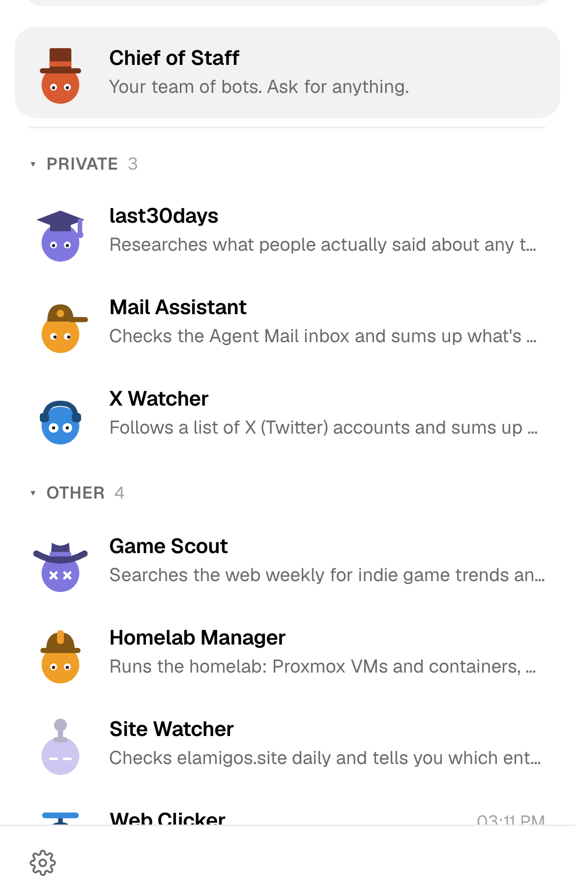
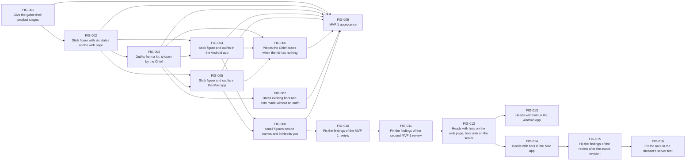

# MVP 1: heads with hats for bots

Status: scope agreed by the owner on 2026-10-02 (planning stage 3) and revised by the owner the same day, during the acceptance test: see "Scope revision". The document's name and the task IDs keep "stick figures" and FIG from the first scope.

## Outcome

The owner can tell every bot apart and see what it is doing from its mark alone, a head in the bot's colour wearing a hat, on the web page and in the Android and Mac apps, demonstrated by a newly created bot appearing in all three with a hat the Chief of Staff picked for its job, and its face going through all six states.

- **Target user:** the owner, the one person who runs a botdot server and talks to its bots.
- **Priority, chosen by the owner on 2026-10-02:** all three apps together, and both "readable at small size" and "character". Where the two pull apart, a hat must first be readable in the list on a phone, and among readable hats the one with more character wins.
- **Why it matters:** the owner reports that dots as the mark for bots are already used by another company, so botdot needs its own. A head with a hat chosen for the job also tells bots apart by more than one of eight colours.

## Scope revision

The first scope made each bot a stick figure with a hat and a held object, and it was built and reviewed that way (FIG-002 to FIG-011). In the acceptance test on 2026-10-02 the owner found the figures hard to see in the list on a phone: a figure is thin lines that use a third of the avatar, and its pieces are a few pixels. After mockups on the test server with the owner's bots (a bigger figure, a head on a stick, the object as an icon, heads with hats, heads with an object badge), the owner decided:

- **The mark is a head with a hat**, filling the avatar, with two eyes. The body, its limbs and its poses go.
- **Held objects are dropped**: an outfit is a hat only.
- **State shows in the face**, with small movement.
- **Beside a name and in "Needs you"**: a small head with its hat.

In that mockup four states are faked: Mail Assistant working, X Watcher needs you, Game Scout failed, Site Watcher paused. The owner was told that working and "needs you" are too alike there and would be made bolder, and that thin hats (the antenna) need redrawing.

## Journey

1. **Start.** The owner has some bots and asks the Chief of Staff for a new one ("make me a bot that keeps an eye on my mail").
2. **The Chief dresses it.** While creating the bot, the Chief picks a hat that fits its name and task, next to its colour. When no hat in the kit fits, it draws one. The owner is not asked.
3. **It appears.** On the web page, Android and Mac, the bot is a head in its colour with that hat, looking ahead.
4. **It lives.** As the bot works, waits for teammates, needs the owner, fails or is paused, its face changes and moves a little. With reduced motion switched on, it holds a still face per state.
5. **The owner changes it by chat.** "Give Mail Keeper a beret instead" and the Chief changes the hat; every app shows it without a restart.
6. **Result.** The list is a row of heads the owner recognises at a glance by hat and colour, with no dots standing for bots.

Failure and edge cases:

- **The Chief gives no hat, or botdot can't reach Claude:** the bot is a bare head in its colour; nothing blocks creating it.
- **The Chief names a hat that isn't in the kit, or draws one that breaks the rules:** the change is refused with the reason and the valid hats, so the Chief corrects itself; the bot keeps its hat.
- **An app is newer than the server, or the server has no definition it knows:** the app keeps the definition it was built with, faces and hats included. Only an app with no definition it can use at all draws the one head it has built in, which has no states and no hat.
- **The kit grows later and an app doesn't know a hat yet:** it draws the head without it.
- **A bot stored with a held object** (from the stick-figure build, which was never released): the object is ignored and removed when the bot is next saved. One that wore no hat counts as never dressed, so it is given one.
- **Restart:** the hat is stored with the bot and survives restarts, backups and restores.

## Included capabilities

1. **The head.** One head, defined once as data (its shape, the eyes, where the hat sits), drawn natively by each app from that definition, in the bot's colour, filling the avatar with no circle behind it.
2. **Six states, in the face.** Idle looks ahead and blinks now and then; working moves its eyes from side to side; waiting looks to one side and holds; needs you has wide eyes and the head bobs; failed has crosses for eyes and the head tilts; paused has closed eyes and is faded. Each differs clearly from the others at list size on a phone, also standing still. A still face per state for reduced motion.
3. **The kit of hats.** Each hat is checked on a head in the list on a phone; a hat that can't be recognised there is redrawn or dropped.
4. **An outfit on each bot** is its hat: a stored `outfit: { hat }`, set by the Chief in `create_bot` and `update_bot`, returned by the API with the bot.
5. **Drawn hats.** When no kit hat fits, the Chief draws one as a short list of simple shapes in the hat's box, validated on the server ([ADR 004](../adr/004-pieces-as-restricted-shape-lists.md)).
6. **Everywhere a bot is shown as a mark.** The avatar is the head with its hat and state. A bot's name in running text carries a small still head with its hat, without eyes. "Needs you" shows one such small head per waiting item.
7. **The Chief of Staff** is a coral head in its own fixed hat.
8. **Existing bots, and bots made without a hat,** are given one once in the background by Claude from their name and task. Until then, or while Claude is signed out, they are bare heads.
9. **Docs.** README, `CONTEXT.md` and `docs/api.md` describe the head and the hat.

## Owner decisions

Taken on 2026-10-02:

- **Generation:** a kit, plus pieces the Chief draws when nothing fits. After the revision: hats only.
- **Needs you:** no count on the mark; how many things wait stays in "Needs you".
- **Existing bots:** dressed automatically in the background.
- **Name and logo:** left for a later decision.
- **Revision:** heads with hats in place of stick figures; held objects dropped; a small head with its hat beside names and in "Needs you".

## Exclusions

- A picker for the hat in any app: it is changed by asking the Chief.
- Held objects, bodies, poses of a body.
- A count of waiting items on a bot's mark.
- The product's name, logo and app icons ("botdot", the coral dot).
- The Linux app (Linux uses the web page).
- New states, or changes to how a state is decided.
- Notifications.
- Dashboard tiles' dots, colour swatches and status marks: they do not stand for bots.

## Acceptance scenarios

- **A1 Create.** The owner asks the Chief for a bot; it appears on web, Android and Mac as the same head, colour and hat, and the hat fits its job.
- **A2 States.** For each of the six states, the face shows that state on all three apps, and the three agree.
- **A3 Change by chat.** The owner asks the Chief to change a bot's hat; all three apps show the new one without a restart.
- **A4 Existing bots.** After updating, bots created before this MVP are heads, and within a few minutes each has a hat that fits its job, with nothing asked of the owner.
- **A5 Reduced motion.** With reduced motion on, each state still has its own face on all three apps.
- **A6 Small size.** In the list on a phone, with at least nine bots, every bot's hat and state are told apart from screenshots.
- **A7 Running text and "Needs you".** Bot names in text and the "Needs you" marks are small heads with hats, not dots.
- **A8 Mixed versions.** The new app against an older server keeps working: it draws from the definition it was built with, faces and hats included, and a bot the server sends no hat for is a head without one. Only with no definition it can use at all does it show the one head it has built in, with no states and no hat.
- **A9 A wrong piece.** A hat the kit lacks, or a drawn hat that breaks the limits, is refused with the reason; the bot keeps its hat.
- **A10 No Claude.** With Claude signed out, the bots still show as bare heads, and get hats once Claude is signed in again.
- **A11 A drawn hat.** A bot whose job has no fitting kit hat gets a hat the Chief drew; it looks the same on all three apps and is recognisable in the list on a phone.

## External prerequisites

None. Everything is inside this repository.

## Evidence limits

- Android is checked on the emulator and the Mac app on the development Mac; no physical phone unless the owner tries one.
- "The hat fits its job" (A1) and "told apart" (A6) are judged by the owner from screenshots, not measured.
- The claim that dots are taken by another company is the owner's report and is not checked.

## Scenario coverage

| Scenario | Delivered by | Verified in |
| --- | --- | --- |
| A1 Create | FIG-003, FIG-004, FIG-005 | FIG-009 |
| A2 States | FIG-002, FIG-004, FIG-005 | FIG-009 |
| A3 Change by chat | FIG-003, FIG-004, FIG-005 | FIG-009 |
| A4 Existing bots | FIG-007 | FIG-009 |
| A5 Reduced motion | FIG-002, FIG-004, FIG-005, FIG-008 | FIG-009 |
| A6 Small size | FIG-002, FIG-003 | FIG-009 |
| A7 Running text and "Needs you" | FIG-008 | FIG-009 |
| A8 Mixed versions | FIG-003, FIG-004, FIG-005 | FIG-009 |
| A9 A wrong piece | FIG-003, FIG-006 | FIG-009 |
| A10 No Claude | FIG-007 | FIG-009 |
| A11 A drawn piece | FIG-006 | FIG-009 |

After the scope revision, FIG-012 (the head, its states, hats only, the web page and the server), FIG-013 (Android) and FIG-014 (the Mac) deliver A1 to A11 again in the new form; FIG-009 verifies them.

FIG-001 gives every task its gates. Backup and restore of the outfit are covered in FIG-003 and FIG-006; there is no migration beyond reading old bots as "never dressed" (FIG-007).

## Task dependencies

