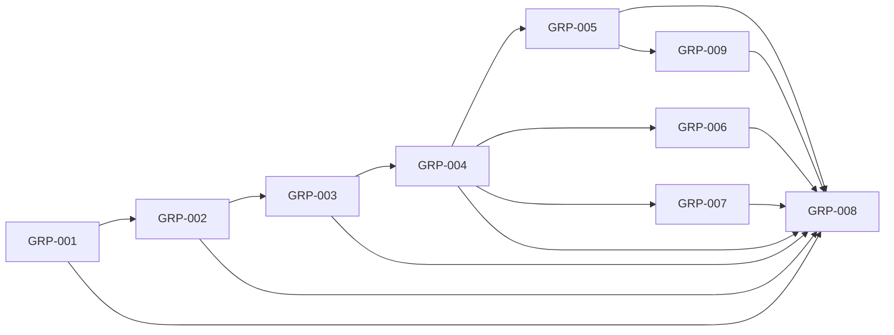

# Milestone 10: a team in one chat

Status: outcome chosen by the owner on 2026-10-08 (planning stage 2). Prototype (seven scenes on the page's own styles, three variants of how a group is made) approved by the owner the same day, seen on desktop and at phone width, with variant C. Scope agreed by the owner the same day ("Approve as written") (stage 3). Three Proposed ADRs, 018 to 020, after a trial of turn-taking on real Claude (stage 4). Backlog prepared the same day (stage 5): GRP-001 to GRP-008. Delivery starts from `main` at `5b2cf30` (the feature "every bot learns" merged through pull request 306) plus the planning commits, on the integration branch `milestone10`; Milestone 9 and the features after it left no unfinished task (stage 6, 2026-10-08).

## Outcome

The owner can put several bots in one chat and watch them work together, demonstrated by a Dev group of three programming bots that the owner made in the app, one message answered under each bot's own name, the bots passing the work among themselves in that chat until it is done, and one Stop that ends them all, on the web page and on Android.

- **Target user:** the owner, writing once to the bots that share a kind of work.
- **What it is for, chosen by the owner on 2026-10-08 ("Watch the team work"):** the bots answer the owner and also pass work among themselves in the chat, as in the Grok Bot group chat the owner showed. "Ask the team" (each bot answers the owner, and may add to another's answer once) was recommended and not chosen; "Only fan-out" (bots never answer each other) was offered and not chosen.
- **Who makes the group, chosen by the owner on 2026-10-08 ("I make the group myself"):** a control in the app. Making it only by chat was recommended, by rule 5 of [AGENTS.md](../../AGENTS.md), and not chosen. The Chief of Staff can make one by chat too (decision 7).
- **Priority, chosen by the owner on 2026-10-08 ("A quiet, safe chat first"):** who answers, every reply under its bot's name, one Stop and new replies come first. Bots answering each other gives way first. So the chat is built to be safe with bots that only answer the owner, and the work among bots is added on that base, inside a stated limit.
- **Why it matters:** today every chat is one bot. To ask three bots the same thing the owner writes three messages in three chats, and no bot reads what another answered; to have two bots work on one thing the owner carries the text between their chats or goes through the Chief, whose answer is the Chief's own words. The baseline is [milestone10-research.md](../archive/product/milestone10-research.md).

## Words

Two words change, in the apps, the documents and `CONTEXT.md`:

- **Group**: one chat with two to six bots, its members. Until now "group" was the folder of bots in the list.
- **Category**: that folder. Only the word on screen changes; a bot's `group` field and the route that renames one keep their names, as the Board kept `dashboard`.

And three are new: a **turn** (one member's chance to answer in a group), a **pass** (a turn that ends with nothing to say, and shows nothing), and to **hand on** (a member names another member in its reply, and that member gets the next turn). A **mention** in a group gives the bot it names the turn; everywhere else it sends nothing, as today.

## Journey

1. **They make a group.** In Coder's chat the owner taps the small plus right of Coder's name ("Add a bot to this chat"), picks Reviewer and Issue Writer, and names it "Dev". A new chat appears in the list, in Coder's category, with the three heads as its picture. Coder's own chat stays as it was. Or they tell the Chief: "Put Coder, Reviewer and Issue Writer in a group called Dev."
2. **They write once.** "We will work on dark mode together. All clear?" Every member reads it, one after another, each having read the replies before it. Issue Writer and Coder answer; Reviewer has nothing to add and passes, which shows nothing. Every reply has its bot's name above it, in its colour, and its head beside it.
3. **They ask one bot.** "@Coder which branch are you on?" Only Coder answers. The others read it later, as part of the chat.
4. **The bots work together.** "The settings page needs a dark mode switch." Issue Writer writes the issue and hands on to Coder by naming it; Coder writes the change and hands on to Reviewer; Reviewer has a finding and hands back; Coder fixes it. It ends when a reply names nobody. The owner wrote once.
5. **It does not run for ever.** After 12 replies without a message from the owner the group stops and says so. "Go on", tapped or typed, gives it 12 more; any message of the owner's starts the count again.
6. **Several work at once.** While Coder works, the owner writes "@Reviewer meanwhile, look at pull request 310." Reviewer is free and starts. Under the chat stands one line per working member with what it says it is doing, and one "Stop all".
7. **A member is busy.** "@Coder also bump the version" waits, shown as waiting with "Take back", until Coder is free. A member that is busy in its own chat or in a job is waited for the same way; the others go ahead.
8. **They stop it.** "Stop all" ends every run of the group at work and the turns that would have followed. Each stopped member says so under its name. A message of the owner's that waited then starts.
9. **A member needs an OK.** The card is in Needs you and at the end of the group chat, with the bot's name on it. Another member's "go ahead" is a reply, never an OK. After the owner's yes the member carries on in the group.
10. **A member asks the owner something.** The group's row says "Asks", as a bot's does. The owner's next message gives that member the first turn.
11. **They come back later.** The group's row shows dots for its new replies and a "New" line in the chat. The phone did not ring for them: it notifies only for a card or a question.
12. **They change it.** The chat's title opens the group's panel: its name, its members with a way to take one out, "Add a bot", "Delete this group". Deleting a group deletes no bot.

Failure cases the journey covers: a member whose run fails (its reply says so under its name; the turns go on); a member that is paused, or whose bot is deleted while it had the turn (it is skipped, and a deleted bot leaves the group, which keeps its history even with one member left); two members that hand the work back and forth (the limit of step 5); a reply that names a bot that is not a member (nobody gets a turn from it); a mention of two members (each gets a turn, in the group's order); the owner writing while a turn is going on (the message goes to the free members and waits for the busy ones); botdot restarted in the middle of an exchange (waiting turns are kept, a run that was cut says so, nothing is answered twice); Claude signed out (turns wait, as a bot's messages do); a forget that leaves a run of the group out (no member is handed it again); the same bot in two groups (each group is its own chat; the bot does one thing at a time); a group made with the bots of an older chat (the bots' own chats are untouched); an app older than this server (it shows no group, and nothing of a group in a bot's own chat) and an app newer than its server (no way to make a group).

The prototype is `public/prototype-m10.html` on the branch `prototype/milestone10`, kept out of `main`: seven scenes on the page's own styles.

## Included capabilities

Protected first (a quiet, safe chat):

1. **A group is a chat of its own.** A record with a name, two to six members and its place in the list; a third kind of chat beside a bot's and the Chief's. A bot can be in several groups. A turn is a run of its member, so a bot still does one thing at a time ([ADR 011](../adr/011-a-bot-does-one-thing-at-a-time-and-the-owners-message-waits.md)).
2. **Made from a bot's chat.** The small plus right of the bot's name in the top of its chat, "Add a bot to this chat", opens a picker of bots and makes a new group; the bot's own chat is untouched. The group's panel renames it, takes a member out, adds one and deletes the group. The same on the web page and on Android.
3. **In the list like a bot.** One row with its members' heads and their faces, its newest reply with the bot's name, dots for new replies, "Asks", and who works and on what while a member works. It sits in a category and is dragged and pinned as a bot is.
4. **Every member reads, each answers or passes.** A message without a mention gives every member a turn, one after another in the group's order, each handed the chat as it stands. A pass shows nothing and is no new reply.
5. **A mention picks who answers.** Only the members the owner names get a turn.
6. **Every reply says whose it is.** The bot's name above the bubble in its colour and its head beside it, on the web page and on Android; in the list and in search too.
7. **What a member is handed.** The group's chat as the owner saw it, capped as a bot's own chat is, with every line saying who wrote it; its own notes and the shared notes; and the lookup of its own notes and past runs. Not its private chat with the owner, and not another member's notes or runs. Its turns in a group are its own past runs: in its own chat it can recall what it did there.
8. **Who said it.** A turn that answers the owner's message directly counts as a run the owner started. A turn another member handed on counts as started by a teammate ([ADR 015](../adr/015-the-server-records-who-said-a-note.md)): what it saves is not the owner's word, and a forget or a change to what the owner said waits on a card.
9. **Busy members are waited for.** A turn for a member that is working waits, shown as waiting; the owner can take a waiting message back. Turns survive a restart and a signed-out Claude.
10. **One Stop.** "Stop all" under the group ends every run of the group at work and the turns that would have followed, and each says who ended it ([ADR 012](../adr/012-a-run-keeps-who-ended-it-and-a-stop-ends-what-its-turn-started.md)).
11. **New replies, without noise.** One read position and one "New" line per group. A reply in a group is a new reply whichever member wrote it. The phone notifies for a card and for a question to the owner, never for a reply in a group.
12. **Cards and questions.** A card asked in a group is drawn in Needs you and at the end of that group, with its bot's name. No member's message is an OK. Carrying on after a yes continues in the group. A member's question shows as "Asks" on the group, and the owner's next message gives that member the first turn.
13. **The owner's files.** A file attached to a message in a group is handed to each member that takes a turn on it. A file a member attaches is shown under its reply.
14. **Old and new apps.** `features` announces groups. An app from before this milestone shows no group and nothing of a group in a bot's own chat; this milestone's apps offer no group against an older server.
15. **The words.** "Category" on screen where a folder of bots was a "group"; `CONTEXT.md`, `docs/api.md` and the README say group, category, turn, pass, hand on, and what a mention does in a group.

Then (the team works):

16. **Handing on.** A member that names another member in its reply gives it the next turn; the bots' instructions say when to hand on, when to pass and that a reply that names nobody ends the work. Naming a bot that is not a member gives nobody a turn.
17. **The limit.** After 12 replies without a message from the owner the group stops and says so in the chat. "Go on", tapped or typed, gives 12 more.
18. **The Chief makes a group by chat.** In a turn the owner started, the Chief can make a group, rename it, and add or take out a member. It is no member, and it does not delete a group.

Give way first: 16 and 17 (without them a group is "every member answers the owner"), then 18.

## Owner decisions

Taken on 2026-10-08.

| # | Decision | The owner chose |
| --- | --- | --- |
| 1 | What the group is for | "Watch the team work". "Ask the team" was recommended and not chosen |
| 2 | Priority | "A quiet, safe chat first"; bots answering each other gives way first |
| 3 | Who makes a group | The owner, with a control. "Ask the Chief" alone was recommended and not chosen |
| 4 | How it is made (on the prototype) | C, grown from a bot's chat by adding a bot. A, a "+" above the list, was recommended and not chosen; B, every category has one chat, was not chosen |
| 5 | Who answers without a mention (on the prototype) | Every member reads; each answers or passes. "Everyone always answers" and "Only a mentioned bot" were not chosen |
| 6 | The limit (on the prototype) | 12 replies without the owner. 6 and 20 were not chosen |
| 7 | The words | The folder becomes "category"; the new chat is a "group". "Team" for the new chat, and "group" for both, were not chosen |
| 8 | Notifications | Only cards and questions. "Once, when it goes quiet" was recommended and not chosen; "Every reply" was not chosen |
| 9 | What a bot carries between its own chat and a group | Its notes and its own turns. "Everything" (its private chat too) and "Nothing but notes" were not chosen |
| 10 | The Chief's part | It makes groups by chat too. "No part" was recommended and not chosen; "Can be a member" was not chosen |
| 11 | Files | The owner's reach whoever answers. A bot's file reaching another member, and no files at all, were not chosen |
| 12 | The prototype | Approved, "seen on desktop and phone", with variant C |
| 13 | The scope | "Approve as written": the 18 capabilities, the exclusions, the 26 scenarios and the unchanged test budget. "The smaller cut", capabilities 1 to 15 only, was offered and not chosen |

Settled in planning from rules botdot already has, shown to the owner on 2026-10-08: "Stop all" ends what runs, and a message of the owner's that waited then starts, as in a bot's chat; a member that asked gets the first turn on the owner's next message; a turn handed on by a member is a run a teammate started; a deleted bot leaves its groups, which keep their history; jobs and scheduled reports never go to a group.

## First look

GRP-005, 2026-10-08. The owner looked at the web page on a test botdot server with real Claude, at a bot's settings. Answer: "Put it there, but just a small very small plus icon": "Add a bot to this chat" keeps its place and becomes a small plus without words. Delivered by GRP-009 on the web page and asked of GRP-006 for Android. The rest of the group's chat was not commented on.

## Exclusions

- People other than the owner in a group.
- The Chief of Staff as a member, and the Chief deleting a group.
- A group that writes first; bots meeting in a group without a message from the owner; a job or a scheduled report in a group.
- A model that chooses who speaks next. The order is the group's, a mention and a hand-on.
- Members answering at the same moment. Turns of one exchange come one after another; two exchanges of the owner's can run side by side.
- A file a member attaches reaching another member's workspace (decision 11).
- A member's private chat with the owner, or its notes, shown to other members.
- Notes of a group's own. A note belongs to a bot, to everyone or to the Chief, as today.
- A notification for a reply in a group (decision 8).
- Reactions, replies to one message, voice, `@everyone`.
- A limit other than 12, or a setting for it; a setting for who answers.
- Changing how bots message each other outside a group (`message_bot`, the inbox, the twenty hops).
- Renaming the `group` field of a bot or its route in the API.
- Anything that shows costs; a cap on runs; the Mac app ([ADR 008](../adr/008-the-mac-app-is-no-longer-developed.md)).

## Acceptance scenarios

- **G1. Make one.** From a bot's chat, the small plus right of its name ("Add a bot to this chat") with two more bots and a name: a group with three members is in the list, in that bot's category; the bot's own chat is unchanged. One bot or seven bots: refused, with the reason.
- **G2. Everyone reads.** A message without a mention gives each of three members one turn, in order; the second is handed the first's reply. Two answer and one passes: two replies, and the pass is in no chat, no preview and no count of new replies.
- **G3. A mention.** "@Coder …" starts a turn of Coder only. Two mentions: two turns, in the group's order.
- **G4. Whose reply.** Each reply carries its bot in what the server sends; the web page and Android draw the name and the head; the list's preview names the bot.
- **G5. What a member reads.** A turn's prompt holds the group's chat with every line's author, the member's own notes and the shared notes; it holds nothing of the member's private chat and nothing of another member's notes or runs.
- **G6. It recalls the group.** In its own chat a member's recall finds its own turn in the group, and not another member's.
- **G7. Who said it.** A note saved in a turn that answers the owner is the owner's; one saved in a handed-on turn is not, and a forget asked there is a card.
- **G8. A busy member.** A member working in its own chat: its turn waits and is shown as waiting; the other members' turns go ahead; "Take back" removes the owner's waiting message. Ten of the owner's messages wait for one member; the eleventh is refused, as today.
- **G9. Restart and sign-out.** botdot restarted with a turn waiting and one running: the waiting turn starts, the cut run says so, no member answers twice. Signed out: turns wait, and start after the sign-in.
- **G10. Stop all.** Two members at work and a turn to follow: after "Stop all" both runs are ended by the owner, the turn to follow never starts, and a waiting message of the owner's starts.
- **G11. New replies.** Three replies while the owner is away: three dots on the group, a "New" line above the first; opening the group reads it, in every app. A pass and a stopped turn count as the rules of a bot's chat have it.
- **G12. No ring.** A reply in a group sends no notification; a card and a question asked in a group send one, which opens the group.
- **G13. A card.** A member's ask in a group is in Needs you and at the end of the group with its bot's name; a member's "yes" changes nothing; after the owner's yes the member carries on and its reply is in the group.
- **G14. A question.** A member asks the owner: the group's row says "Asks"; the owner's next message, without a mention, gives that member the first turn.
- **G15. A file.** A file attached in a group is readable by each member that takes a turn on that message, and by no other bot.
- **G16. A failed turn.** A member's run fails: a failed reply under its name, and the next member's turn still starts.
- **G17. Members change.** Take a member out, add one, rename, delete the group: the list follows in every app; a deleted bot is in no group; a group with one member left keeps its chat; deleting a group deletes no bot and no run.
- **G18. Left out.** After a forget that leaves a run of the group out, no member's turn is handed that run, and the Chief reads it nowhere.
- **G19. Old and new.** An Android app from Milestone 9 against this server: no group in its list, no group's turn in a bot's chat, its notifications unchanged. This milestone's apps against a Milestone 9 server: no "Add a bot to this chat".
- **G20. The words.** No folder of bots is called a "group" on the web page or on Android; `CONTEXT.md` and `docs/api.md` carry the new words.
- **G21. Handing on.** A reply that names a member starts that member's turn and no other; a reply that names nobody starts none; a name that is no member starts none.
- **G22. The limit.** Two members that hand on to each other: after the twelfth reply the group stops with its line; "Go on" starts the next turn and counts from one; a message of the owner's does the same.
- **G23. The Chief makes one.** "Put Coder and Reviewer in a group called Dev": the group exists with both. In a turn botdot started, the Chief has no tool that makes or changes a group. It cannot delete one and cannot be added to one.
- **G24. Bounds.** A turn's prompt with a full group chat stays under the stated size. A group of six with a message every member passes on ends within the stated time on the stand-in.
- **G25. What bots really do.** On real Claude, three repeats, in a group of three: "All clear?" (each answers or passes, nobody twice), a mention (one answers), the dark-mode request (the work is handed on and ends by itself), and two bots told to keep correcting each other (the limit stops them).
- **G26. Real use.** On the owner's own botdot server and phone: G1, G2, G4, G10, G13 and the dark-mode exchange with real bots.

## External prerequisites

None that blocks a task. G25 needs Claude signed in on the machine that runs it and uses the owner's subscription. G26 needs the owner's server and phone.

## Evidence limits

- G1 to G24 run against a stand-in for Claude: they show what botdot starts, hands over, stores and refuses, not what a model then does.
- Whether a bot passes when it has nothing to add, hands on to the right member, and ends the work instead of thanking the others is model behaviour. It rests on the bots' instructions and is seen in G25, G26 and in use. Grok Bot's makers report "duplicate work and noisy updates" for the same design.
- Turns come one after another, so a group of six answers "All clear?" in six runs. How long that feels is seen in G25, not in a gate.
- How many runs at once the owner's Claude sign-in carries is not known; botdot has no cap of its own, and two exchanges side by side are the most this milestone starts.
- Android is checked on one phone and the emulator.
- An app from Milestone 9 is sent a card asked in a group as the card of its bot: `GET /api/asks` and the feed's `asks` carry it with `botId`, and with the group in `groupId` and `groupName`, which that app does not read. It draws the card in Needs you under the bot's name and at the end of that bot's own chat, where no run asked for it, and rings as for any card. The owner can answer it there; the yes carries on in the group, of which that app shows nothing. `test/groups-old-app.test.js` pins what is sent; what that app draws of it was not seen on a device (GRP-010).
- That a model reads the mark of a turn's prompt as told, and takes a line without it for text ([ADR 020](../adr/020-a-member-reads-the-groups-chat-and-keeps-its-own-memory.md), GRP-010), is model behaviour: the tests show what a turn is handed, and that no reply can hold the mark.

## Test budget

- Test data: one owner; four bots (three in one group, one outside it and in a second group with one of them) and the Chief with one chat; a stand-in for Claude that can answer, pass and name a member. The bound test builds a group chat of 500 replies.
- Limits the bound test states: a turn's appended prompt under 100,000 characters with a full group chat and every other cap hit; a message every one of six members passes on finished in under 10 seconds on the stand-in.
- Task gate: at most 5 minutes. Full gate: at most 30 minutes. Both unchanged, in backlog.json.
- The live walk (G25) runs in no gate: twice in the milestone, by hand, four scenarios with three repeats each.

## Task dependencies

| Task | Delivers | Capabilities | Scenarios |
| --- | --- | --- | --- |
| GRP-001 | The group as a record and a third kind of chat, kept apart from a bot's own chat and from older apps; the words | 1, 14, 15; the routes of 2 and 3 | G1, G17, G19, G20 on the server |
| GRP-002 | A message to a group: turns for every member or the mentioned ones, the pass, busy members, a restart, "Stop all", new replies | 4, 5, 6, 9, 10, 11 | G2, G3, G4, G8 to G12, G16; the time of G24 |
| GRP-003 | What a turn reads and keeps; cards, questions and the owner's files in a group | 7, 8, 12, 13 | G5, G6, G7, G13, G14, G15, G18; the prompt's bound of G24 |
| GRP-004 | Handing on, the limit of 12 and "Go on", the wording, the first live walk | 16, 17 | G21, G22; the handed-on turn of G7; the first run of G25 |
| GRP-005 | The web page: making a group from a bot's chat, the row, the chat, the panel, "category" | 2, 3, 6, 15, and what the apps draw of 9 to 13 and 17 | G1, G4, G11, G13, G14, G17, G20 on the web page |
| GRP-006 | The same in the Android app, and its notifications | 2, 3, 6, 11, 15, and what the apps draw of 9 to 13 and 17 | G1, G4, G11 to G14, G17, G19, G20 on Android |
| GRP-007 | The Chief makes and changes a group by chat, in the owner's turns | 18 | G23 |
| GRP-008 | The gates, the walks, the second live walk, the review, the owner's acceptance | All | G25, G26, and every scenario once more on the assembled product |

Eight tasks. The server's work is four and they are a line, because each changes `lib/bots.js`, `server.js` and the module for groups: GRP-001 is what a group is, with ADR 018; GRP-002 is who speaks, with ADR 019; GRP-003 is what a member reads and keeps, with ADR 020; GRP-004 is the work among bots, the part that gives way first and so can be cut as one task. Merging two of them would put two architecture decisions into one review, or tie the part that gives way to a part that is protected. The web page and the Android app are two codebases; both draw the line "The group stopped" and its "Go on", so they start when GRP-004 has fixed that contract. GRP-007 changes the Chief's own files and `server.js`, so it runs beside the apps and not beside the server's line. GRP-008 is the acceptance.

Rounds: GRP-001; GRP-002; GRP-003; GRP-004; GRP-005 with GRP-006 and GRP-007; GRP-008.

## Added features

- 2026-10-08: "Add a bot to this chat" in a bot's settings is a very small plus icon, from the owner's first look. Task: GRP-009.
- 2026-10-08: the small plus leaves the bot's settings and stands in the top of the bot's chat, right of its name, on the web page and on Android, from the owner's test of the milestone ("Move this plus on the top of the chat on the right side of the bot name"). Task: GRP-011.
