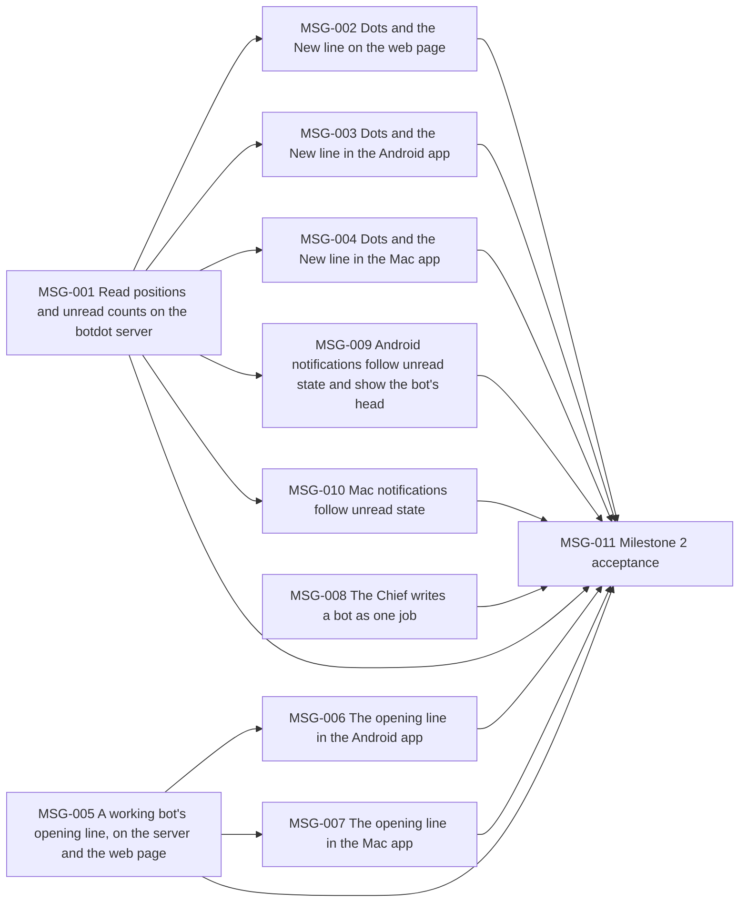

# Milestone 2: a team that feels like a messenger

Status: outcome chosen by the owner on 2026-10-02 (planning stage 2). Scope agreed by the owner on 2026-10-02 (planning stage 3). Backlog prepared the same day (stage 5): MSG-001 to MSG-011. Delivery starts from `main` at `670b633` plus the planning commit, on the integration branch `milestone2`; Milestone 1 left no unfinished work.

## Outcome

The owner can see at a glance which bots have something new, read each chat from where they left off, and see what a working bot is about to do, and a bot the Chief of Staff creates does one job and says what it never does, demonstrated on the web page and in the Android and Mac apps by a bot whose new reply marks it in the list, opens at a "New" line, and whose next run shows its opening line before the answer.

- **Target user:** the owner, the one person who runs a botdot server and talks to its bots.
- **Priority, chosen by the owner on 2026-10-02:** all three parts, with unread state first. When effort runs short, the opening line and the Chief's way of writing a bot are trimmed before unread state is.
- **Why it matters:** the owner compared botdot with Grok Bot and named two things to match: how easy it feels and how alive the bots feel. botdot records nothing about what the owner has read, so every visit starts with checking each bot by hand; a bot's own words while it works are dropped; and the Chief has one sentence of guidance on what a bot's task should contain. The evidence is in [milestone2-research.md](milestone2-research.md).

## Journey

1. **Start.** The owner has several bots in groups and has been away. Two bots answered meanwhile, one scheduled report came in, one bot ran and had nothing to say.
2. **The list tells.** Each bot with something new shows dots next to its time, one per new reply, at most three, in its colour. The list stays in the owner's order. The bot that had nothing to say shows no dot. The phone shows a notification per chat with the bot's head and hat.
3. **Reading.** The owner opens a bot. The chat opens at a thin "New" line above the first reply they have not read. The dots go, in every app, and the phone's and the Mac's notifications for that chat go with them.
4. **Asking.** The owner asks the bot for something. While it works, a line under the chat says what it is about to do ("Planning this week's meals…"), and the list shows the same line as the bot's preview. When the answer arrives the line is gone; the chat keeps only the answer. The owner is looking at the chat, so no dot appears.
5. **A new bot.** The owner asks the Chief for a bot. The Chief writes its task as one job, what it never does, its voice and when it wakes, creates it, reads it back, and says in one line what the bot does and never does.
6. **Result.** The owner opens botdot, sees where to look, reads from where they stopped, and a working bot says what it is doing.

Failure and edge cases:

- **A reply arrives while the owner looks at that chat:** it is read at once; no dot, no notification, no "New" line.
- **The app is open on that chat but in the background, or the screen is off:** the reply is new; the dot and the "New" line show when the owner comes back.
- **Two apps open:** reading in one clears the dots and notifications in the others within a moment.
- **An app was offline:** when it reconnects it shows the server's unread state, not its own.
- **More than three new replies:** three dots.
- **A bot says no opening line:** the step text shows as today ("Searching the web…").
- **A run fails:** "Couldn't finish" counts as a new reply. The opening line disappears as it does on success.
- **A bot is deleted:** its unread state goes with it.
- **Restart, backup, restore:** the read positions are stored with botdot's data and survive all three.
- **First start after the update:** every chat counts as read, so the owner is not met by a list full of dots.
- **An app older than the server:** it shows no dots. **An app newer than the server:** it shows no dots.
- **The Chief cannot read the bot back, or it differs from what was sent:** it says so plainly; it does not report the bot as created as designed.

## Included capabilities

1. **Read positions on the botdot server.** For every bot's chat and the Chief's, how far the owner has read. Stored with botdot's data, returned with the bots, and announced on the live feed when it changes.
2. **What counts as new.** A bot's answer to the owner, a scheduled report that reaches the owner, a failed run, and the Chief's replies. Folded bot-to-bot exchanges and quiet "nothing new" runs never count.
3. **Becoming read.** A chat is read when it is open on screen in an app that is in front. Web, Android and Mac all report it; the existing "which chat is on screen" signal is extended to all three.
4. **Dots in the list.** One dot per new reply next to the time, at most three, in the bot's colour, no number. On web, Android and Mac, and on the Chief's row.
5. **The "New" line.** A thin line with the word "New" in the bot's colour above the first unread reply; the chat opens scrolled to it. It is drawn when the chat is opened and stays until the owner leaves the chat.
6. **The opening line.** Every bot and the Chief may say one short line before work that uses tools. The server keeps it for the running run only; the apps show it under the chat and as the bot's preview in the list, and remove it when the answer arrives. The shared rule "don't narrate your process" gains this one exception.
7. **The Chief's bot design.** The Chief writes every new task as one job, what the bot never does, its voice and when it wakes, in one task text; it asks only what it cannot settle itself; after `create_bot` or `update_bot` it reads the bot back and confirms in one line. Existing bots change only when the owner asks.
8. **Android notifications.** The bot's head with its hat in place of the coloured circle. A notification exists exactly when the chat has an unread reply: what does not count as new never notifies, and reading the chat in any app clears it. The launcher icon's dot follows from that.
9. **Mac notifications** follow unread state the same way. No Dock badge.
10. **Docs.** README, `CONTEXT.md` (the terms "new reply" and "opening line") and `docs/api.md`.

## Owner decisions

Taken on 2026-10-02:

- **Unread look:** dots and a "New" line (variant A of the prototype).
- **Opening line:** a status line that disappears; not a saved message.
- **List order:** the list stays in the owner's order. Sorting by latest was considered and dropped at the scope decision.
- **New means for you:** bot-to-bot exchanges and quiet runs never count.
- **Read means on screen and in front,** in any app.
- **At most three dots,** never a number.
- **No control for jumping to the next unread bot.**
- **Existing bots are not rewritten** unless the owner asks.
- **Android notifications are in:** the head with its hat, and following unread state. An ongoing notification for the opening line is out.

## First look

On 2026-10-02 the owner looked at MSG-002 on the web page (test server, eight bots) and accepted it. Two choices of that task stand:

- The Chief's row opens the Chief chat that has new replies.
- In a bot's chat the "New" line sits below the owner's own message when that started the run, and above the schedule's chip or the folded message otherwise.

## Exclusions

- Sorting the list by latest message: the list stays in the owner's order.
- "Mark as unread".
- A badge on the Mac's Dock icon; a count anywhere.
- A control or shortcut for jumping to the next unread bot.
- Bots or the Chief writing to the owner first without being asked.
- Healthcheck routines that review chats and jobs.
- Voice input, reactions and replies to a message, group chats, a plugin marketplace.
- Rewriting existing bots' tasks in the background.
- New fields in a bot's settings for job, never-does, voice or wake: they stay one task text.
- Keeping opening lines in the chat or in a run's history.
- The Linux app (Linux uses the web page).

## Acceptance scenarios

- **A1 Dots.** A bot answers while no app shows its chat; web, Android and Mac each show one dot on it in its colour. A second answer makes two; a fifth still shows three.
- **A2 Not new.** A quiet scheduled run and a folded bot-to-bot exchange leave the bot without a dot and without a notification.
- **A3 New line.** Opening a bot with unread replies shows the "New" line above the first of them, in all three apps, with the chat scrolled to it.
- **A4 Read everywhere.** Opening the chat in one app removes the dots in the other two and clears the Android and Mac notifications.
- **A5 Read while watching.** A reply that arrives in the chat the owner is looking at makes no dot, no "New" line and no notification.
- **A6 Order.** A bot that gets a new reply stays where the owner put it, in all three apps; dragging inside a group still reorders.
- **A7 Opening line.** A bot asked for something that needs tools shows its line under the chat and as its preview in the list while it works; the line is gone when the answer arrives and is not in the chat afterwards.
- **A8 No opening line.** A bot that says nothing first shows the step text as today.
- **A9 A new bot.** The owner asks the Chief for a bot; its saved task names one job, what it never does, its voice and when it wakes; the Chief's reply says in one line what it does and never does.
- **A10 Existing bots.** After the update, no existing bot's task has changed.
- **A11 Android notification.** A new reply notifies with the bot's head and hat; the launcher icon shows its dot; reading the chat on the Mac clears both.
- **A12 After the update.** The first start shows no dots; restart, backup and restore keep the read positions.
- **A13 Offline app.** An app that reconnects shows the server's unread state.

## External prerequisites

None outside this repository. One dependency on Claude's behaviour: bots must actually write a line before their first tool call when told they may. Stage 4 checks this on real runs; if they do not do it reliably, capability 6 is revised with the owner.

## Evidence limits

- The prototype the owner approved ran on the web page only, at desktop and phone width. Android and Mac draw natively; their look is checked in delivery, on the emulator and on the development Mac. No physical phone unless the owner tries one.
- "Feels easy" and "feels alive" are judged by the owner in the acceptance test, not measured.
- A9 depends on what Claude writes; it is checked on a small number of bots created in the test, not proven for every request.
- Browser tests are in no gate, because the repository does not carry Playwright; the web page's behaviour is covered by server tests and the tests that read the page's code, and by hand in the acceptance test.

## Test budget

- **Test data:** one owner, one botdot server, eight bots in three groups with two pinned, and thirty runs across them, including quiet runs, failed runs and bot-to-bot exchanges.
- **Task gate:** at most 3 minutes. **Full gate:** at most 30 minutes. Both are the limits already recorded as `budgets` in backlog.json.

## Scenario coverage

Every scenario is delivered by the tasks named and verified again on the assembled product by MSG-011.

| Scenario | Delivered by |
| --- | --- |
| A1 Dots | MSG-001, MSG-002, MSG-003, MSG-004 |
| A2 Not new | MSG-001, MSG-009, MSG-010 |
| A3 New line | MSG-002, MSG-003, MSG-004 |
| A4 Read everywhere | MSG-001, MSG-002, MSG-003, MSG-004, MSG-009, MSG-010 |
| A5 Read while watching | MSG-001, MSG-002, MSG-003, MSG-004, MSG-009, MSG-010 |
| A6 Order | MSG-002, MSG-003, MSG-004 |
| A7 Opening line | MSG-005, MSG-006, MSG-007 |
| A8 No opening line | MSG-005, MSG-006, MSG-007 |
| A9 A new bot | MSG-008 |
| A10 Existing bots | MSG-008 |
| A11 Android notification | MSG-009 |
| A12 After the update | MSG-001 |
| A13 Offline app | MSG-001, MSG-002, MSG-003, MSG-004 |

Capabilities to tasks: 1 to 3 MSG-001 (with the apps' reports in MSG-002, MSG-003, MSG-004); 4 and 5 MSG-002, MSG-003, MSG-004; 6 MSG-005, MSG-006, MSG-007; 7 MSG-008; 8 MSG-009; 9 MSG-010; 10 MSG-001 and MSG-005 (`CONTEXT.md`, `docs/api.md`) and MSG-002 (README).

## Task dependencies

## Added features

- 2026-10-02: The owner sees a working bot as one line saying what it is about to do, with Stop beside it, demonstrated by a running bot's chat showing no step bubble and no Details. Task: MSG-013.
- 2026-10-09: The owner changed the decision of 2026-10-02 above: the line stays one line with Stop beside it, and after saying what the bot is about to do it follows the work in the botdot server's words. It is the working line of `CONTEXT.md`. No step bubble and no Details come back. Specified in [Kordal/bot-dot#329](https://github.com/Kordal/bot-dot/issues/329), from the improvement report [Bots that feel alive](improvements/2026-10-09-bots-that-feel-alive.md): its proposal 2. Tasks: ALV-002, ALV-003, ALV-004.
