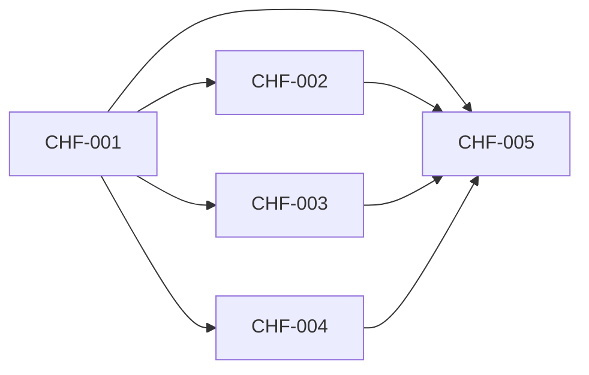

# Milestone 3: the Chief of Staff writes first

Status: outcome chosen by the owner on 2026-10-03 (planning stage 2). Scope and the prototype (variant A with 👍 and 👎, seen on the web page at phone width) agreed by the owner the same day (stage 3). Backlog prepared the same day (stage 5): CHF-001 to CHF-005. Delivery starts from `main` at `5b26b9e` plus the planning commits, on the integration branch `milestone3`; Milestone 2 and the feature after it left no unfinished task. Accepted by the owner on 2026-10-03 (CHF-005).

## Outcome

The owner gets messages from the Chief of Staff that they did not ask for (a tip, a joke, a fresh find, a follow-up) tied to what they care about, demonstrated by a Chief chat on the web page and in the Android and Mac apps that shows such a message as new after a day of normal use, referring to something the owner asked about, and by a day with nothing worth saying on which no message arrives.

- **Target user:** the owner, the one person who runs a botdot server and talks to its bots.
- **Sender, chosen by the owner on 2026-10-03:** the Chief of Staff only. A daily note at a fixed time and other bots writing first were considered and not chosen.
- **Content, chosen by the owner on 2026-10-03:** the owner's world (chats, bots, memory) and fresh finds from the web on topics the owner asked about.
- **Priority, chosen by the owner on 2026-10-03:** feeling alive. When effort runs short, the regular, friendly voice (jokes included) is kept, and the strictness of staying silent is trimmed first.
- **Why it matters:** the owner wants a sidekick that "actually gives a damn": always in the inbox, never in the face, with zero noise. Today the Chief never starts a turn by itself, cannot look anything up, and botdot records nothing about what the owner liked. The evidence is in [milestone3-research.md](milestone3-research.md).

## Journey

1. **Start.** The owner uses botdot as usual: asks the Chief and the bots things, some of them more than once. They said nothing about wanting messages.
2. **The Chief looks around.** A few times a day, outside quiet hours, botdot starts a Chief turn nobody asked for. The Chief reads what it knows about the owner (shared memory, recent chats and runs, what it wrote before and how the owner rated it), may search the web on a topic the owner asked about, and decides: one message worth sending, or nothing.
3. **Nothing.** Most looks end with nothing. The owner sees nothing: no message, no dot, no trace in the chat.
4. **A message.** When there is something, it arrives as an ordinary Chief message at the end of the Chief chat the owner last used. The Chief's row gets its dot, the chat its "New" line, the phone and the Mac a notification, exactly as for any reply.
5. **Reading and rating.** Under the message, next to the time and Copy, are 👍 and 👎. The owner may tap one; it fills in the Chief's colour in every app. Tapping it again clears it.
6. **Answering.** The owner may just answer ("yes, change its check"). The Chief knows what it wrote and carries on in the same chat.
7. **Steering.** The owner tells the Chief "write less", "no jokes", "stop writing first" or "you can write again". The Chief changes how often it writes or remembers the preference, and says so in one line.
8. **Result.** Over days the owner gets up to three unasked messages a day, tied to their own questions, and fewer of the kinds they rated down.

Failure and edge cases:

- **Nothing worth saying:** no message. A day without any is normal.
- **Three already sent today:** botdot starts no further look that day.
- **The Chief is in the middle of answering the owner:** the look is skipped, not queued.
- **Quiet hours:** no look starts and no message arrives.
- **botdot was off:** missed looks are not caught up; the next one runs at its normal time.
- **Claude is not signed in, or the turn fails:** nothing is shown and nothing is counted; the problem is in the server's log, not in the chat.
- **Web search fails or finds nothing:** the Chief uses what it knows or stays silent.
- **The same thing twice:** the Chief sees what it already wrote and does not raise a topic again.
- **No Chief chat exists, or the last one was deleted:** the message starts a new chat.
- **The owner never rates:** the Chief still learns from answers and from what it is told.
- **Rating on two apps:** the last tap wins and every app shows it within a moment.
- **Restart, backup, restore:** ratings, how often the Chief may write, and today's count are stored with botdot's data.
- **First start after the update:** writing first is on. No look runs in the first hour.
- **An app older than the server:** shows the message without 👍 and 👎. **An app newer than the server:** shows no 👍 and 👎.
- **The owner said "stop":** no look runs until the owner says otherwise.

## Included capabilities

1. **The look.** A Chief turn that botdot starts by itself, at spread-out times of day outside quiet hours, at most while fewer than three unasked messages were sent that day. Its answer is one message or an explicit "nothing", which botdot hides.
2. **What the Chief may use.** Shared memory, its own memory, recent Chief chats and bots' runs (through `recall`), its earlier unasked messages with their ratings, and web search for this turn.
3. **What it may write.** A tip, a follow-up on something the owner asked, a fresh find from the web on such a topic, something useful about the owner's bots, or a joke. One message, short, in the owner's language, in the Chief's voice. It never starts work, changes a bot, or spends anything in a look; it may offer to.
4. **Delivery.** An ordinary Chief message in the Chief chat the owner last used, marked on the server as unasked. It counts as a new reply and notifies like one.
5. **👍 and 👎.** Under unasked messages only, on the web page, Android and the Mac. Stored on the botdot server, announced on the live feed, shown the same in every app.
6. **Learning.** The next look sees which messages were rated up or down and which the owner answered. A lasting preference the owner states becomes a memory note.
7. **Steering by chat.** The Chief can turn writing first off and on and set how many a day (none to three) when the owner asks. No settings control.
8. **The Mac's failed-report defect.** A Chief chat that holds a bot's failed report loads on the Mac (carried from Milestone 2's review, because this milestone's messages land in that chat).
9. **Docs.** README, `CONTEXT.md` (the terms "look" and "unasked message") and `docs/api.md`.

## Owner decisions

Taken on 2026-10-03:

- **Look:** a plain Chief message (variant A of the prototype). A quiet note without a bubble and a chat of its own per message were shown and not chosen.
- **Notification:** like any reply.
- **How often:** up to three a day.
- **Feedback:** 👍 and 👎 under these messages.

## Exclusions

- Other bots writing first.
- A feed or page of cards; a daily brief at a fixed time.
- A settings control for how often, or for topics: the owner tells the Chief.
- 👍 and 👎 on ordinary replies or on bots' replies; a count of ratings anywhere.
- An unasked message without a notification.
- Reading the owner's mail or calendar for this purpose; the Chief uses what botdot already holds.
- Starting work or changing anything during a look.
- The Linux app (Linux uses the web page).
- The low findings of Milestone 2's review, except the Mac defect above.

## Acceptance scenarios

- **A1. A message arrives.** With a Chief chat in which the owner asked about a topic, a look ends with a message that refers to it; on web, Android and the Mac the Chief's row shows a dot, the chat a "New" line, and the phone and the Mac a notification.
- **A2. Nothing.** A look that ends with "nothing" leaves no message, no dot and no notification, and the chat file is unchanged.
- **A3. At most three.** After three unasked messages in one day, no further look starts that day; the next day they start again.
- **A4. Quiet hours and busy.** No look starts in quiet hours or while the Chief answers the owner.
- **A5. Rating.** 👍 tapped on one app shows on the other two within a moment, survives a restart, and clears when tapped again; 👎 replaces 👍.
- **A6. Learning.** The next look's input holds the earlier messages with their ratings and whether the owner answered.
- **A7. Answering.** The owner's reply to an unasked message is answered by the Chief with knowledge of that message.
- **A8. Steering.** "Stop writing first" stops the looks; "write at most once a day" limits them; both survive a restart; the Chief confirms in one line.
- **A9. No repeat.** A look whose only candidate is a topic already raised ends with "nothing".
- **A10. Failure is silent.** A look that fails (no sign-in, a crashed turn, no web) shows nothing in any app and is not counted against the three.
- **A11. Old and new.** An app from before this milestone shows the message as a plain reply; a new app on an old server shows no 👍 and 👎.
- **A12. Backup and restore** carry ratings and the setting.
- **A13. The Mac loads a Chief chat that holds a bot's failed report.**
- **A14. Real use.** Over two days on the owner's own botdot server the owner receives at least one unasked message and judges whether it was worth reading.

## External prerequisites

None. Web search in a look uses the Claude sign-in botdot already has.

## Evidence limits

- A1 to A13 are tested with a recorded Chief turn, so they show the plumbing, not the Chief's judgement.
- Whether a message is worth reading is the owner's judgement in A14, on two days of real use: a small sample. Stage 4 checks beforehand, on the owner's real data, that looks produce messages the owner would want.

## Test budget

- Test data: one owner, six bots, three Chief chats, twenty earlier unasked messages with mixed ratings.
- Task gate: at most 3 minutes. Full gate: at most 30 minutes. Unchanged in backlog.json.

## Task dependencies

Scenarios to tasks: A1 to A4, A6 to A10 and A12 are delivered and tested by CHF-001; A5 and A11 by CHF-001 (server) with CHF-002, CHF-003 and CHF-004 (each app); A13 by CHF-004; A14 by CHF-005, which also walks A1 to A13 on the three apps.

## First look

On 2026-10-03 the owner looked at CHF-002 on the web page (test server, phone width): 👍 and 👎 under an unasked Chief message, tapped and cleared. The owner answered "Continue". On the same day the owner looked at CHF-003 on the Android emulator and CHF-004 in a Debug build of the Mac app, both on that test server, and said yes to both.
