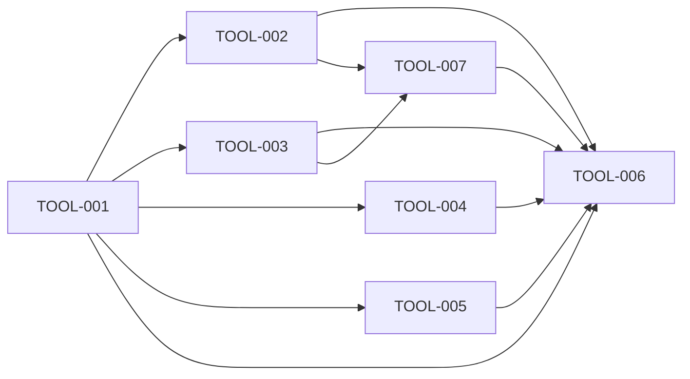

# Milestone 4: the Chief of Staff installs tools on the botdot server

Status: outcome chosen by the owner on 2026-10-03 (planning stage 2). Scope and the prototype (the card with the facts block, seen on the web page at phone width) agreed by the owner the same day (stage 3). The installer was tried and ADR 007 proposed the same day (stage 4). Backlog prepared the same day (stage 5): TOOL-001 to TOOL-006. Delivery starts from `main` at `6ca1262` plus the planning commits, on the integration branch `milestone4`; Milestone 3 left no unfinished task, and the earlier Milestone 4 was cancelled before any product code. Accepted by the owner on 2026-10-03 (TOOL-006).

## Outcome

The owner can have the Chief of Staff put a command-line tool onto the botdot server for a bot that needs it, by chat, demonstrated by the Coder running `gh` and `make` after the owner's OK in Needs you, and again after a botdot update, while another bot still has neither.

- **Target user:** the owner, working through the Chief of Staff and a bot that may run commands.
- **What "tools" covers, chosen by the owner on 2026-10-03:** named command-line tools from a curated registry, installed without root into the data folder, kept across updates. System packages installed as root, and a bigger image with a fixed set of tools, were considered and not chosen.
- **Priority, chosen by the owner on 2026-10-03:** the owner's control. Every install waits for the owner's OK in Needs you. When effort runs short, a tool that cannot be installed this way stays not installed rather than installed without the OK. The Chief installing by itself and telling the owner afterwards was not chosen.
- **Reach, chosen by the owner on 2026-10-03:** a tool belongs to the bot it was installed for. One shared set for every bot that may run commands was not chosen.
- **Why it matters:** the owner's Coder could not start on an issue because `gh` is not on the botdot server, and nobody (the server, the Chief or a bot) can install a system package there. Each missing tool today waits for a botdot release. The evidence is in [milestone4-research.md](milestone4-research.md).

## Journey

1. **Start.** The owner has a bot that may run commands (the Coder). A command it needs is not on the botdot server. Either the owner tells the Chief of Staff "the Coder needs gh", or the Coder, in the middle of its work, asks the Chief for the tool and says in its reply that it did.
2. **The Chief asks.** The Chief looks the tool up by name in botdot's registry of tools, and asks for it to be installed for that bot. It tells the owner in one line that the install waits in Needs you. It installs nothing itself. For a tool that is not in the registry, see step 9.
3. **The card.** Needs you shows one card per tool under the bot's head: the tool, what it is, why the bot needs it and who asked, and a block of facts (version, source, size, "runs as Coder only", "stays across botdot updates"), with Decline and Install.
4. **Installing.** On Install, botdot fetches that version from the registry, checks it against the registry's checksum, and puts it in that bot's own tools folder in the data folder. The bot can run its tools and cannot change them.
5. **Done.** The Chief chat that asked gets the result, and the Chief says it in one line: installed, or what went wrong. When the tool was asked for because a bot's work stopped without it, the Chief starts that bot again on that work.
6. **Using it.** The command works in that bot's runs, its script jobs and its Board tile scripts. Another bot does not have it.
7. **Later.** After a restart and after a botdot update the tool is still there. The owner can ask the Chief what a bot has installed and to remove a tool; removing needs no OK.
8. **Result.** The Coder runs `gh` and `make`, today and after the next update, and the owner said yes once per tool.
9. **A tool that is not in the registry.** The Chief says so, asks the owner for a link to the tool's release file or proposes one it knows, and says in the same message what the risk is: botdot cannot check what such a program does. botdot downloads the file and notes its checksum, and the card in Needs you carries a warning, whose link it is (the owner's or the Chief's), the address, the file's name and its checksum. On Install botdot keeps exactly that file; a later download that differs is refused.

Failure and edge cases:

- **The tool is not in the registry:** the Chief asks the owner for a link or proposes one, and names the risk (step 9).
- **The link is not one the owner wrote in that chat:** the card says the Chief proposed it.
- **The link does not answer** (a made-up address): no card appears and the Chief says the link does not work.
- **The link is not a program botdot can place** (not https, an installer script, a system package, a file for another processor, or an archive without the named command): botdot refuses it and the Chief says why.
- **The file behind a link changed or is gone when botdot installs it again** (after a restore): the tool is not installed and the owner is told once.
- **A bot asks the Chief for a tool:** the Chief treats it as a request, not as the owner's word. It leads to a card for a registry tool with one OK from the owner; for a tool outside the registry the Chief tells the owner as in step 9, and a link in a bot's message is the bot's text, not the owner's.
- **A bot asks again and again:** a declined tool is not asked for again for a week, and one waiting card is not doubled.
- **The name is close to several tools:** the Chief asks the owner which one; it never guesses.
- **The bot may not run commands:** the Chief says the bot first needs that permission; the install is not asked for.
- **Already installed for that bot:** the Chief says so. Asked again for a newer version: a new card that names both versions.
- **The same ask twice:** one card.
- **Declined:** nothing is installed, and the same tool is not asked for that bot again for a week.
- **No network, or the registry is down:** the install fails, nothing is left half-installed, and the Chief says so. The owner asks again later.
- **The checksum does not match:** the install fails the same way and is written to the audit log.
- **The disk is full:** the install fails the same way.
- **botdot restarts during an install:** the install starts again by itself.
- **A botdot update:** the tools stay. A tool that no longer starts on the new image is installed again by itself.
- **Backup and restore:** a backup carries the list of each bot's tools, not the files. After a restore botdot installs them again by itself; until that is done the tool is missing, and a tool that cannot be installed again is reported to the owner once.
- **The bot is deleted:** its tools are deleted with it.
- **Two tools bring a command of the same name, or a tool brings one the botdot server already has:** the one installed later wins, and the Chief says so when it reports the install.
- **A botdot server run without Docker:** the Chief says tools cannot be installed there; the bots use what that machine has.
- **An app older than the server:** the card can be answered there, with a title that may be wrong for it. **An app newer than the server:** nothing changes.

## Included capabilities

1. **A registry.** One curated source of command-line tools with pinned versions and checksums, for `linux/amd64` and `linux/arm64`: conda-forge ([ADR 007](../adr/007-installed-tools-are-pinned-lists-placed-by-a-tools-user.md)). Outside it botdot installs only from a link the owner gave (capability 4).
2. **Asking.** The Chief finds a tool by name and asks for it to be installed for one bot. The ask waits in Needs you. A bot that may run commands can ask the Chief for a tool; it cannot put a card in Needs you itself.
3. **The card.** A new kind of ask in Needs you, on the web page, Android and the Mac, with the notification every ask gets: what the tool is, why, who asked, and the facts block. A tool from a link has the warning.
4. **A tool from a link.** For a tool outside the registry: a link the owner gave or the Chief proposed, to one program file or an archive (`.tar.gz`, `.zip`) that holds it, over https. botdot knows from the chat whose link it is and says so on the card. It notes the checksum at the first download and keeps to it.
5. **Installing without root.** botdot installs an approved tool into that bot's tools folder in the data folder, with no secrets in the installer's environment. No root, no system package, no install script from the tool.
6. **After the install.** The Chief chat that asked gets the result; the Chief reports it and starts the bot again on the work that needed the tool.
7. **Using.** A bot's runs, script jobs and Board tile scripts find its tools on their `PATH`. The bot's instructions name its installed tools, and say that a missing command is reported in one line, not worked around.
8. **The list is the truth.** botdot keeps, per bot, which tools and versions the owner approved, and makes the folder match it at start: after an update, a restore or a broken install.
9. **Listing and removing by chat.** The Chief can say what a bot has and remove a tool. No page and no settings control.
10. **A record.** Installed, removed, declined and failed are lines in the audit log, with the bot, the tool and the version.
11. **Docs.** README, `CONTEXT.md` (a term for an installed tool, apart from the tools a bot "may use"), `docs/api.md` and SECURITY.md, which says what a tool from a link means and that a bot can still fetch programs into its own folder.

## Owner decisions

Taken on 2026-10-03, on the prototype and the questions of stage 3:

- **The card:** variant B of the prototype, the skill card plus a block of facts. The plain skill card, and one card per request with a row per tool, were shown and not chosen.
- **Who may ask:** a bot asks the Chief; the Chief asks the owner.
- **Outside the registry:** the Chief asks the owner for a link, or proposes one, and names the risk. Leaving such a tool not installable, and accepting only a link the owner wrote, were recommended and not chosen.
- **A bot's request:** one OK, on the card.
- **Where a tool works:** the bot's runs, script jobs and Board tile scripts.
- **After the install:** the Chief reports and starts the bot again.
- **Backups:** the list of tools, not the files.
- **Removing** needs no OK; a newer version is a new card.
- **A bot fetching programs into its own folder** stays possible for now.

Taken on 2026-10-03, on a finding of the milestone review:

- **The notification of a tool from a link** has no Install button. Asked "you can approve a tool from a link from the notification without seeing the warning, whose link it is, the address or the checksum. Change it?", the owner answered: "No Install button for a link". Such a notification says the tool is from a link and opens the card; Decline stays as its one button. A tool from the registry keeps Install on its notification. Delivered by TOOL-009.

Taken on 2026-10-03, at the owner's test of the milestone on the web page:

- **The warning of a tool from a link** reads "Not from the approved list. Make sure you trust the source." The owner marked the warning on the closed card and wrote: Change this to : "Not from the approved list. Make sure you trust the source". The final full stop was added, and the owner was told. It replaces TOOL-007's "Not from botdot's registry: not checked." and that task's rule that the warning fits one line: on a phone it may take two, and all of it shows on the closed card. Delivered by TOOL-010.

## Exclusions

- System packages, libraries and background services; anything that needs root.
- An installer script, a system package (`.deb`, `.rpm`), or a package from npm or PyPI by name.
- A bot putting an install card in Needs you without the Chief, and a skill or a bot declaring the tools it needs up front.
- One shared set of tools for all bots.
- Stopping a bot from fetching a program into its own folder, as it can today. Left open by the owner on 2026-10-03.
- Software on a bot's computer.
- Logins for an installed tool (`gh` gets no GitHub login here; that was the cancelled milestone).
- A page, a list or a settings control for tools.
- Limiting the network of the installer to the registry.
- A botdot server run without Docker; the Linux app.

## Acceptance scenarios

- **A1. Install.** The owner tells the Chief the Coder needs `gh`; one card appears in Needs you on the web page, Android and the Mac; after Install, `gh --version` works in the Coder's next run.
- **A2. Only that bot.** Another bot that may run commands gets "command not found" for `gh`.
- **A3. The bot cannot change its tools.** A command run by the Coder cannot write into its tools folder.
- **A4. Not in the registry.** The Chief says so and no card appears.
- **A5. Decline.** Nothing is installed, and the same ask within a week is refused.
- **A6. Failure leaves nothing.** With the registry unreachable, and with a wrong checksum, the install fails, the tools folder is unchanged, the Chief chat gets the reason, and the audit log has the line.
- **A7. Restart and update.** After a restart, and in a container started from a new image on the same data folder, `gh` still works.
- **A8. Backup and restore.** A restore on an empty data folder brings the list back, and the tools are installed again without the owner.
- **A9. A script job and a Board tile script** of the Coder can run `gh`.
- **A10. List and remove.** The Chief names the Coder's tools; after "remove gh" the command is gone and the audit log has the line.
- **A11. Deleting the bot** deletes its tools.
- **A12. Without Docker** the Chief says tools cannot be installed.
- **A13. No secrets.** The installer's environment holds no key, token or login.
- **A14. Old and new.** An app from before this milestone can answer the card.
- **A15. A bot asks.** The Coder asks the Chief for `make`; the card says the Coder asked; after Install the Chief reports it and starts the Coder again on the same work.
- **A16. From a link.** For a tool outside the registry the Chief asks the owner for a link and names the risk; with the owner's link the card shows the warning, "a link you gave", the address, the file and its checksum; after Install the command works.
- **A17. The Chief's link.** A link that the owner did not write in that chat gives a card that says the Chief proposed it; a link that does not answer, or is not a program botdot can place, gives no card.
- **A18. A changed file.** When the file behind an approved link differs at a later install, the tool is not installed and the owner is told once.
- **A19. Real use.** On the owner's own botdot server the Coder gets `gh` and `make` from the real registry, and both still work after the next botdot update.

## External prerequisites

- The botdot server reaches the registry over the network when a tool is installed. Without it nothing is installed and everything else works; it blocks A19 only.

## Evidence limits

- A1 to A18 run against a registry and a file server made for the tests, on one architecture, so they show botdot's part, not the real registry.
- A19 is the only check against the real registry, on the owner's server: one architecture and two tools.
- That a tool from the registry does what it says is the registry's word. botdot checks that it got what the registry lists, not what the program does.
- A tool from a link is checked even less: botdot knows only that the file is the one the owner approved. The owner's OK is the whole protection, also for a link the Chief proposed, which may be an address a model invented or took from a bot's message.
- A bot can still fetch programs into its own folder without asking; this milestone does not close that.
- On a botdot server hosted on a Mac, whether another bot can reach a tool's files depends on how Docker shows the Mac's disk to the container. TOOL-001 checks it and SECURITY.md records the answer.
- The size on the card is what is downloaded. A tool takes about four times that on disk.

## Test budget

- Test data: one owner, three bots (two may run commands), a test registry of four tools, one of them with a wrong checksum, and two files behind links, one of which changes.
- Task gate: at most 3 minutes. Full gate: at most 30 minutes. Unchanged in backlog.json.

## Task dependencies

Scenarios to tasks: A2 to A13 and A15 are delivered and tested by TOOL-001; A1 and A14 by TOOL-001 (server) with TOOL-003, TOOL-004 and TOOL-005 (each app); A16 to A18 by TOOL-002, their card by the three apps; A19 by TOOL-006, which also walks A1 to A18 on the three apps and checks A7 on a second image.

Seven tasks: six from planning, and TOOL-007 from the [first look](#first-look). The three apps are three codebases; a tool from a link is its own risk on the files TOOL-001 changes first; the acceptance task is required. TOOL-001 is the large one and was not split, because its parts change the same files and would only wait for each other.

The owner's test added TOOL-010 on 2026-10-03, the owner's wording of the warning (an [owner decision](#owner-decisions)). The milestone review added two more on 2026-10-03, which depend on no other task: TOOL-008, the review's medium findings, and TOOL-009, the notification of a tool from a link (an [owner decision](#owner-decisions)).

## First look

On 2026-10-03 the owner looked at TOOL-003 on the web page: the card of a tool to install, with the three kinds of ask from the milestone's server. The owner answered:

- The warning of a tool from a link: "make the msg in yellow much shorter".
- A card answered with Install keeps the word "Installing".
- "A link is allowed for a tool the registry also has" stands (TOOL-002's choice).
- TOOL-002's rule that the owner's own later link overrides their earlier no was put to the owner and not chosen: it does not stand. A no to a tool stands for a week against a link too, also one the owner gives.

The two changes are TOOL-007, planned the same day before the queue continued: the warning reads "Not from botdot's registry: not checked." (the wording was that task's proposal; at the acceptance test the owner replaced it, see [Owner decisions](#owner-decisions)), and a declined tool is not asked for that bot again for a week, whoever gives a link.

## Added features

- 2026-10-04: The owner can answer a bot's login request with any saved login, demonstrated by the bot signing in on the requested host with a login saved for another website. Tasks: VAULT-001, VAULT-002, VAULT-003. First look, 2026-10-04, VAULT-001 on the web page with 13 other logins: the owner asked for a search of the logins, shown only for a long list. Planned the same day as VAULT-004 (the web page) and added to the plans of VAULT-002 and VAULT-003. On 2026-10-04 the owner looked at VAULT-004's search on the web page and said the web dialog passes.
- 2026-10-04: The owner can read every job's schedule in plain words wherever it is shown, on the web page, Android and the Mac, demonstrated by `0 8-21 * * *` reading "Every hour, 08:00 to 21:00" and no screen showing a cron expression as a schedule. Tasks: SCHED-001, SCHED-002, SCHED-003. From the improvement report [Job schedules in plain words](improvements/2026-10-04-job-schedule-in-plain-words.md): its proposals 1 and 2, and proposal 3 (the "next" date of a run more than six days away), which the owner approved as part of this feature. First look, 2026-10-04, SCHED-001 on the web page: the owner looked at the Scheduled jobs page of a bot with 11 schedules and approved it, with "Never runs" meaning a schedule that no day or time fits.
- 2026-10-04: The owner can change a bot's settings, its jobs and the Chief's settings while its chat stays in view, on the web page and on wide Android screens, demonstrated by a message sent and answered in the chat with the settings panel open beside it. Tasks: PANEL-001, PANEL-002. The owner chose: a panel right of the chat; in a column too narrow for both it covers the chat as before; Android on wide screens only, phones as before. First look, 2026-10-04, PANEL-001 on the web page: the owner said it passes, and asked for one change: where the panel covers the chat, choosing a bot in the list shows its chat, not its settings. Added to PANEL-002.
- 2026-10-04: The owner, the Chief and a bot can read a bot's standing task under one name, its "main assignment", on the web page and in the Android app, demonstrated by no screen, prompt or doc outside the Mac app saying "usual task", and by a bot's empty chat on the web page offering no button that runs it. Tasks: ASSIGN-001, ASSIGN-002. From the improvement report [A bot's usual task becomes its main assignment](improvements/2026-10-04-main-assignment.md): its proposals 1 to 6. The owner approved the plans on 2026-10-04; jobs already named "Usual task" keep their name. First look, 2026-10-04, ASSIGN-001 on the web page: the owner said it passes. On 2026-10-04 the owner tested the feature and said it passes.
- 2026-10-04: The owner can tell a login, an API token and any other secret apart in the Vault, demonstrated by every saved item showing its type and its form asking only for what that type needs, on the web page and in the Android app. Tasks: VAULT-005, VAULT-006. The owner chose: the type is a label and a fitting form and forbids nothing; items saved before are logins, nothing is guessed; the form of "other" asks for the secret only. First look, 2026-10-04, VAULT-005 on the web page with four made-up items and one login request: the owner said it passes, and decided that a login request saved without a type (an app from before the types) leaves the type of an item already saved; delivered in VAULT-006.
- 2026-10-04: The owner can find their page of tiles under one name, the Board, and open it while it is empty, on the web page and in the Android app, demonstrated by the list reading "Board · Nothing on it yet" at zero tiles, a tap opening a page headed "Board" with two lines and one example, and no screen, prompt or doc outside the Mac app calling it a dashboard. Tasks: BOARD-001, BOARD-002. From the improvement report [The Dashboard becomes the Board, and shows while empty](improvements/2026-10-04-board-name-and-empty-entry.md): its proposals 1, 2 and 3. The owner approved the plans on 2026-10-04 and chose: the Chief's skill and tools are renamed (`chief:board`, `get_board`, `arrange_board`); the API paths, the feed event and the data file keep the name `dashboard`; code comments, `package.json` and the systemd unit say "Board" too. First look, 2026-10-04, BOARD-001 on the web page with zero tiles: the owner said it passes. Before the look the empty strip was 156px tall and cut in the narrow list, because its class `empty` took the page's own `.empty` rule; fixed in BOARD-002 by renaming the class. On 2026-10-04 the owner tested the feature and said it passes.
