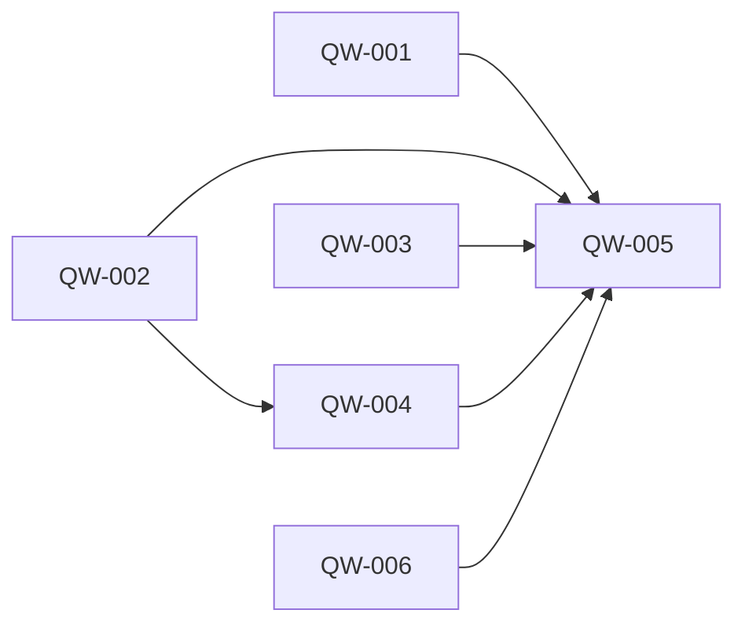

# Milestone 5: the quick wins of the interaction audit

Status: outcome chosen by the owner on 2026-10-05 (planning stage 2). Scope and the prototype (seven scenes on the page's own styles, seen in the browser pane at phone and desktop width) agreed by the owner the same day (stage 3). No ADR was needed (stage 4). Backlog prepared the same day (stage 5): QW-001 to QW-005; QW-006 was added at the first look. Delivery starts from `main` at `ee27a02` plus the planning commits, on the integration branch `milestone5`; Milestone 4 and the features after it left no unfinished task. The first look added QW-006 and the milestone review QW-007 to QW-010. Accepted by the owner on 2026-10-05 (QW-005).

## Outcome

The owner can use botdot with every quick win of the interaction audit fixed, demonstrated by one walk on the web page and on Android, and one test, for each of the thirteen fixes.

- **Target user:** the owner, in ordinary daily use of the Chief of Staff chat, a bot's chat, Needs you and the phone's notifications.
- **What "every quick win" covers, chosen by the owner on 2026-10-05:** the ten numbered quick wins of [the audit](improvements/2026-10-05-bot-interaction-audit.md), section 8, and three of its five "Also small": no cost words reach the Chief, a bot is told the owner may take over its computer, and a question before a bot is given "Everything allowed". The shared voice for all prompts and progress words written on the server were not chosen for this milestone.
- **Priority, chosen by the owner on 2026-10-05:** nothing lost or hidden. When something has to give, these five are protected first: a failed send keeps the message, one "Can't reach botdot", the phone approves only what it shows, a failed Chief reply looks failed, and notes reach a bot with learning off. The other eight save turns or words and give way first.
- **Why it matters:** the audit found these in everyday paths: a message typed twice, an approval given blind, a report that never came. Each is small and none needs a new design. The evidence is in [milestone5-research.md](../archive/product/milestone5-research.md).

## Journey

The owner starts where they are every day: a Chief of Staff chat, a bot's chat, Needs you, the phone's notifications. Nothing new is added to any of them. In each place below, what goes wrong today stops going wrong.

1. **They send a message and it does not arrive** (no connection, botdot restarting, the Chief still replying). The text and the files are back in the box with one line saying why; they press Send again.
2. **botdot is away for a while.** One quiet line says "Can't reach botdot" until it answers again. No red message repeats.
3. **They ask the Chief for a bot that needs the web.** The Chief does not ask "shall I?" in chat. The chip says "Created News Watcher · web access waits for your OK", and the reply says the card waits.
4. **The phone buzzes with something to approve.** The notification says what it is. Where it cannot show what is approved (a changed bot, an action in a connected app, a script), it has Decline only and a tap opens the card.
5. **The Chief's reply fails half way.** What it wrote stays, and under it one sentence says it did not finish and what to do. An empty reply is never "Done."
6. **They ask a bot for something another bot must do.** When the teammate ends without answering, the first bot is started again with what the teammate wrote or why it failed, and tells the owner.
7. **They ask for a report every morning, or one thing once on Friday.** It arrives.
8. **They write a note for a bot whose learning is off.** The bot reads it.
9. **Smaller things.** Seven questions that confirm what can be undone are gone; the password warning no longer fires on ordinary sentences; choosing "Everything allowed" for a bot asks first; the Chief stops saying "free" about scripts; a bot knows the owner may take over its computer.

Failure cases the journey covers: a send refused because the Chief is still replying (step 1, same as no connection); a failed upload inside a message that is otherwise sent (unchanged, out of scope); botdot restarting while a line "Can't reach botdot" shows (it goes when the feed is back); an app older than this server (it ignores what it does not know and keeps today's behaviour; an Android app from Milestone 4 on loses the yes button on a changed bot and a connected-app action, where the server now says `yesOn: "card"`, and keeps it on jobs and tiles until it is updated); a teammate's run cut off by a restart (the asker is told "its run didn't finish").

The prototype is `public/prototype-m5.html` on the branch `prototype/milestone5`, kept out of `main`: seven scenes on the page's own styles at phone and desktop width.

## Included capabilities

Protected first (the owner's priority):

1. **A failed send keeps the message.** Web and Android: the text, the attached files and a tapped quick answer are not lost when the send fails or is refused. One line says why, in botdot's words, never the browser's.
2. **One "Can't reach botdot".** Web: a standing line while botdot does not answer; the background refresh shows no message; a failed request reads "Can't reach botdot", not the browser's error.
3. **The phone approves only what it shows.** The server gives every waiting item a line of text for its notification. A changed bot, an action in a connected app, a script job and a Board tile with a script get `yesOn: "card"`. Android prints the server's line, offers a yes only where a line exists and the server allows it, and its tile card lists every script the web card lists.
4. **A failed Chief reply looks failed.** The server marks every Chief message that failed or was stopped, whatever text it has, with its problem sentence. Both apps draw that sentence under whatever text and chips exist. No app writes "Done." for an empty reply. The feed announces a failed reply as failed.
5. **Notes reach a bot with learning off.** Its pinned private notes are in its prompt; it is told it cannot save notes itself.

Give way first:

6. **One confirmation: the card.** The Chief no longer asks for a yes in chat for something a card in Needs you will ask. It says that the card waits. It still asks before deleting a bot, and before something with lasting effects the owner did not ask for.
7. **Chips say what waits and name the bot.** The Chief's tools get back what waits for the owner, in the owner's words. The chip reads "Created News Watcher · web access waits for your OK"; a deleted bot is named, not shown as an id.
8. **A hand-off always comes back.** When a bot asked teammates and the wait ends with no answer, botdot starts the asking bot again with each teammate's final reply or the sentence of its failure.
9. **A requested report arrives.** The Chief and the bots give a job the owner asked a report from notify "always". A one-time job always delivers its final reply. `attach_file` says the truth in a run whose reply is private.
10. **Fewer needless questions on the web page.** Gone: remove a group, undo a bot's change, take control in the small screen, approve a job in the jobs panel, "Decline and remove" in the job dialog, delete a note that can be restored, download after pressing Download. The password warning matches a password, not the word.
11. **No cost words reach the Chief.** `costUsd` leaves what the Chief's tools return; "free" leaves the job guide, the tool descriptions and the Chief's instructions.
12. **A bot knows the owner may take over its computer.** One sentence in its instructions replaces "that only you use".
13. **A question before "Everything allowed".** Web: choosing that permission mode in a bot's settings asks first.

With them: `docs/api.md` and `features` for what the server newly sends, README where it describes hand-offs and scheduled reports, and the Chief's and the bots' instructions.

## Owner decisions

Taken on 2026-10-05, on the prototype in the browser pane at phone and desktop width:

- **A failed send goes back into the box.** The text and files return to the message box with one line saying why. A faded "Not sent" bubble with Try again and Edit under it was shown and not chosen.
- **The other five scenes are approved as drawn:** the line "Can't reach botdot" beside the logo on a wide screen and above the box on a narrow one; chips that say what waits in the warning colour; the problem sentence in its own block under the Chief's text; notifications that say what they are, without a yes for a changed bot, a connected-app action and a script; the question before "Everything allowed".
- **A hand-off always comes back.** The asking bot is started again whenever its wait ends without an answer, also when the teammate finished quietly. Starting it again only for a failed teammate, and leaving the rule and correcting the README, were not chosen. This reverses the rule "nobody answered: no follow-up".
- **Two additions to the audit's wording are in:** a tapped quick answer is kept when its send fails, and Android's tile card lists every script the web card lists.
- **The scope, the exclusions and the test budget** are agreed as written here.

## Exclusions

- Every structural change of the audit: work that resumes after an OK, one rule for a busy bot or Chief, a connector action that waits, a bot's conversation context, the bot-change card in the Chief's chat, staged job changes.
- A shared voice for all prompts and progress words written on the server (not chosen by the owner on 2026-10-05).
- A "Can't reach botdot" line inside Android's chats: Android has the line on its home screen.
- A retry by botdot itself of a message that failed.
- Changing existing jobs: a job that is report-only today stays so until the owner or the Chief changes it.
- The prices of models in Settings.
- New controls, pages or settings; anything that shows costs; the Mac app.

## Acceptance scenarios

- **A1. Send fails.** With botdot stopped, a message with a file sent from the web page and from Android is back in the box with its file and one line; after botdot is back, Send delivers it once.
- **A2. Send refused.** A message sent to a Chief chat that is replying (started from the other app) comes back the same way, with the reason.
- **A3. A tapped answer.** A quick answer tapped while botdot is stopped is still there to tap again.
- **A4. Away.** With botdot stopped for a minute the web page shows one line and no repeating message; the line goes when botdot is back.
- **A5. Notifications.** On Android: a changed bot, a connected-app action, a script job and a tile with a script each say what they are and have no yes; a permission, an AI job with its schedule, and a shared-memory change keep theirs. No notification reads "Asks to" with nothing after it.
- **A6. The tile card on Android** lists a script that lives in a named read or action.
- **A7. A failed reply.** A Chief turn that ends in an error after writing text shows the text and the problem sentence on both apps, and the feed says failed. A turn with no text and no error shows no "Done."
- **A8. Learning off.** A bot with learning off answers from a note the owner pinned for it.
- **A9. One confirmation.** The Chief's instructions hold no "once the user says yes" for a permission; asked for a bot that browses the web, its reply says the card waits, and its chip says what waits.
- **A10. Deleted.** The chip of a deleted bot shows its name.
- **A11. Hand-off, no answer.** Bot A asks B; B ends without messaging back: A is started again with B's reply and answers the owner. B fails: A is started again and says B did not finish.
- **A12. Hand-off, answered.** As today: one follow-up, no second one.
- **A13. Reports.** A job the Chief adds for "send me X every morning" has notify "always"; a one-time job's reply reaches the owner without `notify_owner`; a watch job with nothing new stays silent.
- **A14. A file in a private run.** `attach_file` in a report-only scheduled run tells the bot the owner gets it only with `notify_owner`.
- **A15. Questions.** The seven are gone on the web page; deleting a bot, resetting its computer and "Always approve" still ask. "My password is wrong again" sends without a warning; a pasted password still warns.
- **A16. Everything allowed** asks first on the web page; Cancel leaves the mode as it was.
- **A17. No cost words.** The Chief's tool results hold no `costUsd`; its instructions and the job guide hold no "free".
- **A18. The computer.** A bot with a computer is told the owner may take the mouse and keyboard.
- **A19. Old and new.** An Android app from before this milestone still shows chats, cards and notifications; its notification of a changed bot and of a connected-app action has no yes button; those of a script job and a tile keep theirs until the app is updated.
- **A20. Real use.** On the owner's own botdot server and phone: A1, A5 and A13 with real Claude.

## External prerequisites

None. A20 needs the owner's server and phone.

## Evidence limits

- A1 to A19 run against a stand-in for Claude, so they show what botdot does with a reply, not what a model writes.
- Capabilities 6, 9, 11 and 12 change instructions. The tests show what the Chief and the bots are told; that they follow it is seen only in A20 and in use.
- Capability 8 costs one more run of the asking bot each time a teammate ends without answering. How often that happens is not known.
- Android is checked on one phone and the emulator.

## Test budget

- Test data: one owner, four bots (one with learning off, one with a computer, two that may message each other), one Chief chat, a stand-in for Claude.
- Task gate: at most 3 minutes. Full gate: at most 30 minutes. Unchanged in backlog.json.

## Task dependencies

Scenarios to tasks: A1 to A3 are delivered and tested by QW-001 (the web page) and QW-003 (Android); A4, A15 and A16 by QW-001; A5 and A6 by QW-002 (what the server sends) with QW-003 (what the phone shows); A7 by QW-002 with QW-001 and QW-003 (each app's drawing); A9, where it concerns the chip, and A10 by QW-002 with QW-001 and QW-003; A8, A9, where it concerns the Chief's instructions, A11 to A14, A17 and A18 by QW-004; A19 and A20 by QW-005, which walks them all on the assembled product.

Six tasks: five planned, and QW-006 added at the first look of QW-001. The web page and the Android app are two codebases, and each builds against the fields its plan writes down, so neither waits for the server. The server's work is two tasks: QW-002 is the contract both apps read; QW-004 changes what the bots and the Chief do, reverses a tested rule, and touches the same two files, so it follows QW-002 and is reviewed on its own. The acceptance task, QW-005, is the last. QW-001 is the first task that changes what the owner sees: it is delivered alone and ends with the first look.

## First look

On 2026-10-05 the owner looked at QW-001 on the web page, from their phone through Tailscale Serve, on a test botdot server started from `milestone5`. With the server stopped, a message came back into the box, as agreed. The owner answered:

- The line read "It may have been sent: check the chat." where botdot was plainly down: Tailscale Serve answers with a 502 in its place. It should read "Not sent: can't reach botdot." This is QW-006, planned the same day before the queue continued.

Seen too and not part of this milestone: the test server's relative data folder broke the Chief's tools file, and a failed reply showed terminal colour codes.

## Added features

None.
