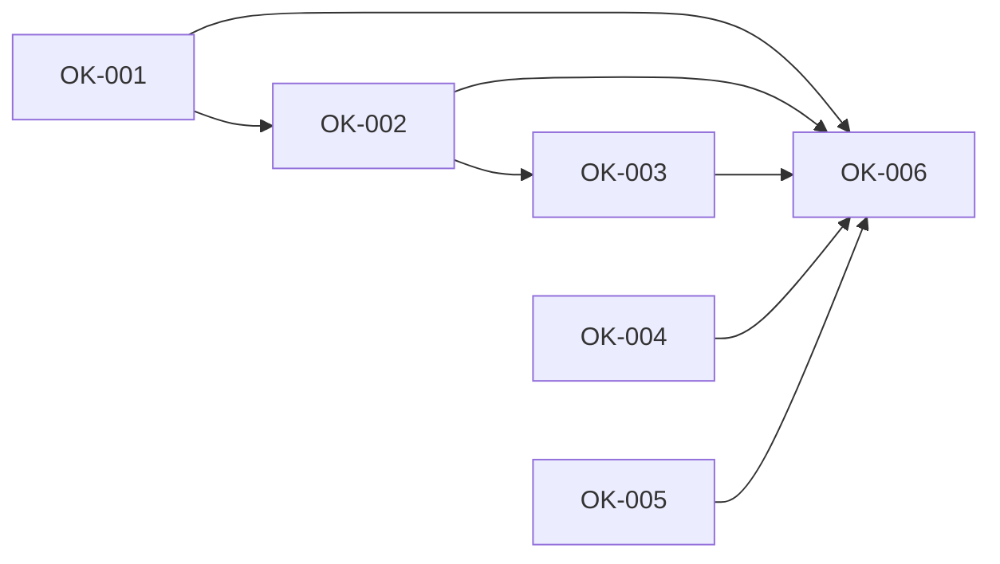

# Milestone 6: an OK continues the work

Status: outcome chosen by the owner on 2026-10-05 (planning stage 2). Scope and the prototype (seven scenes on the page's own styles, seen in the browser pane at phone and desktop width) agreed by the owner the same day (stage 3). Two Proposed ADRs, 009 and 010 (stage 4). Backlog prepared the same day (stage 5): OK-001 to OK-006. Delivery starts from `main` at `6547da9` plus the planning commits, on the integration branch `milestone6`; Milestone 5 left no unfinished task.

## Outcome

The owner gives an OK once and the work it interrupted carries on, demonstrated by three walks on the web page and on Android in which no message is typed twice: a new bot that needs the web runs after one tap on its card, a permission asked in the middle of a task continues the same request after Allow, and a first email through a connected app is sent after "Allow once".

- **Target user:** the owner, answering what waits for them: a card in a chat, in Needs you, or a notification on the phone.
- **Priority, chosen by the owner on 2026-10-05:** nothing typed twice. After any OK (a permission, a changed bot, a skill, a job) the interrupted request carries on by itself. Where the card is shown and how it is worded give way first.
- **Why it matters:** [the interaction audit](improvements/2026-10-05-bot-interaction-audit.md) found that an approval ends the work instead of pausing it, and that "Allow once" on a connected-app action cannot work once its run has ended. These are the two findings it calls critical that Milestone 5 left open. Nine of its readers met the first one independently. The evidence, read again at `6547da9`, is in [milestone6-research.md](../archive/product/milestone6-research.md).

## Journey

The owner starts where an OK is asked of them today: a card at the end of a chat, the same card in Needs you, a notification on the phone. No page, control or setting is added. What changes is what happens after the answer.

1. **They ask the Chief for a bot that needs the web, and to start it.** The Chief creates the bot and says the card waits. The card is under the Chief's reply, in the chat where they asked, in plain words: "Let News Watcher browse the web?". They press Allow. botdot tells the Chief in that chat; the Chief starts the bot's first run and says so in one line.
2. **They ask a bot for something it is not allowed to do.** The bot says what it needs and the card is under its reply. They press Allow. The bot is started again with their request, its own earlier reply and the news that they allowed it, and answers. They typed the request once.
3. **They ask a bot to send an email through a connected app.** The bot does not give up: its line reads "Waiting for your OK" and the card shows the email in plain words: To, Subject, Text. They press "Allow once". The same run sends it and says "Sent".
4. **They answer from the phone.** Allow in a notification carries on in the same way; what follows arrives as the next notification.
5. **They answer late, or not at all.** A bot that waited ten minutes for a connected-app OK says it has not sent it; the card stays, and a later OK starts the bot again. A card answered after the owner has since sent the bot another message that it answered, or after a day, only changes the setting: nothing runs twice.

Failure cases the journey covers: the bot is busy when the OK comes (the request waits its turn and starts by itself); the Chief is replying when the OK comes (it is told after that reply); botdot restarts while the work waits to start (it still starts, once); the bot was deleted meanwhile (the OK changes nothing and the card goes), or its jobs were all switched off (a job's run is not repeated; a request of the owner still carries on); a run asked for two things (it carries on once, after the last answer); a decline (nothing starts; a waiting run is told and goes on without the action); an app older than this server (its Allow carries on all the same, since botdot decides it; its cards keep today's words).

The prototype is `public/prototype-m6.html` on the branch `prototype/milestone6`, kept out of `main`: seven scenes on the page's own styles at phone and desktop width.

## Included capabilities

Protected first (the owner's priority: nothing typed twice):

1. **An ask remembers what it interrupted.** Every permission, skill and bot change records the run that asked for it, or the Chief's chat that did, and who started that run: the owner, the Chief, a teammate or a job.
2. **A bot carries on after the OK.** After a yes on a permission or a skill that a bot's run asked for, botdot starts the bot again with the original request and its files, the bot's earlier reply, and what was allowed, told to go on and not to repeat what is done. An owner's request carries on in the bot's chat. A run the Chief started is handed back to the Chief, as a tool install is today. A teammate's request carries on and its answer goes back to the teammate as a message. A job's run is repeated once, under that job's rules for reports.
3. **The Chief carries on after the OK.** After a yes on a bot change, a skill, a script job or a Board tile that the Chief asked for, botdot tells the Chief in the chat that asked. The Chief does what waited for it and says so in one line; when its turn fails, botdot's own line stands. A decline starts no turn: it is a line of botdot's that the Chief reads with the owner's next message.
4. **A connected-app action waits.** `connector_run` holds the run for up to ten minutes, as a missing login does. "Allow once" lets the same run go on; a decline tells it. The run's line reads "Waiting for your OK". When the wait ends without an answer the bot says so, and the card stays.
5. **A late OK still works.** "Allow once" after the run stopped waiting starts the bot again as in capability 2. That OK counts once, for the run it starts, this action and these exact arguments; anything else asks again. A card whose run stopped waiting goes when the owner sends that bot a new message, or after 24 hours: an OK for one run has nothing left to apply to.
6. **Nothing runs twice.** A refused request carries on unless the owner sent that bot a message after it: a later request that was refused the same carries on in its place, and where the later message was not refused nothing that was refused before it carries on. The same for the Chief once the owner wrote in that Chief chat after it asked. An OK only changes the setting when the ask is older than 24 hours or the bot is gone. Paused, all its jobs switched off, stops a job's run from being repeated, not a request the owner sent the bot or gave the Chief. A run that asked for several things carries on once, after the last one is answered. (Reworded on 2026-10-06: Owner decisions.)
7. **What carries on survives.** Work that waits behind a busy bot uses the bot's queue. A turn that waits behind a Chief reply is kept on disk, so a restart no longer loses it.

Give way first:

8. **The card where the owner asked.** A bot change the Chief asked for shows under the Chief's reply in its chat, and in Needs you; one answer settles both. The card says who carries on.
9. **One card per grant.** A refused tool adds no second card while a bot change for the same permission waits, and the other way round; approving it no longer fails with "The bot changed since this proposal".
10. **Cards in plain words.** A connected-app action shows its fields as rows, not policy text and JSON. A changed text shows the old lines struck and the new text, as a shared-memory change does. The title of a bot change names what changes ("Let News Watcher browse the web?").
11. **The same on Android:** the cards in the Chief's chat, the rows of a connected-app action, the line "Waiting for your OK", the words after an answer.

With them: `docs/api.md` and `features` for what an ask newly carries and what an answer returns, `docs/archive/security-issue-90.md` for the one-use grant, README where it describes approvals, and the Chief's and the bots' instructions.

## Owner decisions

Taken on 2026-10-05, on the prototype in the browser pane at phone and desktop width:

- **The button stays "Allow".** On a permission a bot asked for in the middle of a request, one line on the card says what follows: "It carries on with … when you allow it." A button reading "Allow and carry on" was shown and not chosen.
- **A late OK starts the bot again.** "Allow once" on a connected-app card, given after the bot stopped waiting, starts the bot again and counts once: for the run it starts, this action and these exact arguments. This changes the rule of `docs/archive/security-issue-90.md`, "A one-use grant binds the current run, action and exact arguments": the run the OK starts takes the place of the current run. Keeping the rule, with a late OK refused, was not chosen.
- **The Chief gets a turn after every OK on something it asked for:** a changed bot, a skill, a script job, a Board tile. A turn only after a changed bot and a skill was not chosen.
- **The seven scenes are approved as drawn:** the card under the Chief's reply, the line that says who carries on, "Waiting for your OK" on a held run, the rows of a connected-app action, the cards that only change the setting, Needs you, and the notifications.
- **The scope, the exclusions and the test budget** are agreed as written here, the give-way capabilities 8 to 11 included.

Taken on 2026-10-06, during the acceptance, on two findings of the milestone review. They change capability 6 and scenario A10, and OK-010 delivers them:

- **The latest refused request carries on.** The case: a job's run is refused the web at 7:00 and the card appears; at 8:00 the owner asks the bot something; it is refused the same and joins the card; Allow started nothing, because the 8:00 message came after the card, and the owner typed it again. The owner chose: "The latest refused request: A refused request carries on unless you sent the bot a message after it. In the example your 8:00 request carries on and the job's 7:00 run does not. If your later message was not refused (the bot did it), nothing carries on, as agreed." "Keep A10 as written" was not chosen.
- **Paused stops a job's run from being repeated, not a request the owner sent the bot or gave the Chief.** OK-001 read "the bot is paused" as the bot's state of that name, a bot that has jobs and all are switched off, and such a bot carried on with nothing. The owner chose: "Yes, my own request carries on: Paused stops a job's run from being repeated, not a request you sent the bot yourself or through the Chief." "No, keep as built", a paused bot that carries on with nothing, was not chosen. That a teammate's request to a paused bot carries on too is the reading of the session that delivered OK-010, not the owner's words.

Two readings of the first decision by the session that delivered OK-010, not the owner's words, for the owner to confirm or change:

- "After it" is after the request was refused, not after it was sent, as for the Chief's chat since OK-008: a message the owner sends while a request is still going is not after it. Two requests that overlap (the second sent before the first was refused) can therefore both carry on, as they did before this decision.
- Each refused run counts for itself. After the 8:00 message that the bot answered, the job's next run at 9:00 is refused the same and joins the card: the owner sent nothing after that run, so Allow repeats the job once, for the 9:00 run. "Nothing carries on" holds for what was refused before the message.

## Exclusions

- A refused tool that waits inside the same run, as a connected-app action does. A permission or a skill carries on in a new run; the work before the refusal is not kept open.
- One rule for a busy bot or Chief: the owner's own message is still refused by a replying Chief and still starts a second run of a busy bot. A late result still arrives as the bot's raw message.
- A bot's conversation context beyond what capability 2 hands it: the thin history and the answer without its question stay.
- Staged changes: a changed job or tile still stops until approved, its card still says "added", and Decline still deletes it.
- A shared voice and progress words written on the server.
- Carrying on after a bot's own proposal that interrupted nothing: a job, a tile or a change to its instructions that a bot suggests.
- Taking back an ask, and the week a declined permission is remembered.
- A tool install, a login, a payment and a bot's plan for the Chief: they carry on today and stay as they are.
- New controls, pages or settings; anything that shows costs; the Mac app.

## Acceptance scenarios

- **A1. A new bot.** Asked for a bot that browses the web and to start it, the Chief's chat shows the card; after Allow the Chief gets a turn in that chat and the bot has a run. No message is sent in between.
- **A2. A permission in the middle.** A bot's run is refused a tool; after Allow on its card the bot has a new run whose prompt holds the original request, its earlier reply and what was allowed. The owner's chat shows one request and one answer.
- **A3. A skill** a bot asked for carries on the same way after Install.
- **A4. Through the Chief.** A run the Chief started is refused a tool; after Allow the Chief is told in the chat that started it.
- **A5. A teammate's request** that was refused carries on after Allow, and its answer reaches the asking bot as a message from the bot.
- **A6. A job's run** that was refused is repeated once after Allow; a watch job with nothing new stays silent.
- **A7. A connected-app action waits.** The run is held; "Allow once" lets the same run finish the action, once. Decline: the same run ends and says it was not allowed.
- **A8. No answer.** After ten minutes the run ends saying it waited; the card is still there and says the bot stopped waiting.
- **A9. A late OK.** "Allow once" on that card starts the bot again; the same action with the same arguments goes through once; other arguments make a new card and a new wait.
- **A10. Asked again.** A refused request carries on unless the owner sent the bot a message after it. That later message was refused the same and joined the card: Allow starts one run, for the later request, and none for what asked before it (after a job's run refused at 7:00 and the owner's request refused at 8:00, the 8:00 request carries on and the job is not repeated). That later message was not refused, the bot did it: nothing that was refused before it carries on, and Allow changes the setting and starts no run. The same for a card older than 24 hours. (Reworded on 2026-10-06: Owner decisions.)
- **A11. Two asks, one run.** A run that was refused two tools carries on once, after the second answer; one allowed and one declined still carries on, told which.
- **A12. Busy.** With the bot working, the OK's run starts when it is free. With the Chief replying, it is told after that reply.
- **A13. Restart.** botdot stopped and started while the work waits behind a busy bot or a replying Chief: the bot's run and the Chief's turn still start, once.
- **A14. Decline.** Nothing starts. In the Chief's chat a line says it was declined; the Chief's next turn knows.
- **A15. One card.** A refused tool while the Chief's change for the same permission waits: one card; Allow settles both; no "The bot changed since this proposal".
- **A16. Where the card is.** A bot change the Chief asked for is under its reply in the Chief's chat and in Needs you, on the web page and on Android; answered in one, it goes from the other.
- **A17. Plain words.** The card of a connected-app action shows rows; a changed main assignment shows what goes and what comes. No card shows JSON.
- **A18. The phone.** Allow in a permission's notification carries on as A2.
- **A19. Old and new.** An app from Milestone 5 against this server: its Allow carries on; its cards and notifications keep their words. This app against a Milestone 5 server: it shows no "carries on" and behaves as before.
- **A20. Real use.** On the owner's own botdot server and phone, with real Claude: A1, A2 and A7.

## External prerequisites

None. A7 to A9 in real use (A20) need an app the owner has connected. A20 needs the owner's server and phone.

## Evidence limits

- A1 to A19 run against a stand-in for Claude and a stand-in for a connected app, so they show what botdot starts and with which words, not what a model then does.
- That a bot started again does not repeat what it already did rests on its instructions and on what it is handed; seen only in A20 and in use.
- That the Chief starts a bot's first run after being told is its choice, as after a tool install today.
- A run that waits ten minutes holds a Claude process for that time. How often the owner answers within ten minutes is not known.
- Android is checked on one phone and the emulator.

## Test budget

- Test data: one owner, four bots (one with a connected app, two that may message each other, one with a job), one Chief chat, a stand-in for Claude and one for a connected app.
- Task gate: at most 3 minutes. Full gate: at most 30 minutes. Unchanged in backlog.json. A test of the ten-minute wait sets the wait short; none waits it out.

## Task dependencies

Scenarios to tasks: A2, A3, A5, A6, A10, A11 and the bot's part of A4, A12 and A13 are delivered and tested by OK-001; A1, A14, A15 and the Chief's part of A12 and A13 by OK-002; A7, A8 and A9 by OK-003; A16 and A17 by OK-002 and OK-003 (what the server sends) with OK-004 (the web page) and OK-005 (Android); A18 by OK-001, since botdot decides what follows a yes wherever it is given, with OK-005; A19 and A20 by OK-006, which walks them all on the assembled product. A10 as reworded on 2026-10-06, and a paused bot, by OK-010.

Six tasks. The server's work is three, in a line, because all three change the asks route and `lib/asks.js`: OK-001 is the carrying on itself and the contract both apps read; OK-002 adds the Chief's chat as a second origin and reworks which cards exist; OK-003 changes how a connected-app call is answered and a recorded security rule, and is reviewed on its own. The web page and the Android app are two codebases, each built against the fields the server plans write down, so neither waits for the server. OK-006 is the acceptance. OK-001 is the first task that changes what the owner sees: it is delivered alone and ends with the first look.

## First look

On 2026-10-05 the owner looked at OK-001 on a test botdot server started from `milestone6` at `f1f4281`, with real Claude: a bot without web access was asked for a headline, said what it lacked, and after Allow on its card carried on with the same request. The owner answered: "Approved". No change was asked for. Left open, for the acceptance: a bot whose jobs are all switched off counts as paused and does not carry on, also with the owner's own request. Decided on 2026-10-06 (Owner decisions): the owner's own request carries on, and OK-010 changes it.

## Added features

None.
