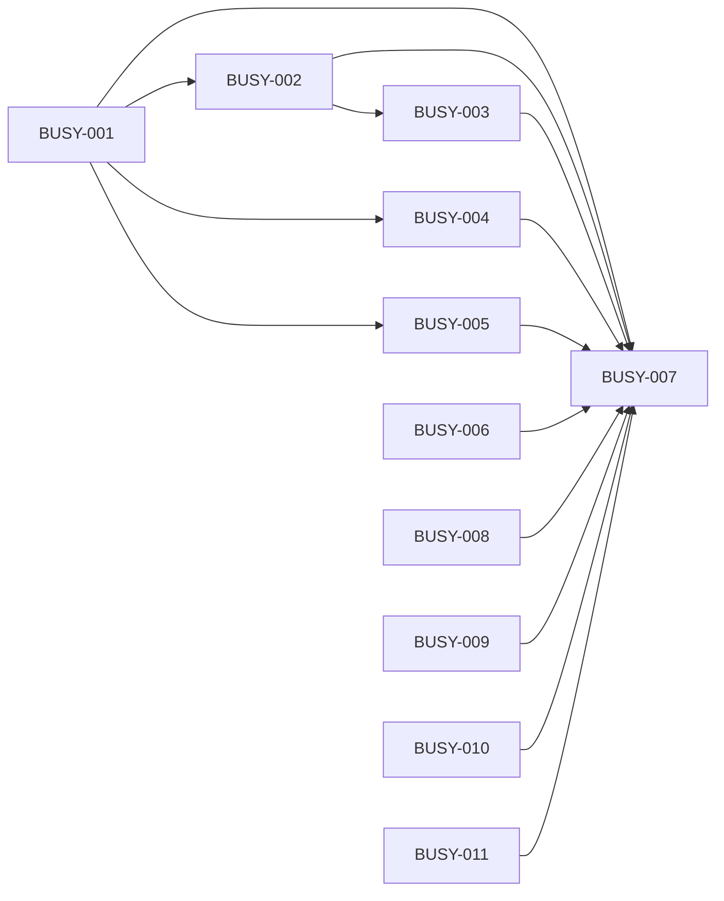

# Milestone 7: busy and stopped

Status: outcome chosen by the owner on 2026-10-06 (planning stage 2). Prototype (seven scenes on the page's own styles, seen in the browser pane at phone and desktop width) and the scope agreed by the owner the same day (stage 3). Two Proposed ADRs, 011 and 012 (stage 4). Backlog prepared the same day (stage 5): BUSY-001 to BUSY-007. Delivery starts from `main` at `ee91cb3` plus the planning commits, on the integration branch `milestone7`; Milestone 6 left no unfinished task.

## Outcome

The owner can write to a bot or to the Chief of Staff while it works, and stop work with one tap, demonstrated by four walks on the web page and on Android: a message sent to a working bot waits and then runs alone, never beside the first; a message sent to a replying Chief is kept and answered next; Stop in the Chief's chat ends the bot run that turn started, and the run says who stopped it; a job that fails three times in a row is said once, and not at night.

- **Target user:** the owner, writing to a bot or to the Chief while it is still working, pressing Stop, and reading what their scheduled jobs did.
- **What it covers, chosen by the owner on 2026-10-06:** all four parts of "Busy and stopped". One rule for busy: the owner's message waits its turn, for a bot and for the Chief. Stop stops what it started and botdot keeps who stopped. A late result becomes a short turn of the Chief. Failures are said once and not at night. "Busy and Stop only" and "Failure hygiene only" were offered and not chosen.
- **Priority, chosen by the owner on 2026-10-06:** the message gets through. It is never refused and never starts a second run beside the first: it is kept and starts when the bot or the Chief is free. Wording, the late result and failure hygiene give way first. "Stop does what it says" and "No noise from failures" were offered and not chosen as the first priority.
- **Why it matters:** [the interaction audit](improvements/2026-10-05-bot-interaction-audit.md) found three rules for "busy": the Chief refuses, a bot starts a second run that cannot see the first, Android blocks. A correction never reaches the work it corrects. It is the largest finding the audit left open after Milestones 5 and 6, and [Milestone 6](milestone6.md) excluded it by name. The evidence, read again at `ee91cb3`, is in [milestone7-research.md](milestone7-research.md).

## Journey

The owner starts where they are every day: a bot's chat, a Chief of Staff chat, a bot's jobs, the phone's notifications. No page, control or setting is added. What changes is what happens when they write to something that is working, when they press Stop, and when a job fails.

1. **They write to a bot that is working.** The message box still has Send. Their message appears in the chat, faded, with "Waits until Fleet Doctor is free" and "Take back" under it. When the bot has finished, the message starts by itself, alone, and the bot sees its own first answer. Nothing runs beside anything.
2. **They change their mind.** "Take back" puts the text and the files in the box again and nothing waits.
3. **They see the bot doing the wrong thing.** They write what they meant and press Stop, the word at the end of the working line. The run ends, "You stopped this run before it finished.", and their waiting message starts at once.
4. **They write to the Chief while it replies.** The same: Send stays, the message waits, faded, and starts when the reply ends. When the Chief was only waiting for a bot, botdot ends that wait: the Chief says in one line that the bot is still on it, and the owner's message is answered next. The bot works on.
5. **The bot finishes later.** The Chief gets a short turn in that chat and says what the bot found. The bot's whole answer stays in the bot's chat.
6. **They press Stop in the Chief's chat.** The Chief's reply ends, and so does the bot run that reply started: "You stopped this reply. Web Surfer's run was stopped too."
7. **Something else ended a run.** The run says who: the Chief, a sign-out of Claude, or botdot after 60 minutes.
8. **A job fails, and fails again.** The first failure is told as today. The next ones in a row are not. At night nothing rings: when quiet hours end, one line says how often it failed. When the job works again, its report arrives as always.
9. **A job's time passed and nothing came.** Under the job one line says why: botdot was off, its last run was still going, the bot had too much waiting, Claude was signed out. The Chief can read the same line when asked.
10. **Claude is signed out.** One line stands above the message box until they sign in, and the phone says it once. Jobs are not started meanwhile.

Failure cases the journey covers: botdot restarts while a message waits (it still starts, once, after the cut-off run); "Take back" tapped as the message starts (it has started, and the app shows it running); the bot waits for the owner's OK on a connected-app action (the message waits behind it; Allow, Decline or Stop frees the bot); more than ten of the owner's messages wait for one bot or chat (the next is refused and stays in the box, as a failed send does); the Chief's short turn for a late result fails (botdot's own line with the bot's text stands, as today); the run a Stop should also end has already finished (nothing is said about it); the same message sent twice with its key (it waits once); an app older than this server and an app newer than its server (below).

The prototype is `public/prototype-m7.html` on the branch `prototype/milestone7`, kept out of `main`: seven scenes on the page's own styles at phone and desktop width.

## Included capabilities

Protected first (the owner's priority: the message gets through):

1. **A bot does one thing at a time.** A message of the owner to a bot that has a run going, or a run that waits for the owner's OK, is kept on the botdot server with its files and starts when the bot is free. It is never refused for being busy and never starts beside another run. The same for a run the Chief asks for and for a Board tile that asks a bot.
2. **The Chief takes a message while it replies.** A message of the owner to a Chief chat whose reply is going is kept, with its files, and starts when the reply ends. A quick answer and a plan's Approve wait the same way.
3. **The owner's messages come first, and survive.** They start before anything else that waits for that bot or chat, in the order they were sent, each as its own run or turn. They are on disk before the server answers, and start once after a restart. At most ten wait per bot and per chat; one more is refused with a sentence and stays in the box.
4. **What waits is shown, and can be taken back.** The server hands out each bot's and each chat's waiting messages; both apps draw them at the end of the chat, faded, with what they wait for. "Take back" removes one and returns its text and files to the box, on any device.
5. **Send stays.** The message box has Send in every chat, working or not, on the web page and on Android. Stop is the word at the end of the working line, as in a bot's chat on the web page today: new in the Chief's chat, and on Android in both.
6. **The Chief stops waiting when the owner writes.** While a Chief turn only waits for a bot's run, a message of the owner ends that wait: the Chief closes its turn in one line and the owner's message is next. The bot's run goes on.

Then:

7. **Stop ends what it started.** Stop in a bot's chat ends the run that is going. Stop in the Chief's chat ends the reply and every bot run that reply started and that has not finished, also one that still waited to start, and says so. After Stop the owner's waiting message starts at once.
8. **Who ended a run is kept and said.** The owner, the Chief, a sign-out of Claude, or the time limit: the server keeps it with the run and words the sentence from it, and both apps draw that sentence; Android no longer writes its own "Stopped.". A run that a sign-out or the time limit ended counts as one that did not finish, not as one the owner stopped: the Chief hears of it and its card stays.
9. **A time limit.** A bot's run and a Chief's turn are ended after 60 minutes, with their own sentence. It is a fixed number, not a setting.

Give way first:

10. **A late result is a short turn of the Chief.** When a run the Chief started ends after the Chief's turn, botdot tells the Chief in that chat how it ended, marked as not from the owner, and the Chief says it in a few lines. Not when the owner stopped that run, and not when the Chief already read how it ended. When the turn fails, botdot's own line with the bot's text stands.
11. **A failing job is said once.** The first failed run of a scheduled job is told as today. Further failed runs in a row are quiet: no dot, no notification, folded in the chat like a run with nothing to report. A run that works again ends the row.
12. **Not at night.** A scheduled job's failure in quiet hours is held. When quiet hours end, one line says how often it failed since.
13. **Why a job did not run.** Whenever a job's time passes without a run, botdot keeps why: botdot was off, its last run was still going, too much was waiting, Claude was signed out. The server writes the job's line, with how often it failed in a row, and both apps draw it under the job. The Chief reads it too. "Run now" says the truth on Android when the job waits.
14. **Claude signed out, said once.** While Claude is signed out both apps show one standing line that leads to the sign-in, and the phone gets one notification. Jobs are not started meanwhile and say so; a one-time job waits for the sign-in, up to a day.

With them: `docs/api.md` and `features` for what the server newly sends and accepts, `docs/api.md` where it says a bot can have two runs going, README where it describes writing to a bot and scheduled jobs, and the Chief's instructions.

## Owner decisions

Taken on 2026-10-06, on the prototype in the browser pane at phone and desktop width:

- **Stop is on the line.** The word Stop at the end of the working line, in every chat on the web page and on Android; the box always has one button, Send. A red Stop button in the box beside Send was shown (scene 1b) and not chosen.
- **After Stop, the waiting message starts at once.** "Back in the box", where nothing starts until Send is pressed again, was not chosen.
- **A failing job: once, and not at night.** The first failure rings, the next ones in a row do not; at night nothing rings and one line when quiet hours end says how often it failed. "Every failure by day", with only the night changed, was not chosen.
- **The scope is agreed as written here** ("Approve as written"): the fourteen capabilities, the exclusions, 60 minutes as the limit, ten waiting messages at most, and the unchanged test budget. "The smaller cut", capabilities 1 to 9 only, was offered and not chosen.
- **The other scenes are approved as drawn:** the Chief ends its wait when the owner writes; a late result is a short turn of the Chief; one Stop ends the Chief's reply and the bot's run; the four sentences for who ended a run; 60 minutes as the limit; the line under a job that did not run; the standing line for a signed-out Claude.

## Exclusions

- A message that reaches a run or a turn already going. It waits for the next one; steering a turn in progress needs a Claude process that stays open and its own ADR.
- A shorter wait of the Chief for a bot. The wait stays at 240 seconds, 540 at most: it no longer locks the chat, since the owner's message ends it.
- Stop that follows a hand-off: a teammate's run that the stopped run asked for goes on. So does a run an earlier turn of the Chief started.
- Catching up a repeating job after botdot was off or Claude was signed out. It says why it did not run, and runs at its next time.
- A notification for a job that did not run; switching a job off after it failed many times; a turn for the Chief to repair a failing job before the owner hears.
- Reordering waiting messages, editing one in place, "send now", and merging several into one run.
- Failures that are not a scheduled job's: the owner's own request that fails is told at once, as today. Errors the server answers with as they were thrown stay as they are.
- What a Board tile says after "Asked X", beyond saying that it waits.
- A bot's conversation context; staged job and tile changes; a shared voice and one wording layer on the server, beyond the job's line and the sentences this milestone adds.
- New controls, pages or settings; anything that shows costs; the Mac app.

## Acceptance scenarios

- **B1. A busy bot.** With a run going, the owner's message starts no run: it is listed as waiting. When the run ends it starts, alone, and its prompt holds the first run's reply.
- **B2. Take back.** A waiting message that is taken back starts nothing; its text and files come back. Taken back as it starts: it has started, and the answer says so.
- **B3. Shown everywhere.** The waiting message is in that bot's chat on the web page and on Android, also on a device that did not send it, and goes from both when it starts or is taken back.
- **B4. First, and in order.** With a job and a teammate's message already waiting, the owner's message starts before them; two messages of the owner start in the order sent, each as its own run.
- **B5. Too many.** The eleventh waiting message is refused with a sentence and stays in the box.
- **B6. Restart.** botdot stopped and started with a message waiting: the cut-off run says so, and the message starts, once. The same for a Chief chat.
- **B7. The Chief and a tile.** `run_bot` and a Board tile on a busy bot wait their turn; the Chief is told that it waits and can still wait for its result; the tile says it waits.
- **B8. A held bot.** A bot that waits for the owner's OK on a connected-app action is busy: the message waits, and starts after Allow, Decline, Stop or the end of the wait.
- **B9. A replying Chief.** The owner's message to a chat whose reply is going is not refused: it waits, and its turn starts when the reply ends. The message key still makes a repeat count once.
- **B10. The Chief stops waiting.** With the Chief's turn waiting for a bot's run, the owner's message ends the wait: the turn ends, the owner's turn starts, the bot's run is still going.
- **B11. A late result.** That run ends: the Chief gets one turn in that chat, whose prompt says how the run ended and that the owner did not write. Not when the owner stopped the run; not when the Chief had read its end. A failed turn leaves botdot's line with the bot's text.
- **B12. Send stays.** On the web page and on Android, in a bot's chat and the Chief's, the box has Send while it works and the working line ends in Stop.
- **B13. Stop, then the message.** Stop with a message waiting: the run is stopped and the message starts at once. In the Chief's chat the same.
- **B14. One Stop.** Stop in the Chief's chat ends the reply and the run that reply started; the reply says the run was stopped too; a run that had finished is not named; a run that still waited to start never starts.
- **B15. Who ended it.** A run the owner stopped, one the Chief stopped, one a sign-out ended and one the time limit ended each carry who did, and each reads its own sentence on the web page and on Android.
- **B16. Not the owner's doing.** A run that a sign-out or the time limit ended is passed to the Chief's chat that started it, and its connected-app card stays.
- **B17. The limit.** A run and a Chief turn that go on past the limit are ended with the limit's sentence; what waits behind them starts.
- **B18. Said once.** Of three failed runs in a row of one job, the first counts as new and the next two are quiet; a run that works after them is reported as always, and a failure after that counts as new again.
- **B19. Not at night.** A job's first failure in quiet hours is not announced; when they end, one line says how often it failed since. A failure of the owner's own request in quiet hours is told at once.
- **B20. Why it did not run.** After botdot was off over a job's time, with its script still running, with ten things waiting, and with Claude signed out, the job's line says which, on the web page, on Android and to the Chief.
- **B21. Signed out.** With Claude signed out: both apps show the standing line, the phone is told once, no job starts, and a one-time job runs after the sign-in.
- **B22. Old and new.** An Android app from Milestone 6 against this server: it still shows Stop in the box while a bot works; a reply from a notification to a busy bot or a replying Chief waits its turn and counts as sent; failures ring once, because the server decides what is new. This app against a Milestone 6 server: its box behaves as before, because the server does not announce `message-waits`.
- **B23. Real use.** On the owner's own botdot server and phone, with real Claude: B1, B10 with B11, and B14.

## External prerequisites

None. B23 needs the owner's server and phone.

## Evidence limits

- B1 to B22 run against a stand-in for Claude, so they show what botdot starts, in which order and with which words, not what a model then does.
- That the Chief closes its turn in one line when its wait is ended, and that its short turn for a late result is short and right, rests on its instructions; seen only in B23 and in use.
- 60 minutes is a number chosen on the prototype. How long the owner's longest runs take is not measured; a run that needs longer is ended.
- How often the owner writes to a working bot, and how often a job fails in a row, is not measured.
- Stop ends a Claude process; what that process had already done stays done.
- Android is checked on one phone and the emulator.

## Test budget

- Test data: one owner, four bots (one with an AI job and a script job, two that may message each other, one the Chief runs), one Chief chat, a stand-in for Claude that can be held.
- Task gate: at most 3 minutes. Full gate: at most 30 minutes. Unchanged in backlog.json. The task gate stood at 2:03 at the end of Milestone 6, 2:32 at worst: a test of the 60-minute limit, of quiet hours or of a streak sets its clock or its limit short, and none waits a real minute.

## Task dependencies

Scenarios to tasks: B1, B2, B4, B5, B7, B8 and the bot's part of B3 and B6 are delivered and tested by BUSY-001; B9, B10, B11 and the Chief's part of B3 and B6 by BUSY-002; B13 to B17 by BUSY-003, with the order after Stop that BUSY-001 and BUSY-002 give it; B18 to B21 by BUSY-004. What the owner sees of them, B3, B12, B13, B15, B20 and B21, is drawn by BUSY-005 (the web page) and BUSY-006 (Android); B22 by BUSY-006 with the names BUSY-001 fixed for an older app. B23, and every scenario once more on the assembled product, by BUSY-007.

Seven tasks. The server's work is four, because each is reviewed on its own and each is more than an hour: BUSY-001 is the queue and the contract both apps read; BUSY-002 is the Chief's chat, in another file with other rules; BUSY-003 changes what "stopped" means for three existing rules and gets its own ADR; BUSY-004 is the scheduler and the reports, and needs only BUSY-001. The first three are a line because each builds on the order the one before gives to what waits. The web page and the Android app are two codebases. The Android app is built against the fields the server plans write down and waits for none; the web page waits for BUSY-001 because it is the first task that changes what the owner sees, and its first look needs a message that really waits. BUSY-007 is the acceptance.

Added during delivery, on 2026-10-06: BUSY-008, from the review of BUSY-002: the files of a late result are drawn under the Chief's reply in both apps. BUSY-009, from the milestone review: a sign-in check that could not tell is not taken for signed out, Stop keeps a script job's AI follow-up from starting, and three smaller gaps. BUSY-010, from the review of that fix: a sign-out that botdot still holds is said to every app that connects, also when the check cannot tell. BUSY-011, from the review of that one and by the owner's decision of 2026-10-06 ("fix them"): a sign-in or a sign-out that could not be checked is said in both apps.

## First look

BUSY-005, 2026-10-06. The owner looked at BUSY-005 on a test botdot server started from `milestone7` at `7e442b1`, with real Claude, on the web page in the browser pane at phone width: a message to a working bot stood faded under the working line with "Waits until News Reader is free" and "Take back", with Stop at the end of the line. The owner answered: "approved". No change was asked for.

Not seen at that look: the Chief's chat taking a message while it replies (BUSY-002), who ended a run (BUSY-003), the jobs' lines (BUSY-004), Android.

## Added features

- 2026-10-06: The owner can follow up on a bot's reply ("Send it", a tapped "Yes", "why did you do that?") and the bot answers from what the owner saw in that chat, demonstrated by the prompt of the follow-up's run holding the bot's last reply in full, the question a tapped answer answers, and the real sender and run number of each earlier exchange. Task: CHAT-001. From finding 5 of [the interaction audit](improvements/2026-10-05-bot-interaction-audit.md). The owner lifted the exclusion "a bot's conversation context" for this feature and approved the plan as written: the server alone changes, a tapped answer is recognized by its words, and the bot is handed its last 4 exchanges with the owner and the last 2 with anyone else over 7 days, the newest reply whole up to 20,000 characters. "Smaller history", 3 and 1 exchanges with the newest reply cut at 6,000 characters, was offered and not chosen.
