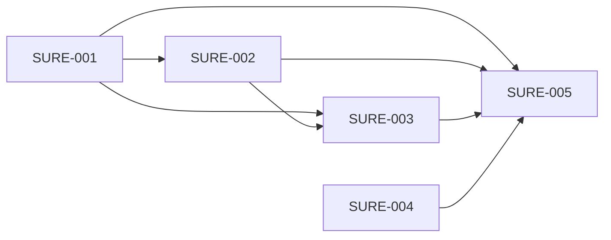

# Milestone 8: nothing approved unseen, no question lost

Status: outcome chosen by the owner on 2026-10-06 (planning stage 2). Prototype (seven scenes on the page's own styles, seen in the browser pane at phone width) and the scope agreed by the owner the same day (stage 3). One Proposed ADR, 013 (stage 4). Backlog prepared the same day (stage 5): SURE-001 to SURE-005. Delivery starts from `main` at `57336cb` plus the planning commits, on the integration branch `milestone8`; Milestone 7 and the feature after it left no unfinished task.

## Outcome

The owner can trust what they approve and never miss a bot's question, demonstrated by four walks on the web page and on Android: a change to an approved job leaves the job running as it was until the owner answers, and Decline keeps the job; "Approve all" approves nothing that runs a script; a bot whose reply ends in a question shows as asking in the list and on the phone, also when the question came from a scheduled run; and a bot whose own proposal the owner approved is told so and carries on.

- **Target user:** the owner, answering cards in Needs you and on the phone, and reading the list of bots to see who waits for them.
- **What it covers, chosen by the owner on 2026-10-06:** group 1 of [the research note](../archive/product/milestone8-research.md), "Approvals you can trust", and the open-question part of its group 2. Recommended as the two places where something is approved unseen or silently lost; the owner answered "OK do it". The rest of group 2 (a Board tile that follows its run, "Try again", scroll-back on the web page, "Can't reach botdot" inside Android's chats), group 3 ("One voice") and group 4 ("The Chief as helper") were named and are not part of this.
- **Priority:** nothing approved unseen and nothing lost come first: "Approve all" without scripts, a Decline that says what it does, and a question that is never a quiet run. Staged changes and a bot's own proposal that carries on give way first. Proposed with the recommendation and agreed with the scope on 2026-10-06.
- **Why it matters:** [the interaction audit](improvements/2026-10-05-bot-interaction-audit.md) lists, under confirmations that are missing, "Approve all" over script jobs and Android's Decline on a job, and as its structural change 6 the staged changes of a job and a tile. The readers of 2026-10-06 found one thing worse than the audit said: a scheduled run whose reply is only a question is stored empty and counts as a run with nothing to report, so the owner never sees it. The evidence, read again at `57336cb`, is in [milestone8-research.md](../archive/product/milestone8-research.md).

## Journey

The owner starts where they are every day: Needs you, a card in a chat, the phone's notifications, the list of bots. No page, control or setting is added. What changes is what an answer does, and what the list says.

1. **A bot or the Chief changes a job they approved.** The job keeps running as they approved it. The card says it is a change and shows the old text struck and the new one, and the old time beside the new. "Approve the change" switches the job over. "Keep as it is" drops the change, and the job runs on.
2. **A new job they do not want.** They decline it. The card says the job was removed. No question in between, and the same words on the web page, on Android and in the notification.
3. **Several things wait.** "Approve all" approves what a card shows in words. A job or a tile that runs a script stays, with one line that says so, and is answered on its own card.
4. **A bot asks them something.** In the list the bot's line reads "Asks: …" with a mark, until they answer. On the phone the notification says "Mail Sorter asks" and the question.
5. **The question came from a job's run.** It arrives like any reply with a question, also from a job that otherwise reports only when it has something. At night it waits for the morning, as a report does.
6. **A bot proposes a job, a tile or a change to its own instructions.** The card says the bot carries on. After the yes botdot starts the bot again with the request, its reply and what was approved, and the bot closes it: "It's set."

Failure cases the journey covers: a second change to a job while the first still waits (the card shows the newest against the approved one; one answer settles it); the owner edits the job themselves while a change waits (their version is approved at once and the waiting change goes); the job is removed while its change waits (the card goes); botdot restarts with a change waiting (the approved version still runs, the card is still there); "Approve all" tapped with only scripts waiting (the button is not shown); the owner answers a question by typing instead of tapping (the mark goes: any message of theirs to that bot answers it); a bot asks again in its next reply (the mark stays, with the new question); a question from a run the Chief started (it goes to the Chief with its answers, not to the owner as buttons nobody sees); a yes on a bot's proposal given after the owner has written to that bot again, or after a day (it only changes the setting: nothing runs twice, the rule of [ADR 009](../adr/009-the-botdot-server-carries-on-after-an-ok.md)); an app older than this server and an app newer than its server (below).

The prototype is `public/prototype-m8.html` on the branch `prototype/milestone8`, kept out of `main`: seven scenes on the page's own styles at phone and desktop width.

## Included capabilities

Protected first (nothing approved unseen, nothing lost):

1. **"Approve all" approves no script.** On the web page and on Android it approves the waiting AI jobs and shared-memory changes. A job that runs a script is left out and named in one line, and the button's label counts what it approves ("Approve 3"). With nothing but scripts waiting there is no button.
2. **Decline says what it does.** The button on a new job or tile reads "Decline and remove", on the card, in the chat and in the notification, and the card then reads "Declined and removed": the server's words, the same on the web page and on Android. The web page's "Remove this job?" goes.
3. **"Always allow this action" asks first on Android**, as on the web page.
4. **A question is never quiet.** A scheduled run whose reply holds a question for the owner is delivered as a reply, whatever the job's report setting, and is held through quiet hours as a report is.
5. **"Asks you" is a state the server hands out.** A bot whose newest reply to the owner holds an open question carries that question in the list of bots and in the feed. Both apps draw "Asks: …" with a mark on the bot's line, and the phone's notification reads "<bot> asks". It ends when the owner sends that bot a message or taps an answer.

Then:

6. **A question in a run the Chief started goes to the Chief.** The Chief is handed the question and its answers as text. The bot's chat shows no buttons for a question the owner was not asked.

Give way first:

7. **A change to an approved job waits beside it.** The approved version keeps running until the owner answers. The card says "a change", shows what changes, and its no reads "Keep as it is". What asks again is unchanged: the fields that ask today.
8. **The same for a Board tile** whose script was changed: the approved tile keeps working until the answer.
9. **A bot's own proposal carries on.** After a yes on a job, a tile or a change to its instructions that a bot proposed during the owner's request, botdot starts the bot again as after a permission since Milestone 6, under the same rules: once, not after a newer message of the owner, not after 24 hours.

With them: `docs/api.md` and `features` for what the server newly sends and accepts, README where it describes approving jobs, and the Chief's and the bots' instructions.

## Owner decisions

Taken on 2026-10-06, on the prototype in the browser pane at phone width:

- **The button says it.** Declining a new job reads "Decline and remove", then "Declined and removed" (scene 2b). A button that stays "Decline", with the card saying afterwards that the job was removed (scene 2a), was not chosen.
- **"Approve all" stays, without scripts** (scene 3a). Removing the button, with every card answered by itself (scene 3b), was not chosen.
- **The other scenes are approved as drawn:** a changed job keeps running, its card says "a change" and its no reads "Keep as it is"; a bot that asks shows "Asks: …" with a mark in the list, and the phone says "<bot> asks"; a bot carries on after the yes on its own proposal.
- **The scope is agreed as written here** ("Approve as written"): the nine capabilities, the exclusions and the unchanged test budget. "The smaller cut", capabilities 1 to 6 only, was offered and not chosen.

Not seen by the owner: the prototype at desktop width. The scenes are single cards and one narrow list, drawn at the same width on both.

## Exclusions

- A guard for an older app: an Android app from Milestone 7 still approves scripts with its "Approve all" until it is updated. The server cannot tell that tap from a yes on the card.
- Which changes ask again. A change of a job's time, report setting or text asks as today; so does every change a bot makes to its own job.
- Earlier versions of a job, and editing a change that waits.
- Taking back an ask, and the week a declined permission is remembered.
- A card for an AI job the Chief adds. It needs none today, by an earlier decision.
- The guard of `delete_bot`; the browser prompt for a changed backup passphrase.
- Answer buttons inside a notification. A tap opens the chat, where the answers are.
- A Board tile that follows its run; "Try again" on a failed request; scroll-back on the web page; "Can't reach botdot" inside Android's chats.
- A shared voice and one wording layer on the server; what the Chief can read for a bug report; trimming the settings panels.
- New controls, pages or settings; anything that shows costs; the Mac app.

## Acceptance scenarios

- **C1. No script in "Approve all".** With two AI jobs, a memory change and a script job waiting, the button reads "Approve 3", approves those three, and the script job still waits, on the web page and on Android.
- **C2. Only scripts.** With only script jobs and script tiles waiting, no "Approve all" is shown.
- **C3. Decline a new job.** The button reads "Decline and remove" on the card, in the chat and in the notification. After it the job is gone and each place reads "Declined and removed". No browser question.
- **C4. Always allow.** On Android "Always allow this action" asks before it answers.
- **C5. A job's question.** A scheduled run of a report-only job ends in a question only: its reply is in the chat with the answers, counts as new and notifies. In quiet hours it is held and arrives when they end.
- **C6. Asks you.** After a reply with a question the bot's line reads "Asks: …" with the mark on the web page and on Android, also on a device that was not open. A tapped answer and a typed message each end it. A new question replaces the old one.
- **C7. The notification.** It reads "<bot> asks" and the question; a tap opens the chat.
- **C8. The Chief's run.** A run the Chief started that ends in a question: the Chief's prompt holds the question and its answers, and the bot is in no "asks you" state.
- **C9. A change waits.** A bot changes the text and the time of its approved job: the job's next run is the approved one, at the approved time. The card says it is a change and shows both.
- **C10. Approve the change.** After the yes the job runs as changed.
- **C11. Keep as it is.** After the no the job is as approved and still runs; nothing was removed.
- **C12. Twice, and by hand.** A second change replaces the first on one card. The owner's own edit is approved at once and the waiting change goes.
- **C13. Restart.** botdot stopped and started with a change waiting: the approved version runs and the card is there.
- **C14. A tile.** A changed script of an approved tile: the tile works as approved until the answer; the no keeps it.
- **C15. A proposal carries on.** A bot proposes a job while doing the owner's request; after Approve the bot has one new run whose prompt holds the request, its reply and what was approved. The same for a tile it suggested and a change to its instructions.
- **C16. Not twice.** A yes given after the owner wrote to that bot again, or after 24 hours, starts nothing.
- **C17. Old and new.** An Android app from Milestone 7 against this server: a job with a change waiting runs on as approved, and a Decline that app sends for it keeps the job; a job's question notifies as a reply; its "Approve all" still includes scripts until the app is updated. This app against a Milestone 7 server: it behaves as before, because the server does not announce the new features.
- **C18. Real use.** On the owner's own botdot server and phone, with real Claude: C6 with C7, C9 with C11, and C15.

## External prerequisites

None. C18 needs the owner's server and phone.

## Evidence limits

- C1 to C17 run against a stand-in for Claude: they show what botdot stores, starts and says, not what a model then does.
- That a bot marks its question so that botdot can read it rests on its instructions; a question written as plain prose is a reply like any other. Seen only in C18 and in use.
- How often the owner changes an approved job, and how often a job's run asks, is not measured.
- Android is checked on one phone and the emulator.

## Test budget

- Test data: one owner, three bots (one with an approved AI job and an approved script job, one the Chief runs, one with a Board tile), one Chief chat, a stand-in for Claude.
- Task gate: at most 3 minutes. Full gate: at most 30 minutes. Unchanged in backlog.json. A test of quiet hours sets its clock; none waits a real minute.

## Task dependencies

Scenarios to tasks: C5, C8 and the server's part of C3, C6 and C7 are delivered and tested by SURE-001; C9 to C16 by SURE-002. What the owner sees of them, C1, C2, C3, C6 and C9 to C15, is drawn by SURE-003 (the web page) and SURE-004 (Android); C4 and C7 by SURE-004; C17 by SURE-002 for what the server answers an older app and by SURE-004 for this app on an older server. C18, and every scenario once more on the assembled product, by SURE-005.

Five tasks. The server's work is two, each more than an hour and each reviewed on its own: SURE-001 is what a reply's question means for the list, the feed and the reports; SURE-002 is the approved definition of a job and a tile, with its ADR. They are a line because both change the route that answers a job. The web page and the Android app are two codebases. The Android app is built against the fields the server plans write down and waits for none; the web page waits for both, because its first look needs a change that really waits. SURE-005 is the acceptance.

## First look

SURE-003, 2026-10-07. The owner looked at SURE-003 on a test botdot server started from `milestone8` at `0b75f9e`, with real Claude, on the web page in a phone's browser over the tailnet. Waiting there: a change a bot made to its approved job "Morning news" (08:00 to 07:00, three stories to five), a script job "Disk check" and an AI job "Evening digest" the bot added, with "Approve 2" and the line that names the script, and a bot with an open question in the list. The owner answered: "approved". No change was asked for.

Not seen at that look: Android, the desktop width, a Board tile with a change.
