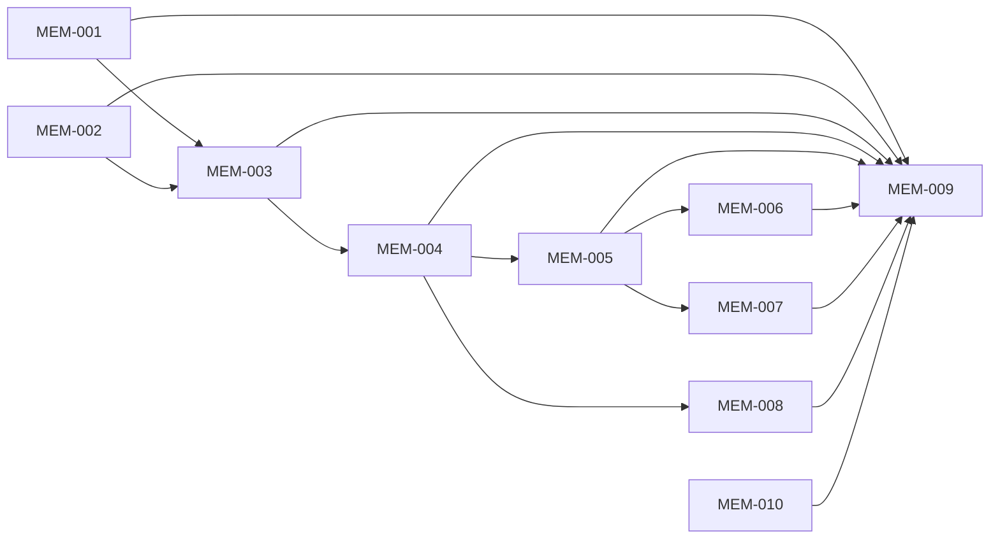

# Milestone 9: memory the owner can trust

Status: outcome chosen by the owner on 2026-10-06 (planning stage 2). Prototype (seven scenes on the page's own styles, seen in the browser pane at phone width) approved by the owner the same day after two changes of theirs (stage 3). Scope agreed by the owner the same day ("Approve as written"). Four Proposed ADRs, 014 to 017 (stage 4). Backlog prepared the same day (stage 5): MEM-001 to MEM-009. Delivery starts from `main` at `37dd09c` (Milestone 8 merged through pull request 277) plus the planning commits, on the integration branch `milestone9`; Milestone 8 left no unfinished task (stage 6, 2026-10-07).

## Outcome

The owner can trust what the bots remember, demonstrated by five walks on the web page and on Android: after "forget what I told you about X" no bot, no Chief tool and no search a model can use finds X; the first thing the owner told a bot is still in its prompt after thirty later notes, and every note says who said it and when; a question asked in other words brings the right note without a tool call; a decision told to the Chief lands with the bot it belongs to, and the chip says where; and a scheduled job reports only what is new since its own last run.

- **Target user:** the owner, telling a bot or the Chief what to keep, correct or forget, by chat.
- **What it covers, chosen by the owner on 2026-10-06:** every point of [the memory audit](improvements/2026-10-06-memory-audit.md), in one milestone ("All of it, one milestone"). Two milestones, the second planned after the first, were offered and not chosen. The owner's request: "Make sure that all points are taken into it." [Audit coverage](#audit-coverage) maps each point.
- **Priority, chosen by the owner on 2026-10-06 ("Safety and forgetting first"):** the side doors, real forgetting and who said a fact come first. The Chief filing a note with a named bot, and meaning search in the lookup, give way first.
- **Why it matters:** the audit found that "forget" leaves the text in at least four places a model reads, one of them written by the forget itself; that the oldest thing the owner said in chat is the first to leave a bot's prompt, silently; that a bot's whole prompt, notes included, is on the command line; and that one obeyed sentence from a web page becomes a standing line of a prompt. Read again at `7a175c3`, nine of its ten findings hold and one is delivered: [milestone9-research.md](../archive/product/milestone9-research.md).

## Journey

The owner talks, as today. Memory has no screen any more: what a bot holds is asked, corrected, forgotten and brought back by chat. Two things about memory stay visible: the chip under a reply, and a card in Needs you when a change must wait for the owner.

1. **They tell a bot something worth keeping.** "I always use pnpm." The bot saves it at once, before other work, as a note that names its subject. The chip under the reply reads "Remembered: Package manager: pnpm for JavaScript". botdot writes the chip from what was stored. Said a second time, it makes no second note and no chip.
2. **A maybe.** "We might use Redis." Nothing is saved.
3. **A passing state.** "This week I'm in Berlin." It is kept for every bot, with its end: "Remembered for all bots until Sun 11 Oct: In Berlin". After Sunday it leaves every prompt by itself. Said without an end, the bot asks until when.
4. **They tell the Chief.** "I moved to Brussels" goes to every bot. "We decided to use PostgreSQL for BotDot" goes to the bot that works on it: "Remembered for Coder". "I prefer TypeScript" goes to each bot it fits: "Remembered for Coder and Reviewer". "Ask me before you create more than one bot" is the Chief's own: "Noted for myself".
5. **They correct something.** "No, I switched to Svelte." One note, "Updated: Front end: Svelte (was: React)"; the old text is history with its date. "Don't use Redis anymore" leaves a note that says so, also when no Redis note existed.
6. **They say "forget it".** The note, its history and its search entries are gone at once, the chats that held it are left out of everything a bot or the Chief reads, and the chip reads "Forgot 1 note". The reply says what still mentions it and that the chats stay in the owner's own history.
7. **Something is no longer true, or the bot deletes a note.** It is hidden from every bot at once and can be brought back by chat for 30 days. Then it is gone.
8. **They ask what a bot remembers.** The answer counts the notes, lists them in pages, and says of each who said it and when.
9. **The pinned set is full.** What the owner said is never unpinned automatically. A conclusion of the bot's own makes room, and the chip says which. When all thirty are the owner's, the new one is kept searchable and the bot says so.
10. **A bot read the web first.** What it saves afterwards is marked "after outside content" and never displaces what the owner said. A change to a note the owner stated, a forget, or a new skill from such a run waits on a card.
11. **They ask in other words.** "What package manager do I prefer?" brings the pnpm note into the prompt by itself. Small talk brings nothing.
12. **A scheduled job runs.** It is handed its own last run, private reply included, and reports what is new.

Failure cases the journey covers: a forget asked by a run the owner did not start, or after the bot read outside content (a card, "Forget for good" / "Keep"); a forget of something said only in chat and never saved (the chats are left out; the reply says so); the same forgotten sentence said again later (it is saved again as new: a forget is not a ban); botdot restarted in the middle of an erase, or in the middle of the first start that rebuilds the index (it finishes on the next start; no half-erased note is readable); a note whose end date passed while botdot was off (it is ended on the next start, before any prompt is built); two notes that contradict each other (each line carries who said it and its date, and the prompt states which wins); a bot told to save by a web page (not saved, or saved as "after outside content", never as the owner's word); the weekly review or a job that wants to change what the owner said (refused, the note stays); a Chief turn that botdot started (no memory-writing tools); the Chief filing with a bot that was deleted or does not exist (nothing saved, the reply says so); meaning search switched on but its server down or slow (the lookup uses words alone); an install whose `claude` is too old for the private prompt file (botdot says so at start and in Setup, and does not fall back to the command line); an app older than this server and an app newer than its server (below).

The prototype is `public/prototype-m9.html` on the branch `prototype/milestone9`, kept out of `main`: seven scenes on the page's own styles.

## Included capabilities

Protected first (the side doors, real forgetting, who said it):

1. **The prompt is private.** A bot's and the Chief's appended prompt is passed in a private file, not on the command line. Claude Code's own memory is off for both: no auto memory, no `CLAUDE.md` loading; a bot's run takes only the MCP servers botdot gives it. A bot that works in a cloned repository is told to read that repository's own instruction file. ([ADR 014](../adr/014-botdots-memory-is-the-only-memory-a-bot-keeps.md))
2. **Memory text is never markup.** Every piece of memory printed into a prompt (notes, topics, lookup excerpts, the conversation block, the review's lists) is neutralised, so no note can close its block or pose as an instruction.
3. **Forget erases.** One server function deletes the note, every version, its search rows, vectors and waiting changes, and records the runs that wrote it as left out. A left-out run is read by no model: not by recall, the lookup, the conversation block, the review, `read_run`, the Chief's `get_run`, `list_runs` and `wait_for_run`, the look's digest, the Chief's waiting turns or the look's file. The tool answers with what still matches, so the bot can extend the forget in the same turn. It is immediate in a run the owner started that read nothing outside; otherwise it is a card. ([ADR 016](../adr/016-a-forgotten-note-is-erased-and-a-removed-one-ends.md))
4. **A run's record of what it learned holds no text.** `learned` keeps a kind and a note's id. The chip is written from the note as it stands; for a forget it reads "Forgot 1 note", and the chip of an earlier run whose note was since erased reads "Remembered a note, since forgotten". The run index is rebuilt once, at the first start.
5. **A removed note ends.** A deleted or replaced note is hidden from every model at once, can be listed and restored by chat in a run the owner started, and is purged 30 days later. A deleted bot takes its versions, waiting changes and indexed runs with it.
6. **A passing state is kept until it ends.** A note may carry an end date. Past it, the note leaves every prompt, lookup and recall and goes the way of a removed note. The bot writes real dates, and asks until when if the owner gave no end.
7. **The server records who said it.** Every note has a source the server sets: the owner (saved in a run the owner started, before that run read outside content, or typed by the owner), the bot (its own conclusion), or outside (saved after web, commands, connected apps or files from others). Nothing a page, a file, a teammate, a job or the review does can produce "the owner". A run that carries on after an OK keeps what the run before it had read. ([ADR 015](../adr/015-the-server-records-who-said-a-note.md))
8. **What the owner said stays pinned.** It is never unpinned automatically. A bot's own conclusion gives way, the oldest first, and every unpin is said in the tool's answer and on the chip. An outside note never displaces anything of the owner's.
9. **What the owner said changes only when the owner asks.** In a run the owner started, a bot may change or remove it. The weekly review and a scheduled run may not: the note stays. Any other run gets a card. A skill a bot writes or changes after it read a web page, a connected app or a file from someone else waits for the owner's OK too; after its own commands alone it goes in as today.
10. **Every line says who and when.** A note is printed with its source and date, as `- [id] (topic, the owner said, 2026-09-12) text`, in the prompt, in recall and in the review's list, with its end date where it has one. What the owner reads says "you said". Every prompt carries today's date, the time zone, and one rule: the owner's current message, then the bot's own notes, then shared notes, then past runs; what the owner said beats what the bot concluded; among equals the newer date wins.
11. **Updates instead of twins.** The duplicate check ignores case in any language, end punctuation and spacing, and counts the topic. A save answers with up to three notes that look alike, own and shared, as a hint. The tool's answer is the sentence to relay: saved, already there, waits for your OK, or not saved.
12. **One wording of what to save.** Said once, in one place: what the owner states and decides (with the date and what it replaces), reversals as a current "do not", passing states with their end; not maybes, not tool results, not one-off results. "About you" is who the owner is, not everything a bot chose to share.

Then (the right note arrives, and memory has no screen):

13. **The lookup finds by more than one word.** Every meaningful word of the request up to a cap; an item needs two matched words, or one that is rare in that bot's memory; up to three notes, then up to two runs; pinned notes, the current run and the job's own runs are excluded before the limit; a newer matching note is never cut for an older one.
14. **`recall` is complete.** A limit, an offset and a total; an empty query pages every note; lines show who and when; removed notes appear only when asked for.
15. **A job knows its last run.** A scheduled run is handed one capped block from that job's last run, its private reply included, and a quiet run's private reply is indexed, marked as not sent.
16. **No memory screen.** The Memory section leaves a bot's settings and the Chief's settings, and the Memory card leaves Settings, on the web page and on Android. The chip under a reply and the card in Needs you stay; the chip opens nothing. The card's words come from the server, the same on the web page, on Android and in the notification. "Forget for good" and a change to a note the owner stated are never part of "Approve all", and an app from before this milestone is not shown them: they are answered in an app of this milestone.
17. **The store keeps up.** A note id that collides is drawn again. Indexing a run no longer scans the search tables. A run records which notes it was given, pinned ones too. Approving, declining and erasing are written to the audit log. The review's list of notes is capped and carries who and when.

Give way first:

18. **The Chief files a note where it belongs.** It keeps notes of its own, files a note for everyone, for itself or with named bots, and can list, correct, remove, restore and forget a bot's notes, in a turn the owner started. A forget told to the Chief reaches the shared notes, its own and every bot's. In a turn botdot starts (a late result, an answered card, a tool request) it has no memory-writing tools. What it saves after it read a bot's reply in that turn is not "the owner". Its chip names the place, from the store's answer. Before a turn it gets the same lookup a bot gets. ([ADR 017](../adr/017-the-chief-files-a-note-with-a-bot-in-the-owners-turns.md))
19. **Meaning search in the lookup.** When meaning search is on, the lookup uses it for notes, merged with the words, under a short timeout. In the Docker image, which carries the model, it is on by default.

With them: every memory route in `docs/api.md`; README ("Bots that learn", "Memory"), `SECURITY.md` (what a bot can read without separate users) and `CONTEXT.md` (the memory terms); the bots', the Chief's and the review's instructions; the Chief's memory-setup skill.

Measured first, before any of it: the live suite repaired so that it exercises recall again, a write-side eval that grades what a bot saved, and its baseline on real Claude; the lookup's fixtures written as failing tests.

## Owner decisions

Taken on 2026-10-06. The first ten are the audit's "Decisions that are yours".

| # | Decision | The owner chose |
| --- | --- | --- |
| 1 | A deleted note | Purged after 30 days. "Keep for ever" was not chosen |
| 2 | How far "forget" reaches | What a model reads. Run files, logs and Claude's transcripts stay; the reply says so. "Also files on disk" was not chosen |
| 3 | "You said" after outside content | No: such a note is "after outside content". Bots save what the owner said first |
| 4 | `CLAUDE.md` loading | Off for bots. "Keep project files" and "Leave as today" were not chosen |
| 5 | A work preference told to the Chief | Filed with each bot it fits. "One shared note" was not chosen |
| 6 | The review or a scheduled run and a note the owner stated | They leave it alone. A card was not chosen |
| 7 | The Chief writing a bot's notes | Yes, in the owner's turns only. "Only with a card" and "No" were not chosen |
| 8 | Meaning search in the Docker image | On by default. "Stay optional" was recommended and not chosen |
| 9 | The web page's Settings memory controls | Removed |
| 10 | Live evals on the owner's subscription | Yes: a baseline before the wording changes and a run after |
| 11 | The memory screens (on the prototype) | "Remove whole UI for the user. He should not see the memories at all." The Memory section goes from both apps; everything is done by chat. The full list of controls on both apps was recommended and not chosen |
| 12 | The chip and the card | Both stay. "Only the card" and "Neither" were not chosen |
| 13 | A passing state (on the prototype) | Kept: "This week I'm in Berlin. So when I ask something over that weekend it will assume I'm there." The audit's "not saved" was drawn first and changed |
| 14 | A passing state without an end | The bot asks until when. "Seven days" and "a lasting fact" were not chosen |
| 15 | The prototype | Approved after decisions 11 and 13, at phone width |
| 16 | A skill a bot writes after outside content | A card, after the web only. "A card after any outside content" (commands too) and "No card" were not chosen |
| 17 | The scope | "Approve as written": the 19 capabilities, the exclusions, the 30 scenarios and the unchanged test budget. "The smaller cut", capabilities 1 to 17 only, was offered and not chosen |

Decisions 11 and 13 depart from the audit: it kept the memory screens and asked for the same controls in both apps, and it advised against an end date on a note.

Not seen by the owner: the prototype at desktop width. Its scenes are a chat, single cards and one settings page, drawn at the same width on both.

## First look

MEM-007, 2026-10-07. The owner looked at the web page on a test botdot server with real Claude, over the tailnet: a bot's settings, Settings and Setup without anything about memory, the chip after "I always use pnpm", "What do you remember about me?", and the chip of a forget. Answer: "ok all good". One decision at the look: Setup's row "Meaning-based memory search" is removed. The card "Forget for good" was not part of the look.

## Exclusions

- An extraction model, a summariser or a background consolidation pass. A note exists because a bot, the Chief or the owner saved it.
- A project scope. The bot is the project; a note names its project in its text and topic.
- Note types, confidence, importance or a status column. `source` and the end date are the only new facts on a note.
- A vector database, a reranking model, meaning search for past runs in the lookup.
- An outside note that is never pinned and never in the lookup (OpenClaw's rule). Commands set the outside mark, so most of what a working bot learns would never reach its prompt. The audit's rule stands: marked, pinned while there is room, never displacing the owner's.
- A state file of a job's own (Cursor, Devin). The block from its last run needs nothing from the bot.
- Erasing run files, logs, screenshots and Claude's transcripts (decision 2). Removing the chats from the owner's own history.
- A ban on a forgotten fact. Said again, it is saved again.
- A review of shared memory. Dates, sources and ends on every line are what this milestone gives it.
- A cap on the main assignment and the rules. The context test fixes them and states its size.
- Task or session state for a bot beyond its chat and its notes.
- Separate OS users on a Mac. `SECURITY.md` says what a bot can read without them.
- The Chief's shared-memory block sent once per session instead of every turn, unless MEM-006 shows that it survives Claude Code's session compaction.
- The owner's routes under `/api/memory`. They stay for an app from before this milestone and are written down; the apps of this milestone no longer call them.
- The weekly review's report in a bot's chat, one line per change. Unchanged: it is a reply, like a bot's own words.
- The learning line's undo in a bot's settings, which offers to delete the note saved with a change. Unchanged.
- The owner's search over all chats. Unchanged: it is the owner's history, not a bot's memory.
- New controls, pages or settings; anything that shows costs; the Mac app ([ADR 008](../adr/008-the-mac-app-is-no-longer-developed.md)).

## Acceptance scenarios

- **D1. Off the command line.** While a bot runs and while the Chief replies, the process list holds no note, no shared note and no chat text. The prompt file is readable by its owner only and is gone after the run.
- **D2. No second memory.** A bot with Write leaves a `CLAUDE.md` and an auto-memory file in its folder; its next run's prompt holds neither, and the run's environment carries the two switches. A bot's run sees only botdot's MCP servers.
- **D3. Too old.** With a `claude` that lacks the prompt-file flag, botdot says so at start and in Setup, and starts no run with a prompt on the command line.
- **D4. Tag escape.** A note, a topic, a lookup excerpt and a chat message that contain `</memory>` or `<shared-memory>`: none closes or opens a block in the prompt.
- **D5. Forget.** After "forget what I told you about X" in a run the owner started: X is found by no reader. Recall with history, the lookup, the conversation block, the review's list, `read_run`, the Chief's `get_run`, `list_runs`, `wait_for_run`, the look's digest, the Chief's waiting turns: none returns it. The chip reads "Forgot 1 note" and the run's record holds no text.
- **D6. Forget, not by the owner.** The same after the bot read a web page, or in a run a teammate started: nothing is erased, a card reads "Forget for good" with "Keep", and the yes erases.
- **D7. Restart.** botdot stopped during an erase, and during the first start's index rebuild: after the next start the erase is complete and the index holds no note text in `learned`.
- **D8. Removed, then gone.** A removed note is in no prompt, lookup or default recall. In a run the owner started the bot lists it and restores it. After 30 days it is in no table.
- **D9. A deleted bot.** No version, waiting change or indexed run of it remains, also after a restart.
- **D10. Until Sunday.** "This week I'm in Berlin" told to a bot: a shared note with its end date, in every bot's prompt until that day and in none after it, also when botdot was off on that day. The chip reads "until" and the date.
- **D11. No end.** The bots' instructions say to ask until when before saving a passing state that came without an end. An end date in the past is refused.
- **D12. Only the owner is "the owner".** A page, a file, a teammate's message, a job, the review, a run the Chief started, a carry-on of a run that read the web: none produces a note with the owner as its source.
- **D13. The first note stays.** A bot told "Use pnpm" by the owner, then thirty more notes of its own: "Use pnpm" is still pinned. Each unpin names the note that left, in the tool's answer and on the chip.
- **D14. Thirty of the owner's.** A thirty-first statement of the owner's is saved searchable; the answer says the pinned set is full.
- **D15. Hands off.** The review and a scheduled run that try to change or remove a note the owner stated: refused, the note is unchanged, no card. A teammate-started run: a card.
- **D16. A skill after the web.** A skill written after the bot read a web page waits for the owner's OK. One written before, or after its own commands alone, goes in.
- **D17. One note.** "Use pnpm" and "Use pnpm." are one note; so are "Mieszka w Łodzi" and "mieszka w łodzi". A second, similar save answers with the note to update. An edit leaves one current note and one dated version.
- **D18. The line.** A pinned line in the prompt and a line of recall carry the source and the date; the prompt carries today's date, the time zone and the precedence rule, once.
- **D19. The lookup's fixtures.** The pnpm paraphrase, the Redis correction, a keyword at word 21, 30 runs of one job, 25 matching pinned notes: each brings the right item; "hello, how are you" brings none. Warszawa / Warszawie with meaning search on.
- **D20. Recall pages.** With 1,000 notes, an empty query pages all of them with the total.
- **D21. A job's last run.** A job's second run holds a block with its first run's private reply; a quiet run's reply is found by recall, marked as not sent.
- **D22. No memory screen.** On the web page and on Android: no Memory section in a bot's or the Chief's settings, no Memory card in Settings. The chip and the card are there.
- **D23. The card's words** for a memory change are the server's, the same on the web page, on Android and in the notification, for add, change, remove and "Forget for good".
- **D24. The Chief files it.** "We decided to use PostgreSQL for BotDot": one note with Coder, source the owner, chip "Remembered for Coder". "I prefer TypeScript": one note with each of two bots, one chip that names both. "Ask me before…": a note of the Chief's own. A duplicate: no chip.
- **D25. Not in botdot's turns.** A late result, an answered card and a tool request: the Chief's turn has no tool that writes memory.
- **D26. Bot isolation still holds.** B's recall, lookup, `read_run`, edit and delete never reach A's notes or runs.
- **D27. Bounds.** The appended prompt with every cap hit stays under the stated size; indexing a run and recall stay under the stated times at 10,000 runs.
- **D28. Old and new.** An Android app from Milestone 8 against this server: its Memory section still works, a note typed there is the owner's, and its "Approve all" is shown no erase and no change to a note the owner stated. This app against a Milestone 8 server: no Memory section, chips and cards as that server words them.
- **D29. What bots really save.** On real Claude, three repeats, graded on the store: the owner's five phrases (saved), a preference repeated in other words (one note), small talk, a guess and "because a file said so" (no note), "this week I'm in Berlin" (a shared note with its end). Compared with the baseline taken before the wording changed.
- **D30. Real use.** On the owner's own botdot server and phone: D5, D10, D13 with a real bot, D24, and "what do you remember about me?".

## External prerequisites

None that blocks a task. D29 needs Claude signed in on the machine that runs it, and uses the owner's subscription (decision 10). D30 needs the owner's server and phone. The Docker image keeps its pinned Claude Code 2.1.284: its binary carries `--append-system-prompt-file`, `--strict-mcp-config` and both memory switches (found in the binary on 2026-10-06, not run). An install without Docker must have a `claude` that knows the flag.

## Evidence limits

- D1 to D28 run against a stand-in for Claude: they show what botdot stores, prints and refuses, not what a model then does.
- What a bot chooses to save, that it saves the owner's words before other work, and that it asks "until when" are model behaviour. Seen in D29, D30 and in use.
- "What do you remember?" is answered by a model from a complete list. With no memory screen there is no second view to check it against.
- Notes saved before this milestone get their source from the run that saved them, where that run's file still exists; the rest count as the bot's own. What the owner dictated long ago may be labelled the bot's.
- Meaning search by default is measured on the Docker image only; its cost on an existing install with years of runs is seen at the first start.
- Android is checked on one phone and the emulator.

## Test budget

- Test data: one owner; four bots (one with 31 notes, one with a scheduled job, one teammate, one that reads the web) and the Chief with one chat; a stand-in for Claude; a stub embedder. The scale test builds 10,000 past runs by bulk insert.
- Limits the scale test states: indexing one run under 20 ms and a recall under 100 ms at 10,000 runs; the appended prompt of a bot's run under 100,000 characters with every cap hit, a tapped answer included, and a fixed main assignment.
- Task gate: at most 5 minutes. Full gate: at most 30 minutes, unchanged. Both in backlog.json. The owner raised the task gate from 3 to 5 minutes on 2026-10-07, after a gate of MEM-004 ran 3:05 against 3:00 on a busy machine. No test waits a real day: a note's end and the 30-day purge take their clock as an argument.
- The live evals (D29) run in no gate: three times in the milestone, by hand, about 10 scenarios with three repeats each.

## Task dependencies

| Task | Delivers | Capabilities | Scenarios |
| --- | --- | --- | --- |
| MEM-001 | The live suite repaired, the write-side baseline, the lookup's fixtures, the memory routes written down | Measured first | The baseline of D29 |
| MEM-002 | The private prompt file, Claude Code's own memory off, no markup from memory | 1, 2; the date of 10; the id of 17 | D1 to D4; the prompt's bound of D27 |
| MEM-003 | The source of a note, eviction by it, the guards, the printed line, updates instead of twins | 7 to 11; the review's list of 17 | D12 to D18 |
| MEM-004 | Forget, "left out", a removed note's end, a passing state's end, a deleted bot, the audit events, the one wording | 3 to 6, 12; the audit events of 17 | D5 to D11; the second run of D29 |
| MEM-005 | The lookup, `recall`'s paging, a job's last run, meaning search in the lookup, the index | 13 to 15, 19; the rest of 17 | D19 to D21; the times of D27 |
| MEM-006 | The Chief's own notes, filing with a bot, whose turn may write | 18 | D24, D25 |
| MEM-007 | The web page without a memory screen; chips and cards in the server's words | 16 | D22, D23 on the web page |
| MEM-008 | The same in the Android app, against this and an older server | 16 | D22, D23 on Android; D28 |
| MEM-010 | A skill a bot wrote is approved on its card, not from its notification (added on 2026-10-07 from the review of MEM-008) | 9 | D16 |
| MEM-011 | The medium findings of the milestone review, and the low ones in the same code (added on 2026-10-07) | 3, 8, 18 | D5, D13 |
| MEM-009 | The gates, the walks, the third live run, the review, the owner's acceptance | All | D26, D29, D30, and every scenario once more on the assembled product |

D26 (bot isolation) is held by today's tests, which every task's gate runs.

Nine tasks. The server's work is five and they are a line, because each changes `lib/memory.js`, `server.js` and the bots' memory route: MEM-002 is how a run is started; MEM-003 is who said a note, with its ADR; MEM-004 is the end of a note, with its ADR; MEM-005 is what reaches a prompt; MEM-006 is the Chief, with its ADR. Each is days of work and is reviewed on its own; merging two would put two architecture decisions into one review. MEM-001 changes tests and one document only and runs beside MEM-002. The web page and the Android app are two codebases: Android starts when MEM-004 has fixed the contract and runs beside MEM-005; the web page waits for MEM-005, because the Memory section may go only when the chat can list and restore, and runs beside MEM-006. MEM-009 is the acceptance.

Rounds: MEM-001 with MEM-002; MEM-003; MEM-004; MEM-005 with MEM-008; MEM-006 with MEM-007; MEM-009.

## Audit coverage

Every point of [the audit](improvements/2026-10-06-memory-audit.md), by its section, with where it lands. "Cap." is a capability above; "Out" is an exclusion with its reason there.

| Audit point | Lands in |
| --- | --- |
| §1 finding 1, "forget" does not forget | Cap. 3, 4, 5 |
| §1 finding 2, the pinned set keeps the newest | Cap. 7, 8 |
| §1 finding 3, updates, duplicates, contradictions | Cap. 10, 11 |
| §1 finding 4, the lookup is literal and has no floor | Cap. 13, 19 |
| §1 finding 5, side doors (a) command line, (b) Claude Code's memory, (c) unescaped text | Cap. 1, 2 |
| §1 finding 6, only shared notes are guarded | Cap. 7, 8, 9, 18 |
| §1 finding 7, a teammate replayed as "Owner:" | Delivered by CHAT-001. Left of it: cap. 2 |
| §1 finding 8, the Chief can only remember globally | Cap. 18 |
| §1 finding 9, a job knows nothing of its last run | Cap. 15 |
| §1 finding 10, "what do you remember?" from a sample | Cap. 14, 18 |
| §1 what must stay: no extraction model, bounded prompt, bot isolation | Exclusions; D26, D27 |
| §3 a Chief session lost after 30 days | Cap. 18 (its own notes and its lookup) |
| §3 no task or session state | Out |
| §3 no project scope; §4 why none | Out; cap. 12 and 18 (the note names its project, the Chief files it with the bot) |
| §3 skills after outside content are not gated | Cap. 9 |
| §3 no types, no confidence; no summaries | Out |
| §4 the scope matrix; §13 the write strategy | Cap. 6, 7, 12. **Changed by the owner:** a passing state is kept, with its end (decision 13) |
| §5 cross-bot leakage through the command line | Cap. 1 |
| §5 a bot can open `memory.db` without separate users | `SECURITY.md`; separate users on a Mac: out |
| §5 wrong memories; poisoning | Cap. 2, 7 to 10 |
| §5 a temporary fact stays for ever | Cap. 6 |
| §5 nothing reviews shared memory | Out; cap. 6 and 10 |
| §5 the review's prompt is uncapped | Cap. 17 |
| §5 no cap on the main assignment and rules | Out; D27 fixes them |
| §5 run files, logs, screenshots, transcripts cannot be forgotten | Out (decision 2); the reply says so (cap. 3) |
| §6 duplicates, also between own and shared | Cap. 11 |
| §6 stale memories; contradictions; own against shared | Cap. 5, 6, 10 |
| §6 poor guidance; "location" as a shared example | Cap. 12 |
| §6 irrelevant retrieval; a job fills its own lookup | Cap. 13 |
| §6 missing memories; incorrect inference | Cap. 7, 8, 18 |
| §7 keep every cap | Kept; D27 |
| §7 the Chief's repeated block | Out, unless shown safe (MEM-006) |
| §7 the memory rules said twice; the lookup fires on small talk | Cap. 12, 13 |
| §8 the lifecycle: created, active, updated, superseded, removed, erased | Cap. 3, 5, 7. **Changed by the owner:** an end date (cap. 6) |
| §9 three places: about you, one bot, the Chief; precedence | Cap. 10, 12, 18 |
| §10 the write path and the read path | Cap. 7 to 15 |
| §11 `source`; `chief` as an owner; `learned` as ids; deleted versions end; the duplicate key; quiet replies indexed; id retry | Cap. 7, 18, 4, 5, 11, 15, 17 |
| §11 deliberately not added | Out, but for `until` (cap. 6) |
| §12 retrieval: scope, pinned, lookup, meaning search, recall, ranking | Cap. 13, 14, 19. Scope and ranking unchanged |
| §14 remember, correct, forget, inspect by chat | Cap. 3, 11, 14; the chips of journey 1 to 9 |
| §14 inspect by screen; the same controls in both apps; Android's failed add | **Changed by the owner:** no memory screen (cap. 16, decisions 11 and 12) |
| §14 Settings memory controls | Removed (cap. 16, decision 9) |
| §15 tests 1 to 10 | D26, D12, D13 and D14, D5, D17, D19, D4, D27, done by CHAT-001 with cap. 2, D27 |
| §15 scripted evals; a baseline first | D29; measured first |
| §16 the twelve quick wins | Cap. 1 (two), 2, 4, 5, 10, 11 and 17, 14, 13; the conversation block: delivered; Android's add: no screen; the Chief's chip: cap. 18; `docs/api.md`: with them |
| §17 the seven structural improvements | Cap. 3 to 5; 7 to 9; 18; 13; 15; `docs/api.md` and the card's words (cap. 16); D29 |
| §18 phases 0 to 6 | Measured first; cap. 1 and 2; 3 to 5; 7 to 12; 13 to 15 and 19; 18; 16 and 17 |
| §19 files; no migration tool | The task plans; ADR 015 (a column is added in one place) |
| Decisions 1 to 10 | Owner decisions 1 to 10 |
| §20 the top five | Cap. 3 to 5; 7 and 8; 1 and 2; 13 and 14; 18 |

## Added features

- 2026-10-07: The owner can update botdot on its Linux machine, from Settings or by running the installer again, without old images filling the disk, demonstrated by three updates in a row leaving one server image beyond those a container uses, a stopped bot's computer that still starts with its files, and an `update.cleaned` line in the audit log for each update. Tasks: IMG-001, IMG-002. From issue #254, planned after the milestone was merged, as a standalone feature on `feature/image-cleanup`. The owner answered the issue's review on 2026-10-07: no earlier image is kept; an image goes when it is of the configured server or desktop repository, carries botdot's release label, is not configured and no container references it; the result is one audit event and nothing in Settings. The owner approved the two plans the same day, without an ADR. During IMG-002, on 2026-10-07, the stage in a real Docker daemon and the reviews raised two questions, and the owner decided: an image that has no name left (no tag and no digest, as Docker's containerd image store leaves it) goes when it carries botdot's release label and no container has it; and the installer, run again, drops the digest pin an update from Settings left, so that it updates. Test document: [feature-image-cleanup-test.md](../archive/product/feature-image-cleanup-test.md).
